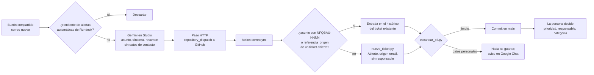
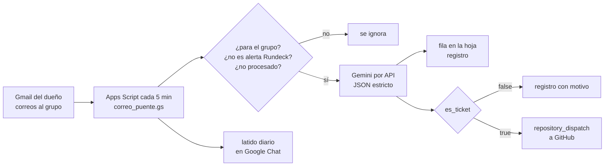

# Diseño — Vault de Soporte BAU (NFQ)

## 1. Objetivo y relación con otros vaults

- Vault **independiente**, repo Git nuevo. No depende de ningún otro repositorio ni requiere conocerlos para trabajar en este.
- Principio de diseño: **dos capas** — al crear o actualizar una nota, la persona solo decide unos pocos campos en lenguaje llano (los "campos humanos"); el resto del *frontmatter* (identificadores, enlaces propuestos, resúmenes) lo completa Claude después, y se valida/ajusta en revisión.
- Convenciones técnicas fijas en todo el repo: carpetas sin acentos en ningún nivel (compatibilidad *shell*/Git/agentes), enlaces Markdown relativos (nunca *wikilinks*, para que naveguen en VS Code/GitHub web/agentes), sincronización vía Git (Obsidian Git para perfiles no técnicos), y una política de protección de datos personales — ver §10.
- Objetivo: gestión operativa diaria de soporte BAU (~10 incidencias/día) para un **único cliente final**, con historial de resolución, decisiones autorizadas y mapa de personas.
- Existe además un **vault técnico ya construido** (de otro sistema/cliente, 100+ notas, ya organizado por carpetas de conocimiento) que se **migra tal cual** a este vault BAU como zona de solo lectura (foto fija, sin resincronización por ahora, sin necesidad de escáner de datos personales porque ya está verificado como libre de ellos).

## 1.bis Stack de software (confirmado)

| Pieza | Uso |
|---|---|
| **Obsidian** | Edición para perfiles no técnicos |
| **Obsidian Git** (plugin) | *Pull* y *commit-push* automáticos cada pocos minutos, para que perfiles no técnicos no tengan que usar Git a mano |
| **Dataview** (plugin) | Dashboard, historial de tickets por persona, vistas del `.base` |
| **Git** | Mecanismo de versionado y sincronización, fuente de verdad |
| **GitHub** | Hosting del repo |
| **Python** | Scripts de `05_GENERAL/Herramientas/` (generador de `NFQBAU-NNNN`, archivador a 30 días, escáner de datos personales — ver §10) |
| **GitHub Actions** | Automatización: escáner de datos personales en cada *push*, archivado programado de tickets resueltos |
| **Submódulo Git** | `06_CODIGO_VERSIONADO/` — enlaza el repo externo de versionado PROD/UAT |

## 2. Estructura de zonas

```
00_REFERENCIA_TECNICA/    → solo lectura, foto fija, estructura original respetada, SIN escáner de datos personales
01_DECISIONES/             → rama + PR (gobernado)
02_TICKETS/
   Abiertos/                → commit directo
   Archivo/                  (auto-archivado 30 días tras pasar a "Resuelto")
03_PROVEEDORES/             → commit directo (tickets de proveedores con seguimiento largo)
04_PERSONAS/                → commit directo
05_GENERAL/
   Plantillas/
   Herramientas/             (scripts Python propios de este vault)
06_CODIGO_VERSIONADO/       → SUBMÓDULO GIT del repo de versionado de código PROD/UAT (ya existe, falta URL)
```

## 3. Numeración de tickets

- Formato: **`NFQBAU-NNNN`**
- Correlativo **global**, nunca se reinicia (ni por año ni por mes)
- **Empieza en `NFQBAU-1500`**
- Se genera **internamente** en el vault (elimina la dependencia del sistema de ticketing externo)
- Necesita un script con contador versionado en Git + manejo básico de concurrencia (dos personas creando ticket casi a la vez)

**Nombre de fichero:** `NFQBAU-1500 — 2026-09-16 — Asunto breve del correo.md`

## 4. Ticket (`02_TICKETS/`) — nota única por ticket, se actualiza con cada interacción

### Campos humanos (los únicos que decide la persona)
- `estado`
- `prioridad`
- `responsable`

### Frontmatter completo (v4, cerrado)

```yaml
id: NFQBAU-1500
fecha_apertura: AAAA-MM-DD
fecha_limite:
estado: Abierto              # Abierto | En curso | Pendiente de terceros | Resuelto
prioridad: Media             # Alta | Media | Baja
responsable: "[[Nombre Apellido]]"
categoria: []                 # Rundeck | BBDD | Qlik | APIs | Otros — puede llevar varios (array)
entorno: []                   # Producción | UAT | Desarrollo — puede llevar varios (array)
codigo_relacionado:            # repo/módulo + commit/tag, si se conoce
  - repo:
    modulo:
    version:
tickets_proveedor: []          # ids/enlaces a notas de 03_PROVEEDORES si aplica
decision_relacionada:          # enlace a 01_DECISIONES si aplica
referencias_tecnicas: []       # array de notas de 00_REFERENCIA_TECNICA que ayudaron a resolver
tags: [ticket, bau]
```

### Cuerpo

- `## Resumen` — una línea, qué pasó.
- `## Histórico de interacciones` — entradas cronológicas por cada email/llamada nueva; **Claude anonimiza y resume automáticamente** el contenido pegado (nunca el email en crudo, nunca datos personales reales).
- `## Resolución` — qué se hizo finalmente; menciona qué referencias técnicas se usaron y por qué (contexto, no solo el enlace).
- `## Vencimiento` — fecha límite + aviso si está vencido (lo calcula el dashboard).

### Criterio para tickets de proveedor
- Seguimiento **largo/sustancial** (varias idas y vueltas) → nota aparte en `03_PROVEEDORES/`, enlazada desde `tickets_proveedor`.
- Intercambio **breve y cerrado** → entrada dentro del histórico del ticket principal, sin nota aparte.

## 5. Archivado automático

- Script (`05_GENERAL/Herramientas/`) que mueve de `Abiertos/` a `Archivo/` cualquier ticket con `estado: Resuelto` con más de **30 días** desde la resolución.
- Pendiente decidir: ejecución manual vs GitHub Actions programado.

## 6. Decisión (`01_DECISIONES/`)

Formato simplificado — no es un ADR (*Architecture Decision Record*, el formato extenso que documenta decisiones de diseño de software con contexto completo, alternativas consideradas, etc.), sino un registro breve de "qué se decidió, quién lo autorizó y con qué fuente". Flujo **rama + PR**:

```yaml
id: NFQBAU-DEC-NNN
titulo:
fecha: AAAA-MM-DD
autorizado_por:
fuente:                # mail | reunión | llamada — con referencia, sin datos personales
ticket_relacionado:     # opcional
estado: vigente | obsoleta
```

Cuerpo: `## Decisión` — `## Razón` — `## Alcance`.

## 7. Persona (`04_PERSONAS/`)

```yaml
nombre:
rol:
equipo_empresa:
escalado_a:
```

Historial de tickets: **no se escribe a mano**, es una consulta Dataview (`FROM "02_TICKETS" WHERE responsable = this.file.link`).

## 8. Dashboard (Dataview, en `05_GENERAL/`)

Vistas: tickets abiertos por estado / por responsable / por categoría / vencidos (fecha_limite pasada y estado ≠ Resuelto).

## 9. Submódulo de código (`06_CODIGO_VERSIONADO/`)

- Repo **ya existe** — falta URL (pendiente de aportar al construir).
- Se integra como **submódulo Git real** (no solo referencia por enlace) para poder navegar el código desde el vault.
- Pendiente definir: carpeta exacta de montaje, si sigue una rama fija (`main`) o se fija commit a commit.
- **Aviso operativo:** cualquiera que clone el vault necesita `git submodule update --init --recursive` tras el clon — documentar en Onboarding/README para no confundir al equipo no técnico.

## 10. Anonimización y política de protección de datos personales

- Política estricta en todas las zonas activas (01 a 06): nunca nombres, NIF/DNI, email o teléfono reales, ni en el vault ni en el historial de Git — solo identificadores técnicos y datos anonimizados.
- Al pegar un email, **Claude anonimiza y resume automáticamente** antes de que quede escrito en la nota; el email en crudo nunca se guarda en el repo.
- Escáner `pre-push` (script Python de `05_GENERAL/Herramientas/`) escanea cada envío buscando patrones de datos personales, como última red de seguridad — no sustituye la anonimización en el momento de escribir.
- `00_REFERENCIA_TECNICA/` queda **excluida** del escáner (ya verificada como limpia).
- El historial de Git es inmutable: cualquier limpieza de datos personales debe hacerse **antes** del primer *commit* que los introduzca, no después.

## 11. Gobierno

- Escribe **todo el equipo técnico**.
- Tickets/Proveedores/Personas: commit directo.
- Decisiones: rama + PR con revisor.
- Las notas las crea la persona; Claude las analiza para completar lo que falte (frontmatter propuesto, resúmenes, anonimización).

## 12. Pendientes antes o durante la construcción

- [ ] Nombre del nuevo repo Git (plataforma ya confirmada: GitHub).
- [ ] URL del repo de código PROD/UAT a integrar como submódulo.
- [ ] Carpeta exacta de montaje del submódulo y política de rama/commit.
- [ ] Confirmar si el archivado a 30 días se dispara manual o vía GitHub Actions.
- [ ] Ruta/ubicación del vault técnico existente (100+ notas) a migrar tal cual a `00_REFERENCIA_TECNICA/`.

---

*Documento de diseño cerrado en conversación con Claude (claude.ai). Continuar construcción en Claude Code con acceso a los ficheros reales.*

## 13. Decisiones de construcción (2026-09-22)

Cierran los pendientes del §12 y corrigen contradicciones detectadas al construir. Donde este apartado difiere de los anteriores, manda este.

| Tema | Decisión |
|---|---|
| Repo del vault | `github.com/RicardoNfq/BAU-NFQ-vault` (privado). Carpeta local `GitHub/BAU`. |
| Repo de código | `github.com/RicardoNfq/BAU-NFQ`, ramas `DEV`, `UAT`, `PRD`. Dos repos separados: ritmos de commit distintos y perfiles no técnicos nunca cambian de rama. |
| Submódulo | Montado dos veces: `06_CODIGO_VERSIONADO/PRD` sigue `PRD`, `06_CODIGO_VERSIONADO/UAT` sigue `UAT`. DEV no se monta (no recibe tickets). |
| Entornos | `entorno` admite Producción y UAT. El dashboard tiene vista por entorno. |
| Datos personales (§10 matizado) | **Nombres reales permitidos** para el equipo. Las personas que aparecen en los correos (cliente, NTT) se guardan como nombre e inicial del apellido más su rol (decisión del 2026-09-28). Prohibido lo que identifique o contacte: email, teléfono, DNI/NIE, IBAN, dirección. |
| `responsable` | Texto plano igual al nombre del fichero de `04_PERSONAS/`. Sin wikilink. La ficha de persona consulta `WHERE responsable = this.file.name`. |
| Escáner | Dos capas: `pre-commit` local (bloquea; se instala con `instalar_hook.sh`) y GitHub Action en cada push (solo avisa). Excluye `00_` y `06_`. |
| Numeración | Sin fichero contador. `nuevo_ticket.py` calcula máximo existente + 1. El escáner detecta ids duplicados. |
| `fecha_resolucion` | Campo nuevo en el ticket. Obligatorio al pasar a Resuelto; el archivador lo usa. |
| Archivado | GitHub Action los lunes 06:00 UTC + ejecución manual del mismo script. |
| Migración de `00_` | Origen `BAU_Legacy_KB/obsidian/` (Megara AS-IS, 184 notas). Wikilinks convertidos a enlaces relativos; acentos quitados de los nombres de carpeta; ficheros sin cambio de nombre. |

## 14. Circuito operativo real y ampliaciones (2026-09-26)

Nace de contrastar el diseño con el diagrama del proceso actual (tres carriles: cliente, NFQ, NTT) y de las decisiones tomadas el 25 y 26 de septiembre. Donde difiere de §4 a §11, manda este apartado. Construido el 2026-09-26 (pasos 1 y 2 de §14.14); el cómo está en `Manual-tecnico.md`.

### 14.1 Actores

| Actor | Papel | Dónde vive |
|---|---|---|
| Cliente | Envía el pedido; revisa y acepta o rechaza el paquete; prueba en UAT; aprueba el paso a PRD | Personas en `04_PERSONAS/` por rol |
| NFQ (equipo BAU) | Analiza, prepara el paquete, pide despliegues, cierra | Personas en `04_PERSONAS/` |
| NTT | Proveedor que despliega en UAT y PRD. A veces abre ticket de servicio propio, a veces solo confirma "ya está" | Nota en `03_PROVEEDORES/` por ticket con código |

### 14.2 Herramientas que se retiran

JIRA y Drive no los exige nadie. Se sustituyen: el ticket del vault es el ticket, y el repo de código guarda el paquete de despliegue. Excepción sin solución en Git: una extracción de datos con información personal no puede entrar en ningún repo; se guarda fuera y el ticket solo lo menciona.

### 14.3 Estados del ticket (lista cerrada, reemplaza a la de §4)

`Abierto` → `En curso` → `Revisión cliente` → `Pendiente despliegue UAT` → `Pruebas cliente UAT` → `Pendiente despliegue PRD` → `Resuelto`

Un rechazo del cliente, en revisión o en pruebas, devuelve el ticket a `En curso`. Un ticket sin código pasa de `En curso` a `Resuelto`. Con `actualizado` (14.5) el dashboard calcula cuánto lleva cada ticket en su estado.

### 14.4 Ticket: campos y secciones nuevas

Frontmatter añadido a §4:

```yaml
origen: email                # email | reunión | llamada
referencia_origen:           # asunto del correo tal cual, o nombre y fecha de la reunión
sintoma:                     # una línea: cómo se manifestó
solucion_corta:              # una línea: qué lo arregló
actualizado:                 # AAAA-MM-DD HH:MM, lo estampa el hook
actualizado_por:             # Nombre Apellido, lo estampa el hook desde git config
```

`responsable` en texto plano (§13). `fecha_resolucion` obligatoria al pasar a `Resuelto`.

Cuerpo:

```
## Resumen
## Histórico de interacciones
- AAAA-MM-DD HH:MM — Nombre Apellido — texto anonimizado
- AAAA-MM-DD HH:MM — Nombre Apellido — APROBACIÓN UAT — por el rol X del cliente
- AAAA-MM-DD HH:MM — Nombre Apellido — RECHAZO — motivo
- AAAA-MM-DD HH:MM — Nombre Apellido — APROBACIÓN PRD — por el rol X del cliente
## Paquete de despliegue
- Update:    enlace al fichero en el repo de código
- Rollback:  enlace (obligatorio para cerrar un ticket con código)
- Informe:   enlace
- Anexos:    enlaces
## Resolución
### Qué se hizo
### Cómo se comprobó          (query, comando, informe)
### Con quién se habló         (por rol, nunca contacto)
### Servicios, jobs o tablas tocados
### Referencias técnicas usadas y por qué
## Vencimiento
```

Prefijos fijos del histórico: `APROBACIÓN UAT`, `APROBACIÓN PRD`, `RECHAZO`. Sustituyen a una nota en `01_DECISIONES/` para las aprobaciones del cliente, que ocurren dos veces por ticket y no justifican rama + PR.

### 14.5 Traza automática

Git ya guarda quién cambió cada línea y cuándo. Para verlo en la nota y en el dashboard, el hook pre-commit (el mismo que escanea datos personales) estampa `actualizado` y `actualizado_por` en cada ticket, decisión o nota de proveedor que cambie. Requiere `git config user.name "Nombre Apellido"` en cada equipo; se añade al onboarding.

### 14.6 Listas cerradas y validación

Un único fichero `05_GENERAL/listas.json` con los valores permitidos de `estado`, `prioridad`, `categoria`, `entorno` y `origen`. `responsable` y `actualizado_por` se validan contra los ficheros de `04_PERSONAS/`. El hook y la Action bloquean un commit con un valor fuera de lista, igual que con un dato personal.

### 14.7 Comando `/ticket` (Claude Code)

Todo se puede hacer a mano en Obsidian con la plantilla. El comando ahorra trabajo y garantiza las listas:

| Modo | Qué hace |
|---|---|
| `/ticket nuevo` | Recibe el email o dos líneas de una llamada. Busca tickets similares en Abiertos y Archivo por categoría, entorno y palabras del síntoma y los muestra. Propone los campos de las listas cerradas; la persona confirma o cambia. Crea el fichero con el siguiente id. |
| `/ticket actualizar NFQBAU-NNNN` | Anonimiza y resume la nueva interacción, propone cambio de estado o responsable, confirma, añade la entrada al histórico. |
| `/ticket resolver NFQBAU-NNNN` | Pregunta los cinco bloques de resolución, admite pegar la query tal cual, exige rollback si hubo código, pide `sintoma` y `solucion_corta`, pone `fecha_resolucion` y `Resuelto`. |
| `/ticket consultar "síntoma"` | Sin crear nada. Busca en Abiertos, Archivo y `00_REFERENCIA_TECNICA` por síntoma, solución corta, categoría y texto; muestra los tickets parecidos y responde en lenguaje llano qué se hizo, con qué query se comprobó, con quién se habló y qué ficha técnica ayudó. Es el modo para quien tiene poca experiencia y tiene que actuar. |
| `/ticket redactar NFQBAU-NNNN` | Redacta el correo recurrente que toque según el estado: envío del paquete al cliente, solicitud de despliegue a NTT, cierre. Siempre en portugués de Brasil y sin firma (decisión del 2026-09-27). La persona copia, firma y envía. |

No hace falta índice semántico ni base vectorial: `sintoma` y `solucion_corta` son el índice, escrito por personas, y Claude lee los ficheros que encajan. Se replantea solo si el volumen o la vaguedad de las preguntas lo exigen.

### 14.8 Proveedor NTT: nota por ticket con código

```yaml
proveedor: NTT
ticket_relacionado: NFQBAU-NNNN
estado: Abierto              # Abierto | Resuelto
```

```
## UAT
- Solicitado:   AAAA-MM-DD HH:MM — por Nombre Apellido
- Ticket NTT:   (si lo dieron)
- Desplegado:   AAAA-MM-DD HH:MM — confirmado por email
## PRD
- Solicitado:
- Ticket NTT:
- Desplegado:
```

Lo que siempre existe es la solicitud y la confirmación. El número de servicio de NTT es opcional.

### 14.9 Repo de código `BAU-NFQ`: fotos por entorno (rehecho el 2026-10-27)

El diseño original (ramas con promoción `DEV` → `UAT` → `PRD`, Action de bajada, tags) suponía que NFQ controlaba el despliegue. No es así: el código vive en bases PostgreSQL del cliente, solo accesibles desde una VDI, y lo despliega NTT a partir de lo que NFQ le envía. El repo pasa a ser **la foto de cada entorno, de nuestro lado**:

- Ramas `DEV`, `UAT`, `PRD`, una por entorno, sin fusiones entre ellas. Misma estructura: `schema_backup/<esquema>/<functions|views|tables>/<objeto>.sql`, un fichero por objeto. `PRD` lleva además `FilesConfiguration` (shells y lookups de Rundeck).
- **Tomar la foto**: `extractor.py` dentro de la VDI (credenciales por `.env`, nunca en el repo) y un zip de `schema_backup`, lo único que sale.
- **Meterla**: `foto.py PRD schema_backup.zip` sustituye la carpeta entera en la rama, commitea `foto PRD AAAA-MM-DD`, sube y lista los objetos añadidos, modificados y borrados desde la foto anterior. Ese listado, cruzado con los tickets, es el control de cambios: lo que aparezca sin ticket, nadie lo pidió.
- **Enviar a NTT**: antes de mandarlo, el cambio se commitea en la rama del entorno destino en `envios/NFQBAU-NNNN/` (`update.sql`, `rollback.sql`), con el id en el mensaje. La foto siguiente dice si se desplegó tal cual.
- `foto.py --comparar UAT PRD`: objetos distintos entre entornos (898 el 2026-10-27).
- El vault monta `UAT` y `PRD` como submódulos en `06_CODIGO_VERSIONADO/`; el ticket enlaza el objeto exacto y su paquete en `envios/`.
- Sin Actions ni protecciones de rama por ahora: el repo no despliega nada.

Primeras fotos: 22 de octubre de 2026, tomadas por Marco Pichardo con `extractor.py`. Ese día `PRD` subió con el esquema duplicado en dos carpetas; se dejó una sola, `schema_backup`, para que las tres ramas comparen carpeta a carpeta.

### 14.10 Dashboard: vistas añadidas

- Tickets por estado con días en el estado (desde `actualizado`).
- Esperando a NTT: estado `Pendiente despliegue UAT` o `PRD`, ordenado por antigüedad.
- Esperando al cliente: `Revisión cliente` y `Pruebas cliente UAT`.
- Soluciones: resueltos por categoría con `sintoma`, `solucion_corta` y enlace.

### 14.11 Mejoras de la primera tanda (2026-09-26)

| Mejora | Qué hace | Dónde |
|---|---|---|
| Fecha límite por prioridad | `fecha_limite` se calcula al crear el ticket: Alta = mismo día, Media = 1 día, Baja = 3 días. Editable a mano. | `nuevo_ticket.py` y `/ticket nuevo` |
| Informe semanal | Cada lunes se escribe `05_GENERAL/Informes/<desde> a <hasta>.md` con la última semana completa de domingo a sábado (decisión del 2026-10-16; la semana en curso se ve en vivo en el Dashboard): abiertos y cerrados de la semana, días en estado por ticket, esperas a NTT y al cliente, rechazos. Incluye un gráfico Mermaid. Sirve de agenda de la reunión con el cliente. | Script en `Herramientas/` + Action junto al archivado |
| `/ticket redactar` | Redacta desde el ticket los tres correos recurrentes: envío del paquete al cliente, solicitud de despliegue a NTT, cierre. En el idioma del destinatario. La persona copia y envía. | Comando `/ticket` |
| Comprobación del puesto | `comprobar_puesto` (`.sh` y `.ps1`, ver 14.13): hooks activados, `git config user.name` puesto, submódulos presentes, plugins activos. Verde o rojo. | `Herramientas/` + onboarding |
| Vista de tickets con Bases | `05_GENERAL/Tickets.base` (Obsidian Bases, de serie): tabla y tarjetas por estado, responsable y entorno, con edición de propiedades por desplegable. Complementa al dashboard Dataview para el perfil no técnico. | `05_GENERAL/` |
| Historial de estados automático | Cuando el hook detecta en el commit que `estado` cambió, añade al ticket una línea `AAAA-MM-DD HH:MM — estado anterior → estado nuevo — Nombre Apellido` bajo `## Historial de estados`. Da el tiempo real en cada estado por ticket; el informe semanal lo usa para medias de espera a NTT y al cliente. | Hook pre-commit |
| Escáner al escribir | Hook de Claude Code (`PostToolUse` sobre Write/Edit en `.claude/settings.json`) que corre `escanear_pii.py` sobre el fichero recién escrito. Un dato personal se detecta en el segundo en que se escribe, antes del commit. | `.claude/settings.json` |

Incluidas también en la primera tanda (decisión del 2026-09-26: se construye todo junto):

| Mejora | Qué hace | Dónde |
|---|---|---|
| Aviso diario en Google Chat | Action que publica vencidos y esperas de más de N días en un espacio de Google Chat por webhook entrante. La URL va en los secretos del repo (`GCHAT_WEBHOOK`); pendiente de aportar. Email como alternativa. | `.github/workflows/` |
| Checklist de despliegue | En la plantilla de proveedor, por entorno: rollback probado en UAT, backup hecho, ventana acordada. | `Plantillas/Proveedor.md` |
| Top de síntomas del mes | Vista del dashboard con los `sintoma` más repetidos. Tres repeticiones = candidato a ficha en `00_` o a arreglo de raíz. | `Dashboard.md` |
| Autor por línea | `lineAuthor.show: true` en la configuración de Obsidian Git del repo. | `.obsidian/plugins/obsidian-git/data.json` |
| Lectura desde el móvil | Obsidian móvil con Obsidian Git en modo lectura. Documentado en el onboarding. | `README.md` |
| `bau` en el terminal | Script que imprime abiertos por estado con colores y días de espera en rojo al pasar el límite. Stdlib. | `Herramientas/bau.py` |
| Línea de estado de Claude Code | `BAU: N abiertos · N esperando a NTT · N vencidos` al abrir Claude Code en el vault. | `.claude/settings.json` + script |
| Máquina de estados en Mermaid | Los siete estados y sus transiciones en el README. Obsidian y GitHub lo pintan solos. | `README.md` |
| Credenciales en el escáner | `escanear_pii.py` bloquea también lo que tiene forma reconocible: `password=`, `pwd:`, `token:` o similares seguidos de valor, cadenas de conexión completas y claves privadas. No atrapa todo; es la red, no la regla. | `Herramientas/escanear_pii.py` |
| Regla de credenciales | En README y CLAUDE.md: credenciales nunca, ni de UAT, ni de Rundeck, ni de ningún sistema. Se escribe el nombre de la variable o del sistema y quien la necesite la pide. Gestor de contraseñas corporativo por decidir. | `README.md`, `CLAUDE.md` |
| `gh` para el paso 3 | La línea de comandos de GitHub, para abrir PR desde el terminal o desde `/ticket`. Solo perfil técnico; `brew install gh` en el onboarding. | `README.md` |

Descartado por ahora: lectura automática del buzón de correo (mete emails en crudo antes de anonimizar). La búsqueda semántica como infraestructura no hace falta: ver 14.7, `/ticket consultar`.

### 14.12 Plugins de Obsidian añadidos (2026-09-26)

Todos gratuitos, de código abierto y locales. Van dentro del repo en `.obsidian/plugins/`, como Dataview y Obsidian Git, para que nadie los instale a mano.

| Plugin | Para qué |
|---|---|
| Tablero de tickets | Columnas por estado con arrastre entre ellas. Primero Bases (núcleo); si la versión instalada no da tablero con arrastre, plugin Projects, que lee el frontmatter. Se confirma al construir. |
| Homepage | Al abrir Obsidian aparece el dashboard, no la última nota abierta. |
| Tasks | Casillas con fecha dentro de un ticket ("llamar a NTT el jueves") y vista global "mis pendientes de hoy" en el dashboard. |
| Advanced Tables | Editar las tablas del checklist de despliegue y de la nota de proveedor con tabulador. |
| Templater | Al crear un ticket desde Obsidian: desplegables con las listas cerradas de `listas.json` y responsables leídos de `04_PERSONAS/`, fecha y hora, fecha límite por prioridad, cursor en el resumen. Lo mismo que `/ticket nuevo` sin Claude ni terminal. |
| Omnisearch | Búsqueda difusa local en todo el vault, tolerante a faltas y acentos. Sin la opción de PDF e imágenes. No envía nada fuera. |

Fuera de Obsidian:

| Pieza | Para qué |
|---|---|
| Proyecto de claude.ai enlazado al repo `BAU-NFQ-vault` | Quien no usa Claude Code pregunta al vault desde el navegador: tickets, soluciones y referencia de Megara. `CLAUDE.md` le sirve de instrucciones. Sustituye a NotebookLM. Configuración en claude.ai, sin construcción. |
| Protección de `main` en el vault + `CODEOWNERS` para `01_DECISIONES/` | Hace obligatorio el "rama + PR con revisor" de las decisiones, que hoy es voluntario. El resto de carpetas sigue con commit directo. |

No se añaden: Kanban clásico (no lee el frontmatter), Full Calendar.

### 14.13 Windows

Todo el equipo usa Windows salvo quien desarrolla el vault, que usa Mac. Consecuencias:

- **Python.** En Windows no viene instalado y el ejecutable es `python` o `py`, no `python3`. Instalación desde python.org en el onboarding; los scripts y hooks detectan el ejecutable disponible.
- **Hooks versionados.** En vez de un instalador que copia a `.git/hooks/`, los hooks viven en `.githooks/` dentro del repo y `git config core.hooksPath .githooks` los activa. Un solo comando, igual en Mac y Windows, y los hooks se actualizan con cada `pull`. Git para Windows trae el shell que los ejecuta. Sustituye a `instalar_hook.sh`.
- **Finales de línea.** `.gitattributes` con `* text=auto` y `*.md text eol=lf` para que un commit desde Windows no reescriba ficheros enteros.
- **Rutas largas.** Límite de 260 caracteres en Windows. `git config core.longpaths true` y la opción de rutas largas del sistema; ambas las comprueba `comprobar_puesto`.
- **`comprobar_puesto`** en dos versiones: `.sh` para Mac y `.ps1` para PowerShell.
- **Obsidian Git en Windows** usa el Git del sistema: Git para Windows es requisito del onboarding.

Primer puesto Windows real (2026-10-15 y 16): tres fallos, los tres en el hook y ninguno en Obsidian ni en los scripts. (1) El hook se descargaba con CRLF y Git no lo ejecutaba: los commits pasaban sin estampar; `.gitattributes` fuerza LF en `.githooks/*`. (2) Con Git de 32 bits, `comando >/dev/null` dentro de un bucle devuelve 127 y la prueba de Python fallaba aunque Python funcionara; el hook captura la salida con `$(...)`. (3) `xargs` no lanzaba Python en ese Git: estampado mudo y zona protegida sin vigilar; el hook pasa los ficheros como argumentos con `IFS` de salto de línea. Regla que queda: el hook no usa `xargs` ni redirige a `/dev/null`, y se recomienda Git de 64 bits. Carrera de ids vista en real: un ticket creado a mano sin subir y uno del correo automático nacen con el mismo número; se renumera el que no subió.

### 14.14 Zona protegida y modo mantenimiento (2026-09-26)

Seguro contra el cambio "de paso": en el uso normal, Claude tiende a modificar un script o una plantilla para resolver un ticket concreto. Se define una **zona protegida**, la infraestructura del vault (herramientas, plantillas, `listas.json`, hooks, Actions, `.obsidian/`, `.claude/`, manuales, diseño, diagramas, `00_`, `06_`), distinta del trabajo diario (`01_` a `04_`, Informes). Dos capas: un hook `PreToolUse` de Claude Code (`guardia.py`) bloquea cualquier escritura en la zona, y el pre-commit bloquea esos ficheros en `main`. Llave: `.claude/mantenimiento`, que solo crea una persona desde su terminal y no se versiona; los cambios van por rama `mantenimiento/*` + PR con revisor (`CODEOWNERS`). Construido. Exentos solo en el hook de Git, no frente a Claude: `.obsidian/`, `Tickets.base`, el Dashboard y, desde el 2026-10-08, `00_REFERENCIA_TECNICA/`, porque abrir una ficha la reformatea y el bloqueo retenía los tickets de la persona.

### 14.15 Entrada automática de correo con Google Workspace Studio (2026-09-27; **retirado el 2026-10-16**, ver 14.15 bis)

> Este apartado se conserva como historia. El circuito vigente es el del 14.15 bis: Studio se retiró porque su disparador falló dos veces sin dejar rastro. Las reglas de creación, respuesta y puerta del escáner siguen valiendo.

Revisa la decisión de §14.11 de no leer el buzón automáticamente. Entonces el riesgo era que un correo en crudo entrara en Git antes de anonimizarse; ahora el escáner de la Action actúa de puerta y nada se commitea sin pasarlo. El equipo tiene Workspace Studio y un **buzón compartido** al que solo llega correo de tickets.



**Reglas**

1. **Filtro de remitentes**: se descartan antes de Gemini los correos de las direcciones de alertas automáticas de Rundeck del cliente (propiedad `EXCLUIR` del script, lista separada por comas; la primera es `alerts_rundeck@s3caceis.com.br`). Son direcciones de máquina, no de personas; solo figuran aquí y en las propiedades del script.
2. **Gemini produce el JSON** (la Action lo recibe como texto en `client_payload.texto`, con o sin adornos ```json, y lo interpreta, recomponiéndolo campo a campo si viene roto): `asunto` (tal cual, es la `referencia_origen`), `sintoma` (una línea), `resumen` (dos o tres líneas; las personas como nombre e inicial del apellido más su rol, sin apellidos completos, correos, teléfonos ni enlaces), `fecha`, y desde el 2026-10-15 `es_ticket` y `motivo`: Gemini decide si el correo es una incidencia o petición; si no, la Action no crea nada y el motivo queda en la hoja. Sustituye a una lista de remitentes excluidos por servicio. Prompt versionado en `05_GENERAL/Herramientas/studio_prompt.md`.
3. **Respuesta o nuevo**: si el asunto contiene `NFQBAU-NNNN`, o si, quitando prefijos `RE:`, `RES:`, `FW:`, `ENC:` (todos los que lleve), coincide con la `referencia_origen` de un ticket **vivo**, la Action añade una línea al `## Histórico de interacciones` de ese ticket, aunque Gemini haya marcado `es_ticket: false`: cualquier interacción sobre un ticket vivo es historial. Si el ticket del hilo está Resuelto, crea uno nuevo que enlaza al anterior: **un ticket cerrado nunca se reabre automáticamente; reabrir es una acción humana** (regla del 2026-09-28). Si no hay ticket del hilo, crea uno con `nuevo_ticket.py`: prioridad Media, `origen: email`, `responsable` vacío.
4. **Puerta**: `escanear_pii.py` sobre el fichero resultante antes del commit. Si detecta algo, no se commitea nada y se publica en Google Chat "correo con asunto X no convertido; revisar a mano". Reutiliza el webhook `GCHAT_WEBHOOK`.
5. **La persona sigue decidiendo** prioridad, responsable y categoría. El ticket aparece en el Dashboard como Abierto sin responsable.

**Piezas**

| Dónde | Qué | Quién |
|---|---|---|
| Studio (retirado) | Flujo de Studio y puente `studio_puente.gs`. Sustituidos el 2026-10-16 por `correo_puente.gs` (14.15 bis) | — |
| Vault | `.github/workflows/correo.yml` (disparo `repository_dispatch`), `05_GENERAL/Herramientas/correo_a_ticket.py`, `studio_prompt.md` | Claude |

**Detalles cerrados el 2026-09-27**: el buzón compartido es un grupo de Google con dirección propia y todos reciben copia en su Gmail; el disparador vive en el Gmail de **un único dueño** (el usuario) con la condición "destinatario contiene la dirección del grupo": un segundo flujo crearía tickets duplicados. Los correos entran en portugués; Gemini escribe síntoma y resumen en español y conserva el asunto tal cual. La Action firma como la ficha `04_PERSONAS/Correo automático.md`, que existe solo para que el escáner acepte `actualizado_por`.

**Límites conocidos**: los adjuntos no viajan (el ticket dice "adjunta capturas" y se miran en el correo); si una persona crea un ticket en Obsidian en el mismo minuto que la Action, puede repetirse un número, que el escáner detecta en el siguiente commit y se corrige a mano. Construcción solo cuando el usuario diga "monta".

### 14.15 bis. Plan C: el script lee el buzón, sin Studio (2026-10-16)

Studio se retira. Su disparador de Gmail falló dos veces sin dejar rastro (el 3 de octubre no llegó a encenderse; el 16 de octubre ignoró los correos de una mañana) y no se puede vigilar. El script de Apps Script de la hoja, que ya corría cada 5 minutos sin fallar, asume todo el circuito:



- Búsqueda en Gmail por `to:`, `cc:` y `deliveredto:` con la dirección del grupo, más comprobación de cabeceras por mensaje. Exclusión del remitente de alertas de Rundeck. Los ids de mensaje procesados se guardan en la pestaña `procesados`: una respuesta en un hilo ya visto se procesa igualmente, un mensaje nunca se repite.
- Gemini por API (`generativelanguage.googleapis.com`), con `responseMimeType: application/json`: se acaban los JSON rotos por comillas en el asunto. **Cadena de modelos** (2026-10-17): la cuenta es corporativa y no puede activar facturación, así que vive en el plan gratuito, **20 peticiones al día por modelo** en los Flash y 500 en los Flash Lite. `MODELO` es una lista de mejor a peor (`gemini-3.8-flash, 3.7, 3.6, 3, 2.5, 3.5-flash-lite, 3.1-flash-lite`): cada correo gasta una petición en el primer modelo con cuota; un 429 no se reintenta, se salta al siguiente, y si todos dan 429 el ciclo se detiene sin gastar más. Capacidad: 100 correos al día con calidad Flash y 1.000 más de red de seguridad. El 503 sí se reintenta (3 veces, 2-4-8 s). Lección del 2026-10-16: cinco reintentos por modelo ante 429 quemaron el día en una tarde.
- La hoja pasa a ser solo registro: pestaña `correos` con fecha, remitente, asunto, JSON, resultado y modelo. Todo se envía a GitHub: `es_ticket` solo decide si se **abre** un ticket cuando el hilo no tiene uno vivo; una respuesta en un hilo con ticket vivo se añade siempre a su histórico, sea informativa o no (regla del 2026-10-16). Un error no marca el mensaje como procesado: se reintenta en el siguiente ciclo.
- `probar(n)` resume los últimos n correos del grupo en la pestaña `pruebas` sin enviar nada: para comparar modelos y ajustar el prompt antes de activar.
- Sin avisos en fin de semana (decisión del 2026-10-16): ni el diario, ni el latido, ni los de ticket nuevo o rechazo de la Action de correo, todo en hora de São Paulo; los tickets se crean igual.
- Latido: la primera ejecución de cada día laborable después de las 08:00 de São Paulo publica en Chat cuántos correos leyó ayer y cuántos fueron ticket. Si un día no llega, el script no está corriendo.
- La Action `correo.yml` no cambia: recibe el mismo `client_payload.texto`.
- **Máximo detalle desde el correo** (2026-10-16): Gemini devuelve además `entorno`, `categoria`, `prioridad` y `detalles` (jobs, tablas, funciones, mensajes de error literales, fechas de los datos, pasos). Las capturas de pantalla y los PDF del correo (hasta 3, de 30 KB a 2 MB: fuera logos de firma y ficheros lentos de subir) van a Gemini como partes multimodales, así describe lo que muestra la pantalla. El script añade `adjuntos` con los nombres de los ficheros; los ficheros no entran en el vault, se localizan por la `referencia_origen`. `correo_a_ticket.py` solo escribe `entorno`, `categoria` y `prioridad` si el valor está en `listas.json`; si Gemini no lo deduce, el campo queda vacío y la prioridad es Media. La prioridad fija la fecha límite. Detalles y adjuntos van bajo el `## Resumen` del ticket nuevo o en la línea del histórico de una respuesta.

Propiedades del script: `GITHUB_TOKEN`, `GEMINI_API_KEY`, `GRUPO`, `EXCLUIR` (lista separada por comas), `MODELO`, `GCHAT_WEBHOOK`, y `DESDE`, que el script fija en su primera ejecución para procesar solo correos posteriores a la activación (sin avalancha ni duplicados de los tickets que ya nacieron con Studio); tope de 20 correos por ejecución. El correo en crudo sigue sin salir de Google Workspace.

### 14.16 Hora del vault (2026-09-28)

El equipo trabaja desde varios países. Todas las marcas de fecha y hora se calculan en la zona fijada en `listas.json`, `America/Sao_Paulo` (la del cliente; UTC-3 sin horario de verano), en el hook de cada ordenador, en las Actions, en los scripts y en las plantillas Templater. Respaldo en Windows sin base de datos de zonas: desplazamiento fijo `-3`. Cambiar de zona es cambiar esos dos valores. Construido.

### 14.18 Responsable de guardia (2026-10-17)

Los tickets del correo nacían sin responsable y alguien tenía que cogerlos tras el aviso. Ahora una nota, `05_GENERAL/Guardia-de-tickets.md`, dice quién atiende los tickets nuevos: la persona elige su nombre en un desplegable del Dashboard (Meta Bind enlazado a esa nota) y el hook estampa la marca. La Action de correo asigna cada ticket nuevo a esa persona y avisa en Chat; una respuesta a un ticket vivo conserva su responsable y el aviso nombra también a quien está de guardia. El dato caduca a las 12 horas de la marca, para que los tickets nuevos no se asignen a quien ya no los atiende. Sin guardia, el comportamiento anterior. El aviso diario recuerda si no hay responsable de guardia.

Primer día con el equipo entero (2026-10-19): dos personas eligieron guardia en el mismo tramo y un tercer puesto quedó en conflicto. Resuelto con un merge driver propio que se queda con la marca más reciente y estampando la nota solo cuando cambia el responsable. Ese mismo día se valoró exigir un seudónimo como `user.email` y se descartó: los correos del equipo NFQ pueden ir como autor de los commits (decisión del usuario); la regla de datos personales se aplica a los ficheros, no al autor.

Dos reglas fijadas ese día: sin emojis en código ni en los avisos que genera, y ningún texto que suene a control de presencia; se controlan tickets, no personas. Google Chat por webhook no puede mencionar con @: el nombre va en texto. Queda para después el estado por correo (campo `evento` de Gemini con transiciones seguras, nunca a Resuelto) y los tickets parecidos al nacer.

### 14.21 Asuntos con comillas (2026-10-22)

Diecisiete tickets duplicados en dos días: cada respuesta de dos hilos de NTT abría uno nuevo. El asunto llevaba comillas, `"function_meg_sac_cl_patr"`; `json.dumps` las escribía escapadas y Obsidian, al cambiar el estado, reescribía el campo con comillas simples. El lector de frontmatter no deshacía ninguna de las dos formas y el emparejado nunca coincidía. Arreglo en el lector (`_sin_comillas`) y en `normalizar()`, que ignora comillas. Los duplicados se fusionaron en el primer ticket de cada hilo, con sus líneas de histórico. Lección: el emparejado de hilos se prueba con asuntos reales, no con asuntos limpios; y el volumen de tickets de la semana del 19 estaba inflado por esto.

### 14.22 La zona protegida descarta, no bloquea (2026-10-27)

Con el equipo entero en Obsidian, el bloqueo del pre-commit en `main` se volvió un problema: un roce accidental con un manual retenía, por el todo o nada de Obsidian Git, los tickets de esa persona hasta que alguien lo deshacía a mano. Ahora el hook devuelve el fichero protegido a su versión de HEAD, avisa, y el commit sigue con lo demás. La protección es la misma, cambia la consecuencia. Además, las notas de infraestructura que se abren en Obsidian se abren en modo lectura (`obsidianUIMode: preview`), para que el roce ni siquiera ocurra.

### 14.23 App de Chat (2026-10-30)

El webhook entrante solo publica. Con la cuenta de NFQ se pudo crear un proyecto de Google Cloud y habilitar la Google Chat API, así que el Apps Script del correo se enlaza a ese proyecto y se publica como app de Chat: responde a `@BAU <id>`, `foto`, `guardia` y `ayuda` leyendo el vault en GitHub. Solo lectura a propósito: escribir desde Chat saltaría el hook, el escáner y el estampado. Lo que abre para después: menciones con @ a la persona de guardia o al responsable en los avisos, y botones que escriban vía repository_dispatch pasando por la Action.

### 14.19 Ids únicos sin contador (2026-10-17)

Visto en real: un ticket creado a mano y otro del correo automático en el mismo tramo de 5 minutos nacen con el mismo número. Un fichero contador se descartó otra vez (conflictos de Git en cada creación sin sincronizar). La solución es comprobar contra `origin/main` en los dos momentos en que el número sale del puesto: al commit (fetch corto y renumerar si el id ya existe en otro fichero) y al push (hook `pre-push`, con el pull de Obsidian Git ya hecho; si renumera, commitea y cancela ese push, que el siguiente ciclo sube). Quien llegó antes conserva su número. Sin red no se bloquea nada. Ventana restante: dos pushes en el mismo segundo.

Misma fecha: pestaña `estado` en la hoja de correos y bloque "Correo automático" en el Dashboard, para responder sin incertidumbre a "llegó un correo y no hay ticket": última lectura, próxima prevista y una fila por correo con lo decidido. Un contador exacto no existe porque el disparador de Apps Script no corre a horas fijas.

### 14.20 La foto del día la dispara el script (2026-10-21)

El cron de GitHub no sirve para avisos a hora fija: del 17 al 21 de octubre salieron 4 de 9, con hasta una hora de retraso. El Apps Script, que ya corre cada 5 minutos y es puntual, manda un `repository_dispatch` tipo `foto` a las 08:55 de Madrid, 08:55 de São Paulo y 10:55 de Ciudad de México, cada hora en su zona, y la Action publica al momento. Mismo día: se retiran los avisos de respuesta en hilo (con 10 a 12 tickets diarios eran demasiados); queda solo el de ticket nuevo. Volumen real desde el 15 de octubre: 7, 10, 12 y 11 tickets por día.

### 14.17 Orden de construcción

1. Todo el vault de §14.11, §14.12 y §14.13: plantillas, `listas.json`, hook con estampado, validación e historial de estados, escáner al escribir, dashboard con top de síntomas, fecha límite por prioridad, comprobación del puesto, `Tickets.base`, informe semanal, aviso en Google Chat, checklist de despliegue, autor por línea, `bau.py`, línea de estado, Mermaid y onboarding móvil.
2. Comando `/ticket` con nuevo, actualizar, resolver, consultar y redactar. Vault.
3. Repo de código: hecho el 2026-10-27 con el modelo de fotos por entorno (§14.9), no con promoción entre ramas.
4. Entrada automática de correo (§14.15). Construido y en producción: el primer correo real del cliente nació como ticket el 2026-09-28.
