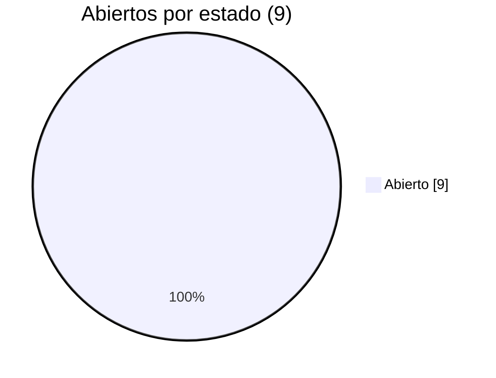

# Informe semanal BAU · del domingo 2026-10-04 al sábado 2026-10-10

## En una línea

9 abiertos · 1 creados · 3 resueltos · 0 rechazos del cliente

## Abiertos por estado

| Estado | Tickets |
|---|---|
| Abierto | 9 |
| En curso | 0 |
| Revisión cliente | 0 |
| Pendiente despliegue UAT | 0 |
| Pruebas cliente UAT | 0 |
| Pendiente despliegue PRD | 0 |

## Esperas en curso

Nadie espera a nadie.

## Tiempo medio en cada espera (histórico completo)

- Revisión cliente: 0.1 días
- Pendiente despliegue UAT: 3.2 días
- Pendiente despliegue PRD: 0.1 días

## Resueltos esta semana

- [NFQBAU-1510](02_TICKETS/Abiertos/NFQBAU-1510%20—%202026-09-28%20—%20Comenzaron%20las%20cargas.md): inicio de ejecución del job Aldrin-Megara STG StartOver → sin solución corta
- [NFQBAU-1511](02_TICKETS/Abiertos/NFQBAU-1511%20—%202026-09-28%20—%20Pedir%20UAT.md): petición de compilación de código adjunto en el entorno UAT para el host psqlcerdatahub01.postgres.database.cloud.corp → sin solución corta
- [NFQBAU-1512](02_TICKETS/Abiertos/NFQBAU-1512%20—%202026-10-05%20—%20Entrar%20em%20P0.md): incidente en producción que requiere entrar en P0 → sin solución corta

## Creados esta semana

- [NFQBAU-1512](02_TICKETS/Abiertos/NFQBAU-1512%20—%202026-10-05%20—%20Entrar%20em%20P0.md): Entrar em P0

## Foto para el cliente

### Resueltos

| Id | Asunto | Resuelto el | Días |
|---|---|---|---|
| NFQBAU-1510 | Comenzaron las cargas | 2026-10-08 | 10 |
| NFQBAU-1511 | Pedir UAT | 2026-10-08 | 10 |
| NFQBAU-1512 | Entrar em P0 | 2026-10-08 | 3 |

### Pendientes a 2026-10-10

| Id | Asunto | Estado | Días abierto |
|---|---|---|---|
| NFQBAU-1515 | [Aldrin] Problema demonstrativo de caixa | Abierto | -5 |
| NFQBAU-1516 | [Aldrin] - Valores no cargados Unit | Abierto | -5 |
| NFQBAU-1517 | [ALDRIN] Novo ajuste na função function_meg_sac_pl_cl_patrrf_t | Abierto | -5 |
| NFQBAU-1518 | [ALDRIN] Novo ajuste na função function_meg_cart_pos_fu_t | Abierto | -5 |
| NFQBAU-1519 | [ALDRIN BR] Nuevos Duplicados - Incidências cargas PRD | Abierto | -6 |
| NFQBAU-1520 | Nuevos Duplicados - Incidências cargas PRD | Abierto | -6 |
| NFQBAU-1522 | Confirmação sobre carga de dados de estoque no Aldrin | Abierto | -6 |
| NFQBAU-1523 | [Aldrin Br] Melhoria no sistema de tickets NFQ | Abierto | -6 |
| NFQBAU-1524 | [ALDRIN] Novo ajuste na função function_meg_sac_pl_cl_patrfut_t | Abierto | -6 |
