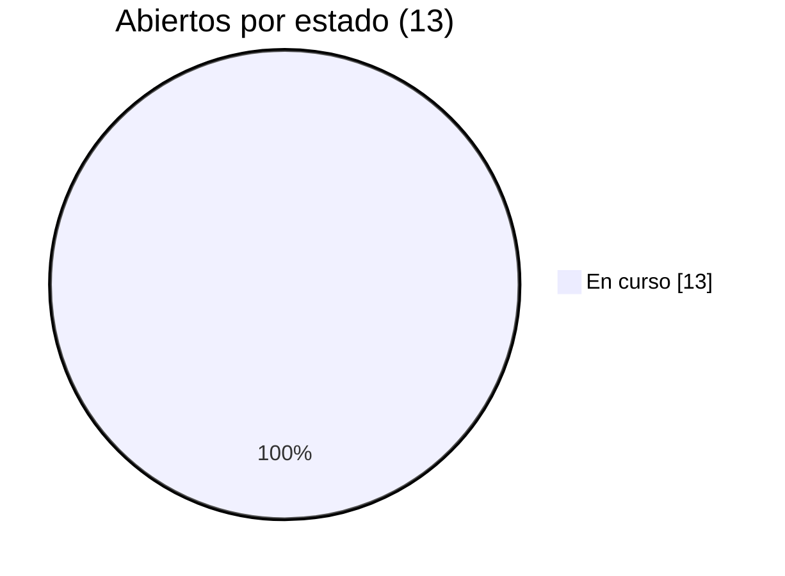

# Informe semanal BAU · del domingo 2026-10-11 al sábado 2026-10-17

## En una línea

13 abiertos · 17 creados · 4 resueltos · 0 rechazos del cliente

## Abiertos por estado

| Estado | Tickets |
|---|---|
| Abierto | 0 |
| En curso | 13 |
| Revisión cliente | 0 |
| Pendiente despliegue UAT | 0 |
| Pruebas cliente UAT | 0 |
| Pendiente despliegue PRD | 0 |

## Esperas en curso

Nadie espera a nadie.

## Tiempo medio en cada espera (histórico completo)

- Revisión cliente: 0.1 días
- Pendiente despliegue UAT: 3.2 días
- Pendiente despliegue PRD: 0.1 días

## Resueltos esta semana

- [NFQBAU-1513](02_TICKETS/Abiertos/NFQBAU-1513%20—%202026-10-15%20—%20Ocorrências%20-%20Demonstrativo%20de%20Caixa%20Portal.md): el informe Demonstrativo de Caixa muestra un saldo final incorrecto por la mañana que se corrige automáticamente más tarde sin intervención → sin solución corta
- [NFQBAU-1514](02_TICKETS/Abiertos/NFQBAU-1514%20—%202026-10-15%20—%20[Aldrin]%20Problema%20demonstrativo%20de%20caixa.md): El informe demonstrativo de caixa no presenta el saldo actualizado y muestra un valor diferente para el fondo CUST1111 en la fecha de hoy. → ticket de prueba del correo automático; sin acción
- [NFQBAU-1519](02_TICKETS/Abiertos/NFQBAU-1519%20—%202026-10-16%20—%20[ALDRIN%20BR]%20Nuevos%20Duplicados%20-%20Incidências%20cargas%20PRD.md): Se detectan nuevos registros duplicados en las tablas sac_pos_rv_em_rem_t y sac_stat_rv_em_pos_ta_re_t. → sin solución corta
- [NFQBAU-1521](02_TICKETS/Abiertos/NFQBAU-1521%20—%202026-10-16%20—%20[Aldrin]%20Incidencias%20cargas%20PRD%20Reload.md): Una carga de datos falló debido a un error en el archivo de flag. → sin solución corta

## Creados esta semana

- [NFQBAU-1513](02_TICKETS/Abiertos/NFQBAU-1513%20—%202026-10-15%20—%20Ocorrências%20-%20Demonstrativo%20de%20Caixa%20Portal.md): Ocorrências - Demonstrativo de Caixa Portal
- [NFQBAU-1514](02_TICKETS/Abiertos/NFQBAU-1514%20—%202026-10-15%20—%20[Aldrin]%20Problema%20demonstrativo%20de%20caixa.md): [Aldrin] Problema demonstrativo de caixa
- [NFQBAU-1515](02_TICKETS/Abiertos/NFQBAU-1515%20—%202026-10-15%20—%20[Aldrin]%20Problema%20demonstrativo%20de%20caixa.md): [Aldrin] Problema demonstrativo de caixa
- [NFQBAU-1516](02_TICKETS/Abiertos/NFQBAU-1516%20—%202026-10-15%20—%20[Aldrin]%20-%20Valores%20no%20cargados%20Unit.md): [Aldrin] - Valores no cargados Unit
- [NFQBAU-1517](../../02_TICKETS/Abiertos/NFQBAU-1517%20—%202026-10-15%20—%20[ALDRIN]%20Novo%20ajuste%20na%20função%20function_meg_sac_pl_cl_patrrf_t.md): [ALDRIN] Novo ajuste na função function_meg_sac_pl_cl_patrrf_t
- [NFQBAU-1518](02_TICKETS/Abiertos/NFQBAU-1518%20—%202026-10-15%20—%20[ALDRIN]%20Novo%20ajuste%20na%20função%20function_meg_cart_pos_fu_t.md): [ALDRIN] Novo ajuste na função function_meg_cart_pos_fu_t
- [NFQBAU-1519](02_TICKETS/Abiertos/NFQBAU-1519%20—%202026-10-16%20—%20[ALDRIN%20BR]%20Nuevos%20Duplicados%20-%20Incidências%20cargas%20PRD.md): [ALDRIN BR] Nuevos Duplicados - Incidências cargas PRD
- [NFQBAU-1520](02_TICKETS/Abiertos/NFQBAU-1520%20—%202026-10-16%20—%20Nuevos%20Duplicados%20-%20Incidências%20cargas%20PRD.md): Nuevos Duplicados - Incidências cargas PRD
- [NFQBAU-1521](02_TICKETS/Abiertos/NFQBAU-1521%20—%202026-10-16%20—%20[Aldrin]%20Incidencias%20cargas%20PRD%20Reload.md): [Aldrin] Incidencias cargas PRD Reload
- [NFQBAU-1522](../../02_TICKETS/Abiertos/NFQBAU-1522%20—%202026-10-16%20—%20Confirmação%20sobre%20carga%20de%20dados%20de%20estoque%20no%20Aldrin.md): Confirmação sobre carga de dados de estoque no Aldrin
- [NFQBAU-1523](02_TICKETS/Abiertos/NFQBAU-1523%20—%202026-10-16%20—%20[Aldrin%20Br]%20Melhoria%20no%20sistema%20de%20tickets%20NFQ.md): [Aldrin Br] Melhoria no sistema de tickets NFQ
- [NFQBAU-1524](02_TICKETS/Abiertos/NFQBAU-1524%20—%202026-10-16%20—%20[ALDRIN]%20Novo%20ajuste%20na%20função%20function_meg_sac_pl_cl_patrfut_t.md): [ALDRIN] Novo ajuste na função function_meg_sac_pl_cl_patrfut_t
- [NFQBAU-1525](02_TICKETS/Abiertos/NFQBAU-1525%20—%202026-10-15%20—%20Valores%20no%20actualizados%20Relatorio%20Estoque%20RF.md): Valores no actualizados Relatorio Estoque RF
- [NFQBAU-1526](02_TICKETS/Abiertos/NFQBAU-1526%20—%202026-10-16%20—%20[Aldrin]%20Codigo%20dashboard%20sustitución%20rundeck.md): [Aldrin] Codigo dashboard sustitución rundeck
- [NFQBAU-1527](02_TICKETS/Abiertos/NFQBAU-1527%20—%202026-10-16%20—%20Ajuste%20na%20carga%20da%20tabela%20s3_interface_control_xml_t.md): Ajuste na carga da tabela s3_interface_control_xml_t
- [NFQBAU-1528](02_TICKETS/Abiertos/NFQBAU-1528%20—%202026-10-16%20—%20Entrar%20na%20sala%20de%20PROJETOS.md): Entrar na sala de PROJETOS
- [NFQBAU-1529](02_TICKETS/Abiertos/NFQBAU-1529%20—%202026-10-16%20—%20[ALDRIN]%20New%20extraction%20%20NavBankBalance.md): [ALDRIN] New extraction  NavBankBalance

## Foto para el cliente

### Resueltos

| Id | Asunto | Resuelto el | Días |
|---|---|---|---|
| NFQBAU-1513 | Ocorrências - Demonstrativo de Caixa Portal | 2026-10-15 | 0 |
| NFQBAU-1514 | [Aldrin] Problema demonstrativo de caixa | 2026-10-15 | 0 |
| NFQBAU-1519 | [ALDRIN BR] Nuevos Duplicados - Incidências cargas PRD | 2026-10-17 | 1 |
| NFQBAU-1521 | [Aldrin] Incidencias cargas PRD Reload | 2026-10-16 | 0 |

### Pendientes a 2026-10-17

| Id | Asunto | Estado | Días abierto |
|---|---|---|---|
| NFQBAU-1515 | [Aldrin] Problema demonstrativo de caixa | En curso | 2 |
| NFQBAU-1516 | [Aldrin] - Valores no cargados Unit | En curso | 2 |
| NFQBAU-1517 | [ALDRIN] Novo ajuste na função function_meg_sac_pl_cl_patrrf_t | En curso | 2 |
| NFQBAU-1518 | [ALDRIN] Novo ajuste na função function_meg_cart_pos_fu_t | En curso | 2 |
| NFQBAU-1525 | Valores no actualizados Relatorio Estoque RF | En curso | 2 |
| NFQBAU-1520 | Nuevos Duplicados - Incidências cargas PRD | En curso | 1 |
| NFQBAU-1522 | Confirmação sobre carga de dados de estoque no Aldrin | En curso | 1 |
| NFQBAU-1523 | [Aldrin Br] Melhoria no sistema de tickets NFQ | En curso | 1 |
| NFQBAU-1524 | [ALDRIN] Novo ajuste na função function_meg_sac_pl_cl_patrfut_t | En curso | 1 |
| NFQBAU-1526 | [Aldrin] Codigo dashboard sustitución rundeck | En curso | 1 |
| NFQBAU-1527 | Ajuste na carga da tabela s3_interface_control_xml_t | En curso | 1 |
| NFQBAU-1528 | Entrar na sala de PROJETOS | En curso | 1 |
| NFQBAU-1529 | [ALDRIN] New extraction  NavBankBalance | En curso | 1 |
