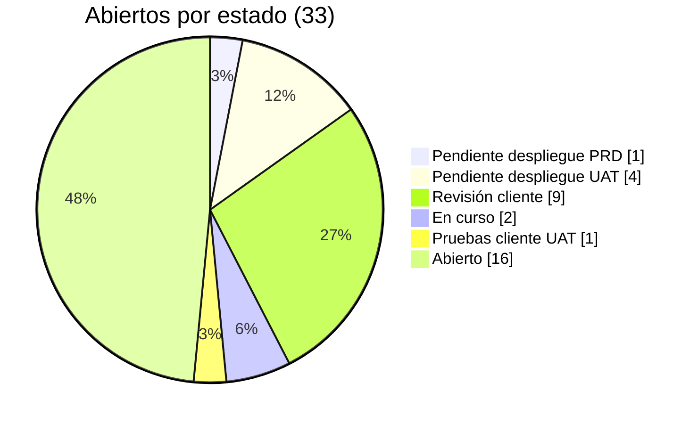

# Informe semanal BAU · del domingo 2026-10-18 al sábado 2026-10-24

## En una línea

33 abiertos · 35 creados · 15 resueltos · 0 rechazos del cliente

## Abiertos por estado

| Estado | Tickets |
|---|---|
| Abierto | 16 |
| En curso | 2 |
| Revisión cliente | 9 |
| Pendiente despliegue UAT | 4 |
| Pruebas cliente UAT | 1 |
| Pendiente despliegue PRD | 1 |

## Esperas en curso

| Ticket | Estado | Desde | Días |
|---|---|---|---|
| [NFQBAU-1520](02_TICKETS/Abiertos/NFQBAU-1520%20—%202026-10-16%20—%20Nuevos%20Duplicados%20-%20Incidências%20cargas%20PRD.md) | Revisión cliente | 2026-10-21 | 3 |
| [NFQBAU-1522](../../02_TICKETS/Abiertos/NFQBAU-1522%20—%202026-10-16%20—%20Confirmação%20sobre%20carga%20de%20dados%20de%20estoque%20no%20Aldrin.md) | Revisión cliente | 2026-10-21 | 3 |
| [NFQBAU-1525](02_TICKETS/Abiertos/NFQBAU-1525%20—%202026-10-15%20—%20Valores%20no%20actualizados%20Relatorio%20Estoque%20RF.md) | Revisión cliente | 2026-10-21 | 3 |
| [NFQBAU-1534](02_TICKETS/Abiertos/NFQBAU-1534%20—%202026-10-19%20—%20[ALDRIN%20BR]%20Incidência%20Saldos.md) | Revisión cliente | 2026-10-21 | 3 |
| [NFQBAU-1546](02_TICKETS/Abiertos/NFQBAU-1546%20—%202026-10-20%20—%20[ALDRIN]%20Novo%20ajuste%20na%20função%20function_meg_sac_pl_cl_patrfi_t.md) | Revisión cliente | 2026-10-21 | 3 |
| [NFQBAU-1529](02_TICKETS/Abiertos/NFQBAU-1529%20—%202026-10-16%20—%20[ALDRIN]%20New%20extraction%20%20NavBankBalance.md) | Pruebas cliente UAT | 2026-10-21 | 3 |
| [NFQBAU-1515](02_TICKETS/Abiertos/NFQBAU-1515%20—%202026-10-15%20—%20[Aldrin]%20Problema%20demonstrativo%20de%20caixa.md) | Pendiente despliegue PRD | 2026-10-22 | 2 |
| [NFQBAU-1517](02_TICKETS/Abiertos/NFQBAU-1517%20—%202026-10-15%20—%20[ALDRIN]%20Novo%20ajuste%20na%20função%20function_meg_sac_pl_cl_patrrf_t.md) | Pendiente despliegue UAT | 2026-10-22 | 2 |
| [NFQBAU-1518](02_TICKETS/Abiertos/NFQBAU-1518%20—%202026-10-15%20—%20[ALDRIN]%20Novo%20ajuste%20na%20função%20function_meg_cart_pos_fu_t.md) | Pendiente despliegue UAT | 2026-10-22 | 2 |
| [NFQBAU-1538](02_TICKETS/Abiertos/NFQBAU-1538%20—%202026-10-19%20—%20[ALDRIN]%20Novo%20ajuste%20na%20função%20function_meg_cart_pos_rf_t.md) | Pendiente despliegue UAT | 2026-10-22 | 2 |
| [NFQBAU-1524](02_TICKETS/Abiertos/NFQBAU-1524%20—%202026-10-16%20—%20[ALDRIN]%20Novo%20ajuste%20na%20função%20function_meg_sac_pl_cl_patrfut_t.md) | Pendiente despliegue UAT | 2026-10-23 | 1 |
| [NFQBAU-1548](02_TICKETS/Abiertos/NFQBAU-1548%20—%202026-10-20%20—%20[ALDRIN]%20Ajuste%20na%20função%20function_meg_sac_cl_patr%20que%20carrega%20a%20tabela%20SAC_CL.md) | Revisión cliente | 2026-10-23 | 1 |
| [NFQBAU-1547](02_TICKETS/Abiertos/NFQBAU-1547%20—%202026-10-20%20—%20[ALDRIN]%20Ajuste%20na%20função%20refresh_summary_netasset_calculations.md) | Revisión cliente | 2026-10-23 | 1 |
| [NFQBAU-1535](02_TICKETS/Abiertos/NFQBAU-1535%20—%202026-10-19%20—%20Ocorrências%20-%20Demonstrativo%20de%20Caixa%20Portal.md) | Revisión cliente | 2026-10-23 | 1 |
| [NFQBAU-1530](02_TICKETS/Abiertos/NFQBAU-1530%20—%202026-10-19%20—%20[ALDRIN%20BR]%20Nuevos%20Excedidos%20-%20Incidências%20cargas%20PRD.md) | Revisión cliente | 2026-10-26 | -2 |

## Tiempo medio en cada espera (histórico completo)

- Revisión cliente: 0.1 días
- Pendiente despliegue UAT: 3.2 días
- Pendiente despliegue PRD: 0.1 días

## Resueltos esta semana

- [NFQBAU-1516](02_TICKETS/Abiertos/NFQBAU-1516%20—%202026-10-15%20—%20[Aldrin]%20-%20Valores%20no%20cargados%20Unit.md): Ausencia de valores en la base de datos de Aldrin en relación a la interfaz Unit. → sin solución corta
- [NFQBAU-1523](02_TICKETS/Abiertos/NFQBAU-1523%20—%202026-10-16%20—%20[Aldrin%20Br]%20Melhoria%20no%20sistema%20de%20tickets%20NFQ.md): Se solicita la implementación de un envío periódico de informes de tickets de proyecto. → sin solución corta
- [NFQBAU-1526](02_TICKETS/Abiertos/NFQBAU-1526%20—%202026-10-16%20—%20[Aldrin]%20Codigo%20dashboard%20sustitución%20rundeck.md): El script SQL no identifica los registros resultantes con el formato correcto en producción. → sin solución corta
- [NFQBAU-1528](02_TICKETS/Abiertos/NFQBAU-1528%20—%202026-10-16%20—%20Entrar%20na%20sala%20de%20PROJETOS.md): Petición de apertura de ticket de soporte para el seguimiento de una incidencia pendiente de detallar. → sin solución corta
- [NFQBAU-1531](02_TICKETS/Abiertos/NFQBAU-1531%20—%202026-10-19%20—%20[ALDRIN%20BR]%20Incidencias%20cart_caixa_mt_t.md): La tabla cart_caixa_mt_t presenta registros con saldos duplicados para los mismos clientes y fechas. → sin solución corta
- [NFQBAU-1532](02_TICKETS/Abiertos/NFQBAU-1532%20—%202026-10-19%20—%20[MEGARA%20X%20ALDRIN]%20Arquivos%20sobrando%20a%20cada%20carga%20no%20UAT.md): Archivos XML quedan acumulados sin procesar en la ruta de carga tras cada ejecución. → sin solución corta
- [NFQBAU-1536](02_TICKETS/Abiertos/NFQBAU-1536%20—%202026-10-19%20—%20Entrar%20em%20P0.md): Se solicita acceso o configuración de un entorno identificado como P0. → sin solución corta
- [NFQBAU-1537](02_TICKETS/Abiertos/NFQBAU-1537%20—%202026-10-19%20—%20Solicitação%20para%20entrar%20no%20P0.md): Solicitud para incorporarse a la llamada de atención de incidencia P0. → sin solución corta
- [NFQBAU-1539](02_TICKETS/Abiertos/NFQBAU-1539%20—%202026-10-19%20—%20[MEGARA%20X%20ALDRIN]%20Podem%20vir%20a%20WR%20P0%20Muitos%20arquivos%20na%20pasta%20de%20prod.md): Acumulación anómala de archivos en la carpeta de producción de la integración MEGARA y ALDRIN. → sin solución corta
- [NFQBAU-1540](02_TICKETS/Abiertos/NFQBAU-1540%20—%202026-10-19%20—%20Boa%20tarde!%20Poderiam%20entrar%20em%20P0.md): Convocatoria para ingresar a la sala de crisis o puente de incidencia crítica (P0) sin detallar el componente afectado. → sin solución corta
- [NFQBAU-1541](02_TICKETS/Abiertos/NFQBAU-1541%20—%202026-10-19%20—%20Demonstrativo%20de%20Caixa%20-%20CUST1157%20-%20saldo%20negativo%20errado.md): El informe Demonstrativo de Caixa CUST1157 muestra un saldo negativo incorrecto. → sin solución corta
- [NFQBAU-1542](02_TICKETS/Abiertos/NFQBAU-1542%20—%202026-10-20%20—%20[Aldrin]%20Incidencias%20cargas%20PRD%20Reload.md): Un job de carga está detenido debido a la falta del archivo MEGAACCOUNTING_IntraDay. → sin solución corta
- [NFQBAU-1544](02_TICKETS/Abiertos/NFQBAU-1544%20—%202026-10-20%20—%20Atualização%20demonstrativo%20de%20caixa%20-%20CUST1157.md): El saldo del informe demonstrativo de caixa CUST1157 en Qlik no se actualiza tras realizar ajustes. → sin solución corta
- [NFQBAU-1549](02_TICKETS/Abiertos/NFQBAU-1549%20—%202026-10-20%20—%20[Aldrin%20BR]%20Problema%20Carga.md): Las cargas en Rundeck no se ejecutan debido a que las llamadas vía API a Megara devuelven error 401. → sin solución corta
- [NFQBAU-1560](02_TICKETS/Abiertos/NFQBAU-1560%20—%202026-10-22%20—%20[EXT][Aldrin]%20Servidor%20UAT.md): Se requiere mantener activo el servicio de Rundeck en el entorno de UAT fuera de su horario habitual. → sin solución corta

## Creados esta semana

- [NFQBAU-1530](02_TICKETS/Abiertos/NFQBAU-1530%20—%202026-10-19%20—%20[ALDRIN%20BR]%20Nuevos%20Excedidos%20-%20Incidências%20cargas%20PRD.md): [ALDRIN BR] Nuevos Excedidos - Incidências cargas PRD
- [NFQBAU-1531](02_TICKETS/Abiertos/NFQBAU-1531%20—%202026-10-19%20—%20[ALDRIN%20BR]%20Incidencias%20cart_caixa_mt_t.md): [ALDRIN BR] Incidencias cart_caixa_mt_t
- [NFQBAU-1532](02_TICKETS/Abiertos/NFQBAU-1532%20—%202026-10-19%20—%20[MEGARA%20X%20ALDRIN]%20Arquivos%20sobrando%20a%20cada%20carga%20no%20UAT.md): [MEGARA X ALDRIN] Arquivos sobrando a cada carga no UAT
- [NFQBAU-1533](02_TICKETS/Abiertos/NFQBAU-1533%20—%202026-10-19%20—%20[MEGARA%20X%20ALDRIN]%20Arquivos%20sobrando%20a%20cada%20carga%20no%20UAT.md): [MEGARA X ALDRIN] Arquivos sobrando a cada carga no UAT
- [NFQBAU-1534](02_TICKETS/Abiertos/NFQBAU-1534%20—%202026-10-19%20—%20[ALDRIN%20BR]%20Incidência%20Saldos.md): [ALDRIN BR] Incidência Saldos
- [NFQBAU-1535](02_TICKETS/Abiertos/NFQBAU-1535%20—%202026-10-19%20—%20Ocorrências%20-%20Demonstrativo%20de%20Caixa%20Portal.md): Ocorrências - Demonstrativo de Caixa Portal
- [NFQBAU-1536](02_TICKETS/Abiertos/NFQBAU-1536%20—%202026-10-19%20—%20Entrar%20em%20P0.md): Entrar em P0
- [NFQBAU-1537](02_TICKETS/Abiertos/NFQBAU-1537%20—%202026-10-19%20—%20Solicitação%20para%20entrar%20no%20P0.md): Solicitação para entrar no P0
- [NFQBAU-1538](02_TICKETS/Abiertos/NFQBAU-1538%20—%202026-10-19%20—%20[ALDRIN]%20Novo%20ajuste%20na%20função%20function_meg_cart_pos_rf_t.md): [ALDRIN] Novo ajuste na função function_meg_cart_pos_rf_t
- [NFQBAU-1539](02_TICKETS/Abiertos/NFQBAU-1539%20—%202026-10-19%20—%20[MEGARA%20X%20ALDRIN]%20Podem%20vir%20a%20WR%20P0%20Muitos%20arquivos%20na%20pasta%20de%20prod.md): [MEGARA X ALDRIN] Podem vir a WR P0 Muitos arquivos na pasta de prod
- [NFQBAU-1540](02_TICKETS/Abiertos/NFQBAU-1540%20—%202026-10-19%20—%20Boa%20tarde!%20Poderiam%20entrar%20em%20P0.md): Boa tarde! Poderiam entrar em P0
- [NFQBAU-1541](02_TICKETS/Abiertos/NFQBAU-1541%20—%202026-10-19%20—%20Demonstrativo%20de%20Caixa%20-%20CUST1157%20-%20saldo%20negativo%20errado.md): Demonstrativo de Caixa - CUST1157 - saldo negativo errado
- [NFQBAU-1542](02_TICKETS/Abiertos/NFQBAU-1542%20—%202026-10-20%20—%20[Aldrin]%20Incidencias%20cargas%20PRD%20Reload.md): [Aldrin] Incidencias cargas PRD Reload
- [NFQBAU-1543](02_TICKETS/Abiertos/NFQBAU-1543%20—%202026-10-20%20—%20Ingresso%20e%20Retirada%20-%20Ajuste%20na%20API.md): Ingresso e Retirada - Ajuste na API
- [NFQBAU-1544](02_TICKETS/Abiertos/NFQBAU-1544%20—%202026-10-20%20—%20Atualização%20demonstrativo%20de%20caixa%20-%20CUST1157.md): Atualização demonstrativo de caixa - CUST1157
- [NFQBAU-1545](02_TICKETS/Abiertos/NFQBAU-1545%20—%202026-10-20%20—%20[ALDRIN]%20Novo%20ajuste%20na%20função%20function_meg_cart_pos_fi_t.md): [ALDRIN] Novo ajuste na função function_meg_cart_pos_fi_t
- [NFQBAU-1546](02_TICKETS/Abiertos/NFQBAU-1546%20—%202026-10-20%20—%20[ALDRIN]%20Novo%20ajuste%20na%20função%20function_meg_sac_pl_cl_patrfi_t.md): [ALDRIN] Novo ajuste na função function_meg_sac_pl_cl_patrfi_t
- [NFQBAU-1547](02_TICKETS/Abiertos/NFQBAU-1547%20—%202026-10-20%20—%20[ALDRIN]%20Ajuste%20na%20função%20refresh_summary_netasset_calculations.md): [ALDRIN] Ajuste na função refresh_summary_netasset_calculations
- [NFQBAU-1548](02_TICKETS/Abiertos/NFQBAU-1548%20—%202026-10-20%20—%20[ALDRIN]%20Ajuste%20na%20função%20function_meg_sac_cl_patr%20que%20carrega%20a%20tabela%20SAC_CL.md): [ALDRIN] Ajuste na função function_meg_sac_cl_patr que carrega a tabela SAC_CL
- [NFQBAU-1549](02_TICKETS/Abiertos/NFQBAU-1549%20—%202026-10-20%20—%20[Aldrin%20BR]%20Problema%20Carga.md): [Aldrin BR] Problema Carga
- [NFQBAU-1550](02_TICKETS/Abiertos/NFQBAU-1550%20—%202026-10-20%20—%20[EXTERNAL]%20RES%20[Aldrin]%20ContractualClien%20extraction%20-%20Fund%20Classification%20and%20F.md): [EXTERNAL] RES [Aldrin] ContractualClien extraction - Fund Classification and F
- [NFQBAU-1553](02_TICKETS/Abiertos/NFQBAU-1553%20—%202026-10-21%20—%20[ALDRIN%20BR]%20Incidencias%20cart_caixa_mt_t.md): [ALDRIN BR] Incidencias cart_caixa_mt_t
- [NFQBAU-1554](02_TICKETS/Abiertos/NFQBAU-1554%20—%202026-10-21%20—%20Monitoramento%20do%20problema%20de%20saldo%20-%20Fundo%20SAM.md): Monitoramento do problema de saldo - Fundo SAM
- [NFQBAU-1559](02_TICKETS/Abiertos/NFQBAU-1559%20—%202026-10-21%20—%20[ALDRIN%20-%20SALA%20DE%20PROJETOS]%20NAVDETAILS.md): [ALDRIN - SALA DE PROJETOS] NAVDETAILS
- [NFQBAU-1560](02_TICKETS/Abiertos/NFQBAU-1560%20—%202026-10-22%20—%20[EXT][Aldrin]%20Servidor%20UAT.md): [EXT][Aldrin] Servidor UAT
- [NFQBAU-1561](02_TICKETS/Abiertos/NFQBAU-1561%20—%202026-10-22%20—%20[SALA%20DE%20PROJETOS]%20Podem%20vir%20a%20sala%20de%20projetos.md): [SALA DE PROJETOS] Podem vir a sala de projetos
- [NFQBAU-1562](02_TICKETS/Abiertos/NFQBAU-1562%20—%202026-10-22%20—%20Carga%20de%20Posição%20de%20SWAP%20em%20PRD.md): Carga de Posição de SWAP em PRD
- [NFQBAU-1563](02_TICKETS/Abiertos/NFQBAU-1563%20—%202026-10-22%20—%20[Aldrin]%20Problema%20VPN.md): [Aldrin] Problema VPN
- [NFQBAU-1564](02_TICKETS/Abiertos/NFQBAU-1564%20—%202026-10-22%20—%20[ALDRIN%20BR]%20Nuevos%20Duplicados%20-%20Incidências%20cargas%20PRD.md): [ALDRIN BR] Nuevos Duplicados - Incidências cargas PRD
- [NFQBAU-1565](02_TICKETS/Abiertos/NFQBAU-1565%20—%202026-10-23%20—%20Demonstrativo%20de%20Caixa%20-%20MAMS%20FIA%20CUST4327.md): Demonstrativo de Caixa - MAMS FIA CUST4327
- [NFQBAU-1566](02_TICKETS/Abiertos/NFQBAU-1566%20—%202026-10-23%20—%20[Migração%20Fundos%20Apollo]Suporte%20Fim%20Semana.md): [Migração Fundos Apollo]Suporte Fim Semana
- [NFQBAU-1567](02_TICKETS/Abiertos/NFQBAU-1567%20—%202026-10-23%20—%20Collins%20Release%20W12.02.01.md): Collins Release W12.02.01
- [NFQBAU-1568](02_TICKETS/Abiertos/NFQBAU-1568%20—%202026-10-23%20—%20[EXTERNAL]%20RE%20Collins%20Release%20W12.02.01.md): [EXTERNAL] RE Collins Release W12.02.01
- [NFQBAU-1569](02_TICKETS/Abiertos/NFQBAU-1569%20—%202026-10-23%20—%20Solicitação%20de%20Querry%20[DC%20CCF].md): Solicitação de Querry [DC CCF]
- [NFQBAU-1570](02_TICKETS/Abiertos/NFQBAU-1570%20—%202026-10-23%20—%20PODE%20VIR%20A%20SALA%20DE%20PROJETOS%20-%20AdditionalDerivativePrices.md): PODE VIR A SALA DE PROJETOS - AdditionalDerivativePrices

## Foto para el cliente

### Resueltos

| Id | Asunto | Resuelto el | Días |
|---|---|---|---|
| NFQBAU-1516 | [Aldrin] - Valores no cargados Unit | 2026-10-21 | 6 |
| NFQBAU-1523 | [Aldrin Br] Melhoria no sistema de tickets NFQ | 2026-10-21 | 5 |
| NFQBAU-1526 | [Aldrin] Codigo dashboard sustitución rundeck | 2026-10-20 | 4 |
| NFQBAU-1528 | Entrar na sala de PROJETOS | 2026-10-21 | 5 |
| NFQBAU-1531 | [ALDRIN BR] Incidencias cart_caixa_mt_t | 2026-10-20 | 1 |
| NFQBAU-1532 | [MEGARA X ALDRIN] Arquivos sobrando a cada carga no UAT | 2026-10-21 | 2 |
| NFQBAU-1536 | Entrar em P0 | 2026-10-21 | 2 |
| NFQBAU-1537 | Solicitação para entrar no P0 | 2026-10-21 | 2 |
| NFQBAU-1539 | [MEGARA X ALDRIN] Podem vir a WR P0 Muitos arquivos na pasta de prod | 2026-10-21 | 2 |
| NFQBAU-1540 | Boa tarde! Poderiam entrar em P0 | 2026-10-21 | 2 |
| NFQBAU-1541 | Demonstrativo de Caixa - CUST1157 - saldo negativo errado | 2026-10-21 | 2 |
| NFQBAU-1542 | [Aldrin] Incidencias cargas PRD Reload | 2026-10-21 | 1 |
| NFQBAU-1544 | Atualização demonstrativo de caixa - CUST1157 | 2026-10-21 | 1 |
| NFQBAU-1549 | [Aldrin BR] Problema Carga | 2026-10-21 | 1 |
| NFQBAU-1560 | [EXT][Aldrin] Servidor UAT | 2026-10-22 | 0 |

### Pendientes a 2026-10-24

| Id          | Asunto                                                                          | Estado                   | Días abierto |
| ----------- | ------------------------------------------------------------------------------- | ------------------------ | ------------ |
| NFQBAU-1515 | [Aldrin] Problema demonstrativo de caixa                                        | Pendiente despliegue PRD | 9            |
| NFQBAU-1517 | [ALDRIN] Novo ajuste na função function_meg_sac_pl_cl_patrrf_t                  | Pendiente despliegue UAT | 9            |
| NFQBAU-1518 | [ALDRIN] Novo ajuste na função function_meg_cart_pos_fu_t                       | Pendiente despliegue UAT | 9            |
| NFQBAU-1525 | Valores no actualizados Relatorio Estoque RF                                    | Revisión cliente         | 9            |
| NFQBAU-1520 | Nuevos Duplicados - Incidências cargas PRD                                      | Revisión cliente         | 8            |
| NFQBAU-1522 | Confirmação sobre carga de dados de estoque no Aldrin                           | Revisión cliente         | 8            |
| NFQBAU-1524 | [ALDRIN] Novo ajuste na função function_meg_sac_pl_cl_patrfut_t                 | Pendiente despliegue UAT | 8            |
| NFQBAU-1527 | Ajuste na carga da tabela s3_interface_control_xml_t                            | En curso                 | 8            |
| NFQBAU-1529 | [ALDRIN] New extraction  NavBankBalance                                         | Pruebas cliente UAT      | 8            |
| NFQBAU-1530 | [ALDRIN BR] Nuevos Excedidos - Incidências cargas PRD                           | Revisión cliente         | 5            |
| NFQBAU-1533 | [MEGARA X ALDRIN] Arquivos sobrando a cada carga no UAT                         | En curso                 | 5            |
| NFQBAU-1534 | [ALDRIN BR] Incidência Saldos                                                   | Revisión cliente         | 5            |
| NFQBAU-1535 | Ocorrências - Demonstrativo de Caixa Portal                                     | Revisión cliente         | 5            |
| NFQBAU-1538 | [ALDRIN] Novo ajuste na função function_meg_cart_pos_rf_t                       | Pendiente despliegue UAT | 5            |
| NFQBAU-1543 | Ingresso e Retirada - Ajuste na API                                             | Abierto                  | 4            |
| NFQBAU-1545 | [ALDRIN] Novo ajuste na função function_meg_cart_pos_fi_t                       | Abierto                  | 4            |
| NFQBAU-1546 | [ALDRIN] Novo ajuste na função function_meg_sac_pl_cl_patrfi_t                  | Revisión cliente         | 4            |
| NFQBAU-1547 | [ALDRIN] Ajuste na função refresh_summary_netasset_calculations                 | Revisión cliente         | 4            |
| NFQBAU-1548 | [ALDRIN] Ajuste na função function_meg_sac_cl_patr que carrega a tabela SAC_CL  | Revisión cliente         | 4            |
| NFQBAU-1550 | [EXTERNAL] RES [Aldrin] ContractualClien extraction - Fund Classification and F | Abierto                  | 4            |
| NFQBAU-1553 | [ALDRIN BR] Incidencias cart_caixa_mt_t                                         | Abierto                  | 3            |
| NFQBAU-1554 | Monitoramento do problema de saldo - Fundo SAM                                  | Abierto                  | 3            |
| NFQBAU-1559 | [ALDRIN - SALA DE PROJETOS] NAVDETAILS                                          | Abierto                  | 3            |
| NFQBAU-1561 | [SALA DE PROJETOS] Podem vir a sala de projetos                                 | Abierto                  | 2            |
| NFQBAU-1562 | Carga de Posição de SWAP em PRD                                                 | Abierto                  | 2            |
| NFQBAU-1563 | [Aldrin] Problema VPN                                                           | Abierto                  | 2            |
| NFQBAU-1564 | [ALDRIN BR] Nuevos Duplicados - Incidências cargas PRD                          | Abierto                  | 2            |
| NFQBAU-1565 | Demonstrativo de Caixa - MAMS FIA CUST4327                                      | Abierto                  | 1            |
| NFQBAU-1566 | [Migração Fundos Apollo]Suporte Fim Semana                                      | Abierto                  | 1            |
| NFQBAU-1567 | Collins Release W12.02.01                                                       | Abierto                  | 1            |
| NFQBAU-1568 | [EXTERNAL] RE Collins Release W12.02.01                                         | Abierto                  | 1            |
| NFQBAU-1569 | Solicitação de Querry [DC CCF]                                                  | Abierto                  | 1            |
| NFQBAU-1570 | PODE VIR A SALA DE PROJETOS - AdditionalDerivativePrices                        | Abierto                  | 1            |
