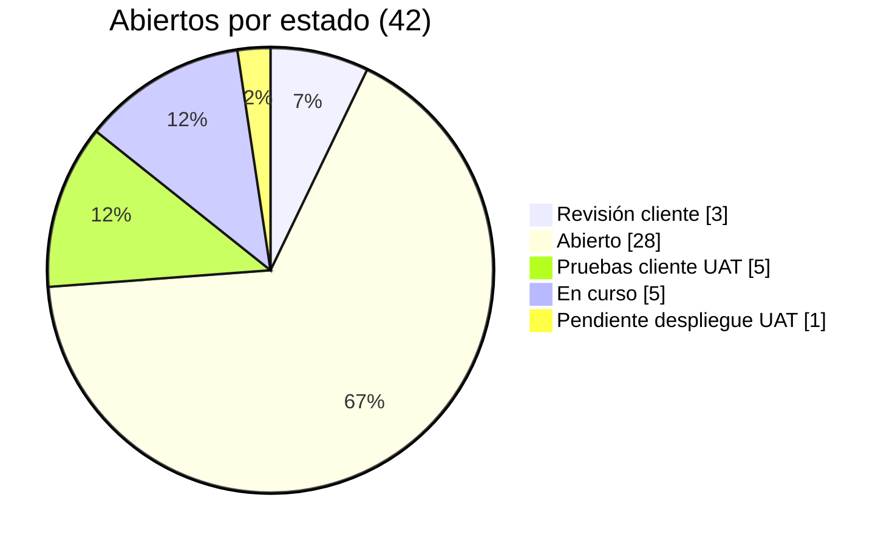

# Informe semanal BAU · del domingo 2026-10-25 al sábado 2026-10-31

## En una línea

42 abiertos · 41 creados · 33 resueltos · 0 rechazos del cliente

## Abiertos por estado

| Estado | Tickets |
|---|---|
| Abierto | 28 |
| En curso | 5 |
| Revisión cliente | 3 |
| Pendiente despliegue UAT | 1 |
| Pruebas cliente UAT | 5 |
| Pendiente despliegue PRD | 0 |

## Esperas en curso

| Ticket | Estado | Desde | Días |
|---|---|---|---|
| [NFQBAU-1522](../../02_TICKETS/Abiertos/NFQBAU-1522%20—%202026-10-16%20—%20Confirmação%20sobre%20carga%20de%20dados%20de%20estoque%20no%20Aldrin.md) | Revisión cliente | 2026-10-21 | 10 |
| [NFQBAU-1525](02_TICKETS/Abiertos/NFQBAU-1525%20—%202026-10-15%20—%20Valores%20no%20actualizados%20Relatorio%20Estoque%20RF.md) | Revisión cliente | 2026-10-21 | 10 |
| [NFQBAU-1546](02_TICKETS/Abiertos/NFQBAU-1546%20—%202026-10-20%20—%20[ALDRIN]%20Novo%20ajuste%20na%20função%20function_meg_sac_pl_cl_patrfi_t.md) | Revisión cliente | 2026-10-21 | 10 |
| [NFQBAU-1529](02_TICKETS/Abiertos/NFQBAU-1529%20—%202026-10-16%20—%20[ALDRIN]%20New%20extraction%20%20NavBankBalance.md) | Pruebas cliente UAT | 2026-10-21 | 10 |
| [NFQBAU-1538](02_TICKETS/Abiertos/NFQBAU-1538%20—%202026-10-19%20—%20[ALDRIN]%20Novo%20ajuste%20na%20função%20function_meg_cart_pos_rf_t.md) | Pendiente despliegue UAT | 2026-10-22 | 9 |
| [NFQBAU-1545](02_TICKETS/Abiertos/NFQBAU-1545%20—%202026-10-20%20—%20[ALDRIN]%20Novo%20ajuste%20na%20função%20function_meg_cart_pos_fi_t.md) | Pruebas cliente UAT | 2026-10-26 | 5 |
| [NFQBAU-1550](02_TICKETS/Abiertos/NFQBAU-1550%20—%202026-10-20%20—%20[EXTERNAL]%20RES%20[Aldrin]%20ContractualClien%20extraction%20-%20Fund%20Classification%20and%20F.md) | Pruebas cliente UAT | 2026-10-28 | 3 |
| [NFQBAU-1597](02_TICKETS/Abiertos/NFQBAU-1597%20—%202026-10-29%20—%20[ALDRIN]%20Novo%20ajuste%20na%20função%20function_meg_cart_pos_fu_t.md) | Pruebas cliente UAT | 2026-10-30 | 1 |
| [NFQBAU-1596](02_TICKETS/Abiertos/NFQBAU-1596%20—%202026-10-29%20—%20[ALDRIN]%20Novo%20ajuste%20na%20função%20function_meg_sac_pl_cl_patrfut_t.md) | Pruebas cliente UAT | 2026-10-30 | 1 |

## Tiempo medio en cada espera (histórico completo)

- Revisión cliente: 3.2 días
- Pendiente despliegue UAT: 3.6 días
- Pruebas cliente UAT: 1.9 días
- Pendiente despliegue PRD: 1.2 días

## Resueltos esta semana

- [NFQBAU-1571](02_TICKETS/Abiertos/NFQBAU-1571%20—%202026-10-26%20—%20[ALDRIN]%20Novo%20ajuste%20na%20função%20function_meg_sac_pl_cl_patrfut_t.md): Solicitud de validación del código ajustado de la función function_meg_sac_pl_cl_patrfut_t. → sin solución corta
- [NFQBAU-1572](02_TICKETS/Abiertos/NFQBAU-1572%20—%202026-10-26%20—%20[ALDRIN]%20Novo%20ajuste%20na%20função%20function_meg_cart_pos_fu_t.md): La función function_meg_cart_pos_fu_t utiliza una fecha incorrecta para la cotización de precios. → sin solución corta
- [NFQBAU-1573](02_TICKETS/Abiertos/NFQBAU-1573%20—%202026-10-26%20—%20[ALDRIN%20-%20SALA%20DE%20PROJETOS]%20Pode%20entrar%20na%20sala%20de%20projetos..md): Problemas al probar 'cashtransferorder' y 'OPTION' en UAT, con 'InvestCompanyInstitute' y 'Unit' atascados en una carpeta; además, una función de finalización en Producción no actualizó una tabla de control el fin de semana. → sin solución corta
- [NFQBAU-1575](02_TICKETS/Abiertos/NFQBAU-1575%20—%202026-10-27%20—%20[ALDRIN%20BR]%20Nuevos%20Excedidos%20-%20Incidências%20cargas%20PRD.md): Diversos archivos XML de interfaces de carga superan el límite de tamaño medio histórico configurado. → sin solución corta
- [NFQBAU-1578](02_TICKETS/Abiertos/NFQBAU-1578%20—%202026-10-27%20—%20CUST3333.md): Los datos del DC del CSUT3333 no están actualizados. → sin solución corta
- [NFQBAU-1579](02_TICKETS/Abiertos/NFQBAU-1579%20—%202026-10-27%20—%20[ALDRIN%20BR]%20Incidência%20Saldos.md): Duplicidad de saldos para un mismo cliente y fecha en la tabla cart_caixa_saldo_mt_t. → sin solución corta
- [NFQBAU-1581](02_TICKETS/Abiertos/NFQBAU-1581%20—%202026-10-27%20—%20Arquivo%20Unit%20%20ContractualClient.md): Los archivos Unit y ContractualClient presentan campos inválidos. → sin solución corta
- [NFQBAU-1582](02_TICKETS/Abiertos/NFQBAU-1582%20—%202026-10-27%20—%20[MEGARA%20X%20ALDRIN]%20PROD%20Unit%20XML%20different%20from%20current%20XSD%20in%20ALDRIN.md): El XML de la unidad generado en MEGARA es diferente del XSD actual en ALDRIN debido a un campo no mapeado. → sin solución corta
- [NFQBAU-1583](02_TICKETS/Abiertos/NFQBAU-1583%20—%202026-10-27%20—%20[MEGARA%20X%20ALDRIN]%20PRD%20CONTRACTUAL%20CLIENT%20-%20Issue%20XML%20vs%20XSD.md): Se detectan diferencias entre el fichero XML y su definición XSD en el entorno de producción. → sin solución corta
- [NFQBAU-1589](02_TICKETS/Abiertos/NFQBAU-1589%20—%202026-10-28%20—%20[ALDRIN%20BR]%20Incidencias%20cart_caixa_mt_t.md): La tabla cart_caixa_mt_t presenta saldos duplicados para un mismo cliente y día. → sin solución corta
- [NFQBAU-1593](02_TICKETS/Abiertos/NFQBAU-1593%20—%202026-10-28%20—%20Entrar%20na%20sala%20de%20PROJETOS.md): El remitente solicita acceso a la sala de PROJETOS. → sin solución corta
- [NFQBAU-1594](02_TICKETS/Abiertos/NFQBAU-1594%20—%202026-10-28%20—%20[MEGARA%20X%20ALDRIN]%20Ajustes%20-%20function_meg_cart_caixa_cpr_t9.md): Se solicita actualizar los controles de NFQ con la función function_meg_cart_caixa_cpr_t9. → sin solución corta
- [NFQBAU-1595](02_TICKETS/Abiertos/NFQBAU-1595%20—%202026-10-28%20—%20[ALDRIN]%20Novo%20Ajuste%20na%20função%20cs_cli_cash_account_transf_pc.md): Se requiere actualizar la función cs_cli_cash_account_transf_pc para que inserte el campo dat_qlikupdate en cada nuevo registro. → sin solución corta
- [NFQBAU-1515](02_TICKETS/Archivo/NFQBAU-1515%20—%202026-10-15%20—%20[Aldrin]%20Problema%20demonstrativo%20de%20caixa.md): El informe de caja no muestra registros para el cliente CUST1234 y el portal lanza un error al intentar generar el informe del cliente CUST6767 para la fecha 2026-10-01. → sin solución corta
- [NFQBAU-1517](02_TICKETS/Archivo/NFQBAU-1517%20—%202026-10-15%20—%20[ALDRIN]%20Novo%20ajuste%20na%20função%20function_meg_sac_pl_cl_patrrf_t.md): La carga de datos en producción falla debido a una diferencia de segundos en la función function_meg_sac_pl_cl_patrrf_t. → sin solución corta
- [NFQBAU-1518](02_TICKETS/Archivo/NFQBAU-1518%20—%202026-10-15%20—%20[ALDRIN]%20Novo%20ajuste%20na%20função%20function_meg_cart_pos_fu_t.md): La función function_meg_cart_pos_fu_t en producción no carga ciertos datos debido a una discrepancia de segundos. → sin solución corta
- [NFQBAU-1520](02_TICKETS/Archivo/NFQBAU-1520%20—%202026-10-16%20—%20Nuevos%20Duplicados%20-%20Incidências%20cargas%20PRD.md): Se detectan registros duplicados en las tablas sac_pos_rv_em_rem_t y sac_stat_rv_em_pos_ta_re_t. → sin solución corta
- [NFQBAU-1524](02_TICKETS/Archivo/NFQBAU-1524%20—%202026-10-16%20—%20[ALDRIN]%20Novo%20ajuste%20na%20função%20function_meg_sac_pl_cl_patrfut_t.md): La función function_meg_sac_pl_cl_patrfut_t no carga algunos datos debido a una diferencia de segundos, causando un problema en producción. → sin solución corta
- [NFQBAU-1530](02_TICKETS/Archivo/NFQBAU-1530%20—%202026-10-19%20—%20[ALDRIN%20BR]%20Nuevos%20Excedidos%20-%20Incidências%20cargas%20PRD.md): Diversos archivos de interfaz superan el tamaño medio histórico permitido durante las cargas. → sin solución corta
- [NFQBAU-1534](02_TICKETS/Archivo/NFQBAU-1534%20—%202026-10-19%20—%20[ALDRIN%20BR]%20Incidência%20Saldos.md): Presencia de registros duplicados de saldos para un mismo cliente y fecha en la tabla cart_caixa_saldo_mt_t. → sin solución corta
- [NFQBAU-1547](02_TICKETS/Archivo/NFQBAU-1547%20—%202026-10-20%20—%20[ALDRIN]%20Ajuste%20na%20função%20refresh_summary_netasset_calculations.md): La función de base de datos 'refresh_summary_netasset_calculations' necesita ser modificada para incluir nuevos campos en la tabla 'summary_netasset_calculations'. → sin solución corta
- [NFQBAU-1548](02_TICKETS/Archivo/NFQBAU-1548%20—%202026-10-20%20—%20[ALDRIN]%20Ajuste%20na%20função%20function_meg_sac_cl_patr%20que%20carrega%20a%20tabela%20SAC_CL.md): Se requiere modificar la función de base de datos "function_meg_sac_cl_patr" para incluir cuatro nuevos campos en la carga de la tabla SAC_CL_PATR. → sin solución corta
- [NFQBAU-1553](02_TICKETS/Archivo/NFQBAU-1553%20—%202026-10-21%20—%20[ALDRIN%20BR]%20Incidencias%20cart_caixa_mt_t.md): La tabla cart_caixa_mt_t presenta registros de saldos duplicados para un mismo cliente y fecha. → sin solución corta
- [NFQBAU-1559](02_TICKETS/Archivo/NFQBAU-1559%20—%202026-10-21%20—%20[ALDRIN%20-%20SALA%20DE%20PROJETOS]%20NAVDETAILS.md): Se solicita la validación del archivo adjunto correspondiente a NavDetails. → sin solución corta
- [NFQBAU-1561](02_TICKETS/Archivo/NFQBAU-1561%20—%202026-10-22%20—%20[SALA%20DE%20PROJETOS]%20Podem%20vir%20a%20sala%20de%20projetos.md): Convocatoria o consulta para revisar la función function_meg_sac_stat_cl_mc_txadm_t. → sin solución corta
- [NFQBAU-1562](02_TICKETS/Archivo/NFQBAU-1562%20—%202026-10-22%20—%20Carga%20de%20Posição%20de%20SWAP%20em%20PRD.md): La tabla TRF_S3.SSS_ADDL_DERIV_PRICE_T se encuentra vacía en PRD, impidiendo el funcionamiento del mapeo function_meg_cart_pos_sw_t. → sin solución corta
- [NFQBAU-1563](02_TICKETS/Archivo/NFQBAU-1563%20—%202026-10-22%20—%20[Aldrin]%20Problema%20VPN.md): La VPN no puede abrir una puerta local necesaria para el túnel en el CloudPC de Marco J., indicando que la puerta ya está en uso o bloqueada por una instancia anterior de la aplicación. → sin solución corta
- [NFQBAU-1564](02_TICKETS/Archivo/NFQBAU-1564%20—%202026-10-22%20—%20[ALDRIN%20BR]%20Nuevos%20Duplicados%20-%20Incidências%20cargas%20PRD.md): Detección de registros duplicados en varias tablas de la base de datos tras las cargas. → sin solución corta
- [NFQBAU-1565](02_TICKETS/Archivo/NFQBAU-1565%20—%202026-10-23%20—%20Demonstrativo%20de%20Caixa%20-%20MAMS%20FIA%20CUST4327.md): Solicitud de generación y extracción del informe Demonstrativo de Caixa en formato PDF y Excel. → sin solución corta
- [NFQBAU-1566](02_TICKETS/Archivo/NFQBAU-1566%20—%202026-10-23%20—%20[Migração%20Fundos%20Apollo]Suporte%20Fim%20Semana.md): No se describe un problema en un sistema específico, sino una solicitud de disponibilidad de soporte. → sin solución corta
- [NFQBAU-1567](02_TICKETS/Archivo/NFQBAU-1567%20—%202026-10-23%20—%20Collins%20Release%20W12.02.01.md): Ningún fallo reportado; se solicita la subida de un paquete de release a producción como dependencia para el producto SWAP. → sin solución corta
- [NFQBAU-1568](02_TICKETS/Archivo/NFQBAU-1568%20—%202026-10-23%20—%20[EXTERNAL]%20RE%20Collins%20Release%20W12.02.01.md): Se requiere la ejecución de un script de la release Collins W12.02.01 en el entorno de Producción, lo que implica la parada de los módulos de Megara PRD. → sin solución corta
- [NFQBAU-1570](02_TICKETS/Archivo/NFQBAU-1570%20—%202026-10-23%20—%20PODE%20VIR%20A%20SALA%20DE%20PROJETOS%20-%20AdditionalDerivativePrices.md): Fallo en la carga del XML de precios de SWAP correspondiente a AdditionalDerivativePrices. → sin solución corta

## Creados esta semana

- [NFQBAU-1571](02_TICKETS/Abiertos/NFQBAU-1571%20—%202026-10-26%20—%20[ALDRIN]%20Novo%20ajuste%20na%20função%20function_meg_sac_pl_cl_patrfut_t.md): [ALDRIN] Novo ajuste na função function_meg_sac_pl_cl_patrfut_t
- [NFQBAU-1572](02_TICKETS/Abiertos/NFQBAU-1572%20—%202026-10-26%20—%20[ALDRIN]%20Novo%20ajuste%20na%20função%20function_meg_cart_pos_fu_t.md): [ALDRIN] Novo ajuste na função function_meg_cart_pos_fu_t
- [NFQBAU-1573](02_TICKETS/Abiertos/NFQBAU-1573%20—%202026-10-26%20—%20[ALDRIN%20-%20SALA%20DE%20PROJETOS]%20Pode%20entrar%20na%20sala%20de%20projetos..md): [ALDRIN - SALA DE PROJETOS] Pode entrar na sala de projetos.
- [NFQBAU-1574](02_TICKETS/Abiertos/NFQBAU-1574%20—%202026-10-26%20—%20[MEGARA%20X%20ALDRIN]%20Last%20up%20to%20date%20XSD%20-%20CashTransferOrder%20and%20an%20XML%20as%20example.md): [MEGARA X ALDRIN] Last up to date XSD - CashTransferOrder and an XML as example
- [NFQBAU-1575](02_TICKETS/Abiertos/NFQBAU-1575%20—%202026-10-27%20—%20[ALDRIN%20BR]%20Nuevos%20Excedidos%20-%20Incidências%20cargas%20PRD.md): [ALDRIN BR] Nuevos Excedidos - Incidências cargas PRD
- [NFQBAU-1576](02_TICKETS/Abiertos/NFQBAU-1576%20—%202026-10-27%20—%20New%20Aldrin%20Extraction%20+%20ValorizedPosition%20update%20-%20JIra%20SC-10594.md): New Aldrin Extraction + ValorizedPosition update - JIra SC-10594
- [NFQBAU-1577](02_TICKETS/Abiertos/NFQBAU-1577%20—%202026-10-27%20—%20PORTAL%20%20Incluir%20o%20código%20ISIN%20nos%20lastros%20das%20operações%20listadas%20no%20relatório%20D.md): PORTAL  Incluir o código ISIN nos lastros das operações listadas no relatório D
- [NFQBAU-1578](02_TICKETS/Abiertos/NFQBAU-1578%20—%202026-10-27%20—%20CUST3333.md): CUST3333
- [NFQBAU-1579](02_TICKETS/Abiertos/NFQBAU-1579%20—%202026-10-27%20—%20[ALDRIN%20BR]%20Incidência%20Saldos.md): [ALDRIN BR] Incidência Saldos
- [NFQBAU-1580](02_TICKETS/Abiertos/NFQBAU-1580%20—%202026-10-27%20—%20[Aldrin%20Br]%20Melhoria%20no%20sistema%20de%20tickets%20NFQ.md): [Aldrin Br] Melhoria no sistema de tickets NFQ
- [NFQBAU-1581](02_TICKETS/Abiertos/NFQBAU-1581%20—%202026-10-27%20—%20Arquivo%20Unit%20%20ContractualClient.md): Arquivo Unit  ContractualClient
- [NFQBAU-1582](02_TICKETS/Abiertos/NFQBAU-1582%20—%202026-10-27%20—%20[MEGARA%20X%20ALDRIN]%20PROD%20Unit%20XML%20different%20from%20current%20XSD%20in%20ALDRIN.md): [MEGARA X ALDRIN] PROD Unit XML different from current XSD in ALDRIN
- [NFQBAU-1583](02_TICKETS/Abiertos/NFQBAU-1583%20—%202026-10-27%20—%20[MEGARA%20X%20ALDRIN]%20PRD%20CONTRACTUAL%20CLIENT%20-%20Issue%20XML%20vs%20XSD.md): [MEGARA X ALDRIN] PRD CONTRACTUAL CLIENT - Issue XML vs XSD
- [NFQBAU-1584](02_TICKETS/Abiertos/NFQBAU-1584%20—%202026-10-27%20—%20[ALDRIN%20BR]%20Incidência%20Saldos.md): [ALDRIN BR] Incidência Saldos
- [NFQBAU-1585](02_TICKETS/Abiertos/NFQBAU-1585%20—%202026-10-28%20—%20[EXTERNAL]%20[MEGARA%20X%20ALDRIN]%20PRD%20CONTRACTUAL%20CLIENT%20-%20Issue%20XML%20vs%20XSD.md): [EXTERNAL] [MEGARA X ALDRIN] PRD CONTRACTUAL CLIENT - Issue XML vs XSD
- [NFQBAU-1586](02_TICKETS/Abiertos/NFQBAU-1586%20—%202026-10-28%20—%20[EXTERNAL]%20[MEGARA%20X%20ALDRIN]%20PROD%20Unit%20XML%20different%20from%20current%20XSD%20in%20ALDRIN.md): [EXTERNAL] [MEGARA X ALDRIN] PROD Unit XML different from current XSD in ALDRIN
- [NFQBAU-1587](02_TICKETS/Abiertos/NFQBAU-1587%20—%202026-10-28%20—%20[EXT]%20Re%20[EXTERNAL]%20Regulation%20change%20for%20non-resident%20individual%20clients%20-%20CR.md): [EXT] Re [EXTERNAL] Regulation change for non-resident individual clients - CR
- [NFQBAU-1588](02_TICKETS/Abiertos/NFQBAU-1588%20—%202026-10-28%20—%20[EXTERNAL]%20RES%20JIRA%20SC-9861%20Campo%20código%20SubClasse%20não%20é%20preenchido%20no%20Megara.md): [EXTERNAL] RES JIRA SC-9861 Campo código SubClasse não é preenchido no Megara
- [NFQBAU-1589](02_TICKETS/Abiertos/NFQBAU-1589%20—%202026-10-28%20—%20[ALDRIN%20BR]%20Incidencias%20cart_caixa_mt_t.md): [ALDRIN BR] Incidencias cart_caixa_mt_t
- [NFQBAU-1590](02_TICKETS/Abiertos/NFQBAU-1590%20—%202026-10-28%20—%20[EXTERNAL]%20Aldrin%20-%20SWAP%20-%20Jira%20SC-10631%20-%20Novos%20campos%20na%20extração%20OTCSWAP.md): [EXTERNAL] Aldrin - SWAP - Jira SC-10631 - Novos campos na extração OTCSWAP
- [NFQBAU-1591](02_TICKETS/Abiertos/NFQBAU-1591%20—%202026-10-28%20—%20[MEGARA%20X%20ALDRIN]%20Arquivo%20XML%20RefRatePrice.md): [MEGARA X ALDRIN] Arquivo XML RefRatePrice
- [NFQBAU-1592](02_TICKETS/Abiertos/NFQBAU-1592%20—%202026-10-28%20—%20[EXTERNAL]%20Regulation%20change%20for%20non-resident%20individual%20clients%20-%20CR%20SC-9947.md): [EXTERNAL] Regulation change for non-resident individual clients - CR SC-9947
- [NFQBAU-1593](02_TICKETS/Abiertos/NFQBAU-1593%20—%202026-10-28%20—%20Entrar%20na%20sala%20de%20PROJETOS.md): Entrar na sala de PROJETOS
- [NFQBAU-1594](02_TICKETS/Abiertos/NFQBAU-1594%20—%202026-10-28%20—%20[MEGARA%20X%20ALDRIN]%20Ajustes%20-%20function_meg_cart_caixa_cpr_t9.md): [MEGARA X ALDRIN] Ajustes - function_meg_cart_caixa_cpr_t9
- [NFQBAU-1595](02_TICKETS/Abiertos/NFQBAU-1595%20—%202026-10-28%20—%20[ALDRIN]%20Novo%20Ajuste%20na%20função%20cs_cli_cash_account_transf_pc.md): [ALDRIN] Novo Ajuste na função cs_cli_cash_account_transf_pc
- [NFQBAU-1596](02_TICKETS/Abiertos/NFQBAU-1596%20—%202026-10-29%20—%20[ALDRIN]%20Novo%20ajuste%20na%20função%20function_meg_sac_pl_cl_patrfut_t.md): [ALDRIN] Novo ajuste na função function_meg_sac_pl_cl_patrfut_t
- [NFQBAU-1597](02_TICKETS/Abiertos/NFQBAU-1597%20—%202026-10-29%20—%20[ALDRIN]%20Novo%20ajuste%20na%20função%20function_meg_cart_pos_fu_t.md): [ALDRIN] Novo ajuste na função function_meg_cart_pos_fu_t
- [NFQBAU-1598](02_TICKETS/Abiertos/NFQBAU-1598%20—%202026-10-29%20—%20Pode%20entrar%20em%20WR%20P1.md): Pode entrar em WR P1
- [NFQBAU-1599](02_TICKETS/Abiertos/NFQBAU-1599%20—%202026-10-29%20—%20[MEGARA%20X%20ALDRIN]%20Implantação%20de%20artefatos%20em%20PRD%20com%20acompanhamento.md): [MEGARA X ALDRIN] Implantação de artefatos em PRD com acompanhamento
- [NFQBAU-1600](02_TICKETS/Abiertos/NFQBAU-1600%20—%202026-10-29%20—%20[ALDRIN]%20Ajuste%20na%20função%20function_meg_sac_regul_cl_conta_corr_t%20que%20carrega%20a.md): [ALDRIN] Ajuste na função function_meg_sac_regul_cl_conta_corr_t que carrega a
- [NFQBAU-1601](02_TICKETS/Abiertos/NFQBAU-1601%20—%202026-10-29%20—%20[ALDRIN%20BR]%20-%20Cargas%20Interfaces.md): [ALDRIN BR] - Cargas Interfaces
- [NFQBAU-1602](02_TICKETS/Abiertos/NFQBAU-1602%20—%202026-10-29%20—%20[ALDRIN]%20Novo%20Ajuste%20na%20função%20cs_cli_cash_account_transf_pc.md): [ALDRIN] Novo Ajuste na função cs_cli_cash_account_transf_pc
- [NFQBAU-1603](02_TICKETS/Abiertos/NFQBAU-1603%20—%202026-10-30%20—%20[Aldrin]%20Incidencias%20cargas%20PRD%20Reload.md): [Aldrin] Incidencias cargas PRD Reload
- [NFQBAU-1604](02_TICKETS/Abiertos/NFQBAU-1604%20—%202026-10-30%20—%20Liberação%20Carteira%20ASA%20-%20Portal.md): Liberação Carteira ASA - Portal
- [NFQBAU-1605](02_TICKETS/Abiertos/NFQBAU-1605%20—%202026-10-30%20—%20Bom%20dia..md): Bom dia.
- [NFQBAU-1606](02_TICKETS/Abiertos/NFQBAU-1606%20—%202026-10-30%20—%20Podem%20entrar%20na%20sala%20de%20projetos%20Referente%20a%20um%20erro%20de%20clientinstruction%20em%20UA.md): Podem entrar na sala de projetos Referente a um erro de clientinstruction em UA
- [NFQBAU-1608](02_TICKETS/Abiertos/NFQBAU-1608%20—%202026-10-30%20—%20Entrar%20na%20sala%20WR%20P1.md): Entrar na sala WR P1
- [NFQBAU-1609](02_TICKETS/Abiertos/NFQBAU-1609%20—%202026-10-30%20—%20[Implantação%20Megara]Suporte%20Fim%20Semana.md): [Implantação Megara]Suporte Fim Semana
- [NFQBAU-1610](02_TICKETS/Abiertos/NFQBAU-1610%20—%202026-10-30%20—%20Erro%20validação%20ClientInstruction%20-%20UAT.md): Erro validação ClientInstruction - UAT
- [NFQBAU-1611](02_TICKETS/Abiertos/NFQBAU-1611%20—%202026-10-31%20—%20[Implantação]%20Plantão%20NFQ.md): [Implantação] Plantão NFQ
- [NFQBAU-1612](02_TICKETS/Abiertos/NFQBAU-1612%20—%202026-10-31%20—%20[JIRA]%20[JIRA]%20(SC-9009)%20Create%20field%20in%20FIDIC%20operation%20-%20RISK.md): [JIRA] [JIRA] (SC-9009) Create field in FIDIC operation - RISK

## Foto para el cliente

### Resueltos

| Id | Asunto | Resuelto el | Días |
|---|---|---|---|
| NFQBAU-1571 | [ALDRIN] Novo ajuste na função function_meg_sac_pl_cl_patrfut_t | 2026-10-29 | 3 |
| NFQBAU-1572 | [ALDRIN] Novo ajuste na função function_meg_cart_pos_fu_t | 2026-10-29 | 3 |
| NFQBAU-1573 | [ALDRIN - SALA DE PROJETOS] Pode entrar na sala de projetos. | 2026-10-28 | 2 |
| NFQBAU-1575 | [ALDRIN BR] Nuevos Excedidos - Incidências cargas PRD | 2026-10-27 | 0 |
| NFQBAU-1578 | CUST3333 | 2026-10-27 | 0 |
| NFQBAU-1579 | [ALDRIN BR] Incidência Saldos | 2026-10-27 | 0 |
| NFQBAU-1581 | Arquivo Unit  ContractualClient | 2026-10-27 | 0 |
| NFQBAU-1582 | [MEGARA X ALDRIN] PROD Unit XML different from current XSD in ALDRIN | 2026-10-28 | 1 |
| NFQBAU-1583 | [MEGARA X ALDRIN] PRD CONTRACTUAL CLIENT - Issue XML vs XSD | 2026-10-28 | 1 |
| NFQBAU-1589 | [ALDRIN BR] Incidencias cart_caixa_mt_t | 2026-10-28 | 0 |
| NFQBAU-1593 | Entrar na sala de PROJETOS | 2026-10-29 | 1 |
| NFQBAU-1594 | [MEGARA X ALDRIN] Ajustes - function_meg_cart_caixa_cpr_t9 | 2026-10-29 | 1 |
| NFQBAU-1595 | [ALDRIN] Novo Ajuste na função cs_cli_cash_account_transf_pc | 2026-10-29 | 1 |
| NFQBAU-1515 | [Aldrin] Problema demonstrativo de caixa | 2026-10-26 | 11 |
| NFQBAU-1517 | [ALDRIN] Novo ajuste na função function_meg_sac_pl_cl_patrrf_t | 2026-10-26 | 11 |
| NFQBAU-1518 | [ALDRIN] Novo ajuste na função function_meg_cart_pos_fu_t | 2026-10-26 | 11 |
| NFQBAU-1520 | Nuevos Duplicados - Incidências cargas PRD | 2026-10-26 | 10 |
| NFQBAU-1524 | [ALDRIN] Novo ajuste na função function_meg_sac_pl_cl_patrfut_t | 2026-10-26 | 10 |
| NFQBAU-1530 | [ALDRIN BR] Nuevos Excedidos - Incidências cargas PRD | 2026-10-26 | 7 |
| NFQBAU-1534 | [ALDRIN BR] Incidência Saldos | 2026-10-26 | 7 |
| NFQBAU-1547 | [ALDRIN] Ajuste na função refresh_summary_netasset_calculations | 2026-10-26 | 6 |
| NFQBAU-1548 | [ALDRIN] Ajuste na função function_meg_sac_cl_patr que carrega a tabela SAC_CL | 2026-10-26 | 6 |
| NFQBAU-1553 | [ALDRIN BR] Incidencias cart_caixa_mt_t | 2026-10-26 | 5 |
| NFQBAU-1559 | [ALDRIN - SALA DE PROJETOS] NAVDETAILS | 2026-10-26 | 5 |
| NFQBAU-1561 | [SALA DE PROJETOS] Podem vir a sala de projetos | 2026-10-26 | 4 |
| NFQBAU-1562 | Carga de Posição de SWAP em PRD | 2026-10-26 | 4 |
| NFQBAU-1563 | [Aldrin] Problema VPN | 2026-10-26 | 4 |
| NFQBAU-1564 | [ALDRIN BR] Nuevos Duplicados - Incidências cargas PRD | 2026-10-26 | 4 |
| NFQBAU-1565 | Demonstrativo de Caixa - MAMS FIA CUST4327 | 2026-10-26 | 3 |
| NFQBAU-1566 | [Migração Fundos Apollo]Suporte Fim Semana | 2026-10-26 | 3 |
| NFQBAU-1567 | Collins Release W12.02.01 | 2026-10-26 | 3 |
| NFQBAU-1568 | [EXTERNAL] RE Collins Release W12.02.01 | 2026-10-26 | 3 |
| NFQBAU-1570 | PODE VIR A SALA DE PROJETOS - AdditionalDerivativePrices | 2026-10-26 | 3 |

### Pendientes a 2026-10-31

| Id | Asunto | Estado | Días abierto |
|---|---|---|---|
| NFQBAU-1525 | Valores no actualizados Relatorio Estoque RF | Revisión cliente | 16 |
| NFQBAU-1522 | Confirmação sobre carga de dados de estoque no Aldrin | Revisión cliente | 15 |
| NFQBAU-1527 | Ajuste na carga da tabela s3_interface_control_xml_t | Abierto | 15 |
| NFQBAU-1529 | [ALDRIN] New extraction  NavBankBalance | Pruebas cliente UAT | 15 |
| NFQBAU-1533 | [MEGARA X ALDRIN] Arquivos sobrando a cada carga no UAT | En curso | 12 |
| NFQBAU-1535 | Ocorrências - Demonstrativo de Caixa Portal | En curso | 12 |
| NFQBAU-1538 | [ALDRIN] Novo ajuste na função function_meg_cart_pos_rf_t | Pendiente despliegue UAT | 12 |
| NFQBAU-1543 | Ingresso e Retirada - Ajuste na API | Abierto | 11 |
| NFQBAU-1545 | [ALDRIN] Novo ajuste na função function_meg_cart_pos_fi_t | Pruebas cliente UAT | 11 |
| NFQBAU-1546 | [ALDRIN] Novo ajuste na função function_meg_sac_pl_cl_patrfi_t | Revisión cliente | 11 |
| NFQBAU-1550 | [EXTERNAL] RES [Aldrin] ContractualClien extraction - Fund Classification and F | Pruebas cliente UAT | 11 |
| NFQBAU-1554 | Monitoramento do problema de saldo - Fundo SAM | En curso | 10 |
| NFQBAU-1569 | Solicitação de Querry [DC CCF] | Abierto | 8 |
| NFQBAU-1574 | [MEGARA X ALDRIN] Last up to date XSD - CashTransferOrder and an XML as example | Abierto | 5 |
| NFQBAU-1576 | New Aldrin Extraction + ValorizedPosition update - JIra SC-10594 | Abierto | 4 |
| NFQBAU-1577 | PORTAL  Incluir o código ISIN nos lastros das operações listadas no relatório D | En curso | 4 |
| NFQBAU-1580 | [Aldrin Br] Melhoria no sistema de tickets NFQ | En curso | 4 |
| NFQBAU-1584 | [ALDRIN BR] Incidência Saldos | Abierto | 4 |
| NFQBAU-1585 | [EXTERNAL] [MEGARA X ALDRIN] PRD CONTRACTUAL CLIENT - Issue XML vs XSD | Abierto | 3 |
| NFQBAU-1586 | [EXTERNAL] [MEGARA X ALDRIN] PROD Unit XML different from current XSD in ALDRIN | Abierto | 3 |
| NFQBAU-1587 | [EXT] Re [EXTERNAL] Regulation change for non-resident individual clients - CR | Abierto | 3 |
| NFQBAU-1588 | [EXTERNAL] RES JIRA SC-9861 Campo código SubClasse não é preenchido no Megara | Abierto | 3 |
| NFQBAU-1590 | [EXTERNAL] Aldrin - SWAP - Jira SC-10631 - Novos campos na extração OTCSWAP | Abierto | 3 |
| NFQBAU-1591 | [MEGARA X ALDRIN] Arquivo XML RefRatePrice | Abierto | 3 |
| NFQBAU-1592 | [EXTERNAL] Regulation change for non-resident individual clients - CR SC-9947 | Abierto | 3 |
| NFQBAU-1596 | [ALDRIN] Novo ajuste na função function_meg_sac_pl_cl_patrfut_t | Pruebas cliente UAT | 2 |
| NFQBAU-1597 | [ALDRIN] Novo ajuste na função function_meg_cart_pos_fu_t | Pruebas cliente UAT | 2 |
| NFQBAU-1598 | Pode entrar em WR P1 | Abierto | 2 |
| NFQBAU-1599 | [MEGARA X ALDRIN] Implantação de artefatos em PRD com acompanhamento | Abierto | 2 |
| NFQBAU-1600 | [ALDRIN] Ajuste na função function_meg_sac_regul_cl_conta_corr_t que carrega a | Abierto | 2 |
| NFQBAU-1601 | [ALDRIN BR] - Cargas Interfaces | Abierto | 2 |
| NFQBAU-1602 | [ALDRIN] Novo Ajuste na função cs_cli_cash_account_transf_pc | Abierto | 2 |
| NFQBAU-1603 | [Aldrin] Incidencias cargas PRD Reload | Abierto | 1 |
| NFQBAU-1604 | Liberação Carteira ASA - Portal | Abierto | 1 |
| NFQBAU-1605 | Bom dia. | Abierto | 1 |
| NFQBAU-1606 | Podem entrar na sala de projetos Referente a um erro de clientinstruction em UA | Abierto | 1 |
| NFQBAU-1608 | Entrar na sala WR P1 | Abierto | 1 |
| NFQBAU-1609 | [Implantação Megara]Suporte Fim Semana | Abierto | 1 |
| NFQBAU-1610 | Erro validação ClientInstruction - UAT | Abierto | 1 |
| NFQBAU-1611 | [Implantação] Plantão NFQ | Abierto | 0 |
| NFQBAU-1612 | [JIRA] [JIRA] (SC-9009) Create field in FIDIC operation - RISK | Abierto | 0 |
| NFQBAU-1613 | Upgrade versão Postgres - Megara e Qlik | Abierto | -1 |
