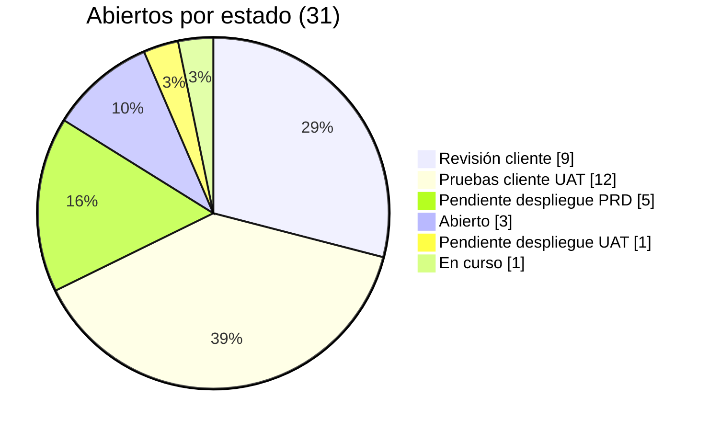

# Informe semanal BAU · del domingo 2026-11-01 al sábado 2026-11-07

## En una línea

31 abiertos · 42 creados · 50 resueltos · 2 rechazos del cliente · 5 salas atendidas

## Abiertos por estado

| Estado | Tickets |
|---|---|
| Abierto | 3 |
| En curso | 1 |
| Revisión cliente | 9 |
| Pendiente despliegue UAT | 1 |
| Pruebas cliente UAT | 12 |
| Pendiente despliegue PRD | 5 |

## Esperas en curso

| Ticket | Estado | Desde | Días |
|---|---|---|---|
| [NFQBAU-1525](02_TICKETS/Abiertos/NFQBAU-1525%20—%202026-10-15%20—%20Valores%20no%20actualizados%20Relatorio%20Estoque%20RF.md) | Revisión cliente | 2026-10-21 | 17 |
| [NFQBAU-1529](02_TICKETS/Abiertos/NFQBAU-1529%20—%202026-10-16%20—%20[ALDRIN]%20New%20extraction%20%20NavBankBalance.md) | Pruebas cliente UAT | 2026-10-21 | 17 |
| [NFQBAU-1545](02_TICKETS/Abiertos/NFQBAU-1545%20—%202026-10-20%20—%20[ALDRIN]%20Novo%20ajuste%20na%20função%20function_meg_cart_pos_fi_t.md) | Pruebas cliente UAT | 2026-10-26 | 12 |
| [NFQBAU-1550](02_TICKETS/Abiertos/NFQBAU-1550%20—%202026-10-20%20—%20[EXTERNAL]%20RES%20[Aldrin]%20ContractualClien%20extraction%20-%20Fund%20Classification%20and%20F.md) | Pruebas cliente UAT | 2026-10-28 | 10 |
| [NFQBAU-1576](02_TICKETS/Abiertos/NFQBAU-1576%20—%202026-10-27%20—%20New%20Aldrin%20Extraction%20+%20ValorizedPosition%20update%20-%20JIra%20SC-10594.md) | Pruebas cliente UAT | 2026-11-04 | 3 |
| [NFQBAU-1588](02_TICKETS/Abiertos/NFQBAU-1588%20—%202026-10-28%20—%20[EXTERNAL]%20RES%20JIRA%20SC-9861%20Campo%20código%20SubClasse%20não%20é%20preenchido%20no%20Megara.md) | Pendiente despliegue PRD | 2026-11-04 | 3 |
| [NFQBAU-1604](02_TICKETS/Abiertos/NFQBAU-1604%20—%202026-10-30%20—%20Liberação%20Carteira%20ASA%20-%20Portal.md) | Revisión cliente | 2026-11-06 | 1 |
| [NFQBAU-1622](02_TICKETS/Abiertos/NFQBAU-1622%20—%202026-11-03%20—%20[Aldrin]%20-%20InvestCompany.md) | Revisión cliente | 2026-11-06 | 1 |
| [NFQBAU-1623](02_TICKETS/Abiertos/NFQBAU-1623%20—%202026-11-03%20—%20Portal%20PRD%20Erro%20relatório%20de%20Estoque%20de%20Cotas.md) | Pruebas cliente UAT | 2026-11-06 | 1 |
| [NFQBAU-1617](02_TICKETS/Abiertos/NFQBAU-1617%20—%202026-11-03%20—%20[EXTERNAL]%20Jiras%20Packages%20in%20the%20PRE-PROD%20Environment%20-%2030102026.md) | Revisión cliente | 2026-11-06 | 1 |
| [NFQBAU-1618](02_TICKETS/Abiertos/NFQBAU-1618%20—%202026-11-03%20—%20[ALDRIN%20SALA%20DE%20PROJETOS]%20Testes%20CASHTRANSFERORDER%20-%20Pode%20entrar%20na%20sala%20de%20proj.md) | Pendiente despliegue UAT | 2026-11-06 | 1 |
| [NFQBAU-1619](02_TICKETS/Abiertos/NFQBAU-1619%20—%202026-11-03%20—%20[ALDRIN]%20CashTransferOrder%20new%20CashTransferOrder%20type%20BookToBookTransferOrder.md) | Revisión cliente | 2026-11-06 | 1 |
| [NFQBAU-1640](02_TICKETS/Abiertos/NFQBAU-1640%20—%202026-11-04%20—%20Ocorrências%20-%20Demonstrativo%20de%20Caixa%20Portal.md) | Revisión cliente | 2026-11-06 | 1 |
| [NFQBAU-1592](02_TICKETS/Abiertos/NFQBAU-1592%20—%202026-10-28%20—%20[EXTERNAL]%20Regulation%20change%20for%20non-resident%20individual%20clients%20-%20CR%20SC-9947.md) | Pendiente despliegue PRD | 2026-11-06 | 1 |
| [NFQBAU-1646](02_TICKETS/Abiertos/NFQBAU-1646%20—%202026-11-05%20—%20[ALDRIN%20BR]%20Incidencias%20Error%20Mapeo.md) | Revisión cliente | 2026-11-06 | 1 |
| [NFQBAU-1651](02_TICKETS/Abiertos/NFQBAU-1651%20—%202026-11-06%20—%20RES%20[ALDRIN]%20Novo%20ajuste%20na%20função%20function_meg_cart_pos_fu_t.md) | Revisión cliente | 2026-11-06 | 1 |
| [NFQBAU-1637](02_TICKETS/Abiertos/NFQBAU-1637%20—%202026-11-04%20—%20OTCSwap%20em%20UAT.md) | Pruebas cliente UAT | 2026-11-06 | 1 |
| [NFQBAU-1649](02_TICKETS/Abiertos/NFQBAU-1649%20—%202026-11-06%20—%20Updates%20to%20OTCSwap%20extraction%20%20SC-10631.md) | Pruebas cliente UAT | 2026-11-06 | 1 |
| [NFQBAU-1652](02_TICKETS/Abiertos/NFQBAU-1652%20—%202026-11-06%20—%20[ALDRIN]%20Novo%20ajuste%20na%20função%20function_meg_sac_pl_cl_patrfut_t.md) | Revisión cliente | 2026-11-06 | 1 |
| [NFQBAU-1597](02_TICKETS/Abiertos/NFQBAU-1597%20—%202026-10-29%20—%20[ALDRIN]%20Novo%20ajuste%20na%20função%20function_meg_cart_pos_fu_t.md) | Pruebas cliente UAT | 2026-11-07 | 0 |
| [NFQBAU-1596](02_TICKETS/Abiertos/NFQBAU-1596%20—%202026-10-29%20—%20[ALDRIN]%20Novo%20ajuste%20na%20função%20function_meg_sac_pl_cl_patrfut_t.md) | Pruebas cliente UAT | 2026-11-07 | 0 |
| [NFQBAU-1538](02_TICKETS/Abiertos/NFQBAU-1538%20—%202026-10-19%20—%20[ALDRIN]%20Novo%20ajuste%20na%20função%20function_meg_cart_pos_rf_t.md) | Pendiente despliegue PRD | 2026-11-08 | -1 |
| [NFQBAU-1662](02_TICKETS/Abiertos/NFQBAU-1662%20—%202026-11-07%20—%20[ALDRIN]%20Novo%20ajuste%20na%20função%20function_meg_sac_pl_cl_patrrf_t.md) | Pruebas cliente UAT | 2026-11-09 | -2 |
| [NFQBAU-1644](02_TICKETS/Abiertos/NFQBAU-1644%20—%202026-11-05%20—%20[ALDRIN]%20Novo%20ajuste%20na%20função%20function_meg_sac_pl_cl_patrrf_t.md) | Pruebas cliente UAT | 2026-11-09 | -2 |
| [NFQBAU-1664](02_TICKETS/Abiertos/NFQBAU-1664%20—%202026-11-07%20—%20RES%20[ALDRIN]%20Novo%20ajuste%20na%20função%20function_meg_cart_pos_rf_.md) | Pruebas cliente UAT | 2026-11-09 | -2 |
| [NFQBAU-1657](02_TICKETS/Abiertos/NFQBAU-1657%20—%202026-11-06%20—%20[ALDRIN]%20Ajuste%20na%20função%20“function_meg_sac_stat_sw_cad_t()”.md) | Pendiente despliegue PRD | 2026-11-09 | -2 |
| [NFQBAU-1658](02_TICKETS/Abiertos/NFQBAU-1658%20—%202026-11-06%20—%20[ALDRIN]%20Ajuste%20no%20mapeamento%20para%20a%20tabela%20SAC_SW2_POS%20(cart_pos_sw_t).md) | Pendiente despliegue PRD | 2026-11-09 | -2 |

## Tiempo medio en cada espera (histórico completo)

- Revisión cliente: 2.2 días
- Pendiente despliegue UAT: 4.0 días
- Pruebas cliente UAT: 0.8 días
- Pendiente despliegue PRD: 1.2 días

## Resueltos esta semana

- [NFQBAU-1522](02_TICKETS/Abiertos/NFQBAU-1522%20—%202026-10-16%20—%20Confirmação%20sobre%20carga%20de%20dados%20de%20estoque%20no%20Aldrin.md): El informe de Operaciones con Fondos de Inversión, en la sección de Movimientos, está vacío a pesar de que hay movimientos para el fondo en la fecha actual. → sin solución corta
- [NFQBAU-1527](02_TICKETS/Abiertos/NFQBAU-1527%20—%202026-10-16%20—%20Ajuste%20na%20carga%20da%20tabela%20s3_interface_control_xml_t.md): Se solicita modificar el procedimiento de carga de la tabla trf_s3.s3_interface_control_xml_t para que las inserciones y actualizaciones no dependan de la condición de conteo. → sin solución corta
- [NFQBAU-1533](02_TICKETS/Abiertos/NFQBAU-1533%20—%202026-10-19%20—%20[MEGARA%20X%20ALDRIN]%20Arquivos%20sobrando%20a%20cada%20carga%20no%20UAT.md): Archivos XML quedan pendientes o "sobrando" después de cada carga en el entorno UAT. → sin solución corta
- [NFQBAU-1535](02_TICKETS/Abiertos/NFQBAU-1535%20—%202026-10-19%20—%20Ocorrências%20-%20Demonstrativo%20de%20Caixa%20Portal.md): El informe "Demonstrativo de Caixa Portal" muestra un saldo final incorrecto para el cliente SAM por la mañana, que luego se corrige automáticamente. → sin solución corta
- [NFQBAU-1543](02_TICKETS/Abiertos/NFQBAU-1543%20—%202026-10-20%20—%20Ingresso%20e%20Retirada%20-%20Ajuste%20na%20API.md): Seguimiento pendiente de respuesta sobre el ajuste solicitado para la API de BancoAgenciaConta. → sin solución corta
- [NFQBAU-1546](02_TICKETS/Abiertos/NFQBAU-1546%20—%202026-10-20%20—%20[ALDRIN]%20Novo%20ajuste%20na%20função%20function_meg_sac_pl_cl_patrfi_t.md): La función function_meg_sac_pl_cl_patrfi_t está calculando incorrectamente la diferencia de segundos dentro del mismo procesamiento al usar la fecha y hora de actualización en lugar del número de procesamiento. → Se ajustó la lógica de la función para usar cod_valprocs en lugar de dat_update para identificar el procesamiento.
- [NFQBAU-1554](02_TICKETS/Abiertos/NFQBAU-1554%20—%202026-10-21%20—%20Monitoramento%20do%20problema%20de%20saldo%20-%20Fundo%20SAM.md): El saldo del día no se muestra de forma intermitente en el informe Demonstrativo de Caixa para el fondo SAM. → Se implementó una optimización de rendimiento en el informe para reducir el tiempo de carga y reflejar datos actualizados.
- [NFQBAU-1569](02_TICKETS/Abiertos/NFQBAU-1569%20—%202026-10-23%20—%20Solicitação%20de%20Querry%20[DC%20CCF].md): Se solicita la query utilizada para generar informes. → sin solución corta
- [NFQBAU-1574](02_TICKETS/Abiertos/NFQBAU-1574%20—%202026-10-26%20—%20[MEGARA%20X%20ALDRIN]%20Last%20up%20to%20date%20XSD%20-%20CashTransferOrder%20and%20an%20XML%20as%20example.md): Diferencias en la capitalización de etiquetas entre el esquema XSD y el archivo XML en CashTransferOrder. → sin solución corta
- [NFQBAU-1580](02_TICKETS/Abiertos/NFQBAU-1580%20—%202026-10-27%20—%20[Aldrin%20Br]%20Melhoria%20no%20sistema%20de%20tickets%20NFQ.md): El informe semanal de tickets no se ha recibido ni el lunes pasado ni ayer. → sin solución corta
- [NFQBAU-1584](02_TICKETS/Abiertos/NFQBAU-1584%20—%202026-10-27%20—%20[ALDRIN%20BR]%20Incidência%20Saldos.md): Presencia de registros duplicados de saldos para un mismo cliente y fecha en la tabla cart_caixa_saldo_t. → sin solución corta
- [NFQBAU-1585](02_TICKETS/Abiertos/NFQBAU-1585%20—%202026-10-28%20—%20[EXTERNAL]%20[MEGARA%20X%20ALDRIN]%20PRD%20CONTRACTUAL%20CLIENT%20-%20Issue%20XML%20vs%20XSD.md): Discrepancia entre el archivo XML y el esquema XSD de ContractualClient respecto al campo dateOfBirth. → Se aclaró que la modificación responde a un requisito legal de INR implementado en producción desde el 25 de junio.
- [NFQBAU-1586](02_TICKETS/Abiertos/NFQBAU-1586%20—%202026-10-28%20—%20[EXTERNAL]%20[MEGARA%20X%20ALDRIN]%20PROD%20Unit%20XML%20different%20from%20current%20XSD%20in%20ALDRIN.md): Diferencia de esquema en la integración de Unit entre MEGARA y ALDRIN por la inclusión del campo cvmCode no mapeado en el XSD. → sin solución corta
- [NFQBAU-1587](02_TICKETS/Abiertos/NFQBAU-1587%20—%202026-10-28%20—%20[EXT]%20Re%20[EXTERNAL]%20Regulation%20change%20for%20non-resident%20individual%20clients%20-%20CR.md): Consulta sobre la promoción al entorno de producción de la interfaz ContractualClient. → sin solución corta
- [NFQBAU-1590](02_TICKETS/Abiertos/NFQBAU-1590%20—%202026-10-28%20—%20[EXTERNAL]%20Aldrin%20-%20SWAP%20-%20Jira%20SC-10631%20-%20Novos%20campos%20na%20extração%20OTCSWAP.md): La extracción "OTCSWAP" no incluye los campos "basis" e "interestRate" necesarios para el producto Swap. → Se solicitó poner la demanda On Hold a la espera de un nuevo XSD.
- [NFQBAU-1591](02_TICKETS/Abiertos/NFQBAU-1591%20—%202026-10-28%20—%20[MEGARA%20X%20ALDRIN]%20Arquivo%20XML%20RefRatePrice.md): Se solicita la evaluación de un archivo XML de ReferenceRatePrice. → sin solución corta
- [NFQBAU-1598](02_TICKETS/Abiertos/NFQBAU-1598%20—%202026-10-29%20—%20Pode%20entrar%20em%20WR%20P1.md): Convocatoria a una War Room P1 para tratar un despliegue. → sin solución corta
- [NFQBAU-1599](02_TICKETS/Abiertos/NFQBAU-1599%20—%202026-10-29%20—%20[MEGARA%20X%20ALDRIN]%20Implantação%20de%20artefatos%20em%20PRD%20com%20acompanhamento.md): Se requiere la implantación de artefactos de la carga ALDRIN en el entorno de Producción. → Se implantaron los artefactos de la carga ALDRIN en Producción y se reanudaron las cargas con éxito.
- [NFQBAU-1600](02_TICKETS/Abiertos/NFQBAU-1600%20—%202026-10-29%20—%20[ALDRIN]%20Ajuste%20na%20função%20function_meg_sac_regul_cl_conta_corr_t%20que%20carrega%20a.md): La función function_meg_sac_regul_cl_conta_corr_t necesita ser modificada para registrar correctamente el campo COD_INT_EXT en la tabla SAC_CL_CONTA_CORRENTE. → Se ajustó la función de base de datos para registrar correctamente el campo COD_INT_EXT.
- [NFQBAU-1601](02_TICKETS/Abiertos/NFQBAU-1601%20—%202026-10-29%20—%20[ALDRIN%20BR]%20-%20Cargas%20Interfaces.md): Posible fallo en la ejecución de la carga de la interfaz de Unit. → sin solución corta
- [NFQBAU-1602](02_TICKETS/Abiertos/NFQBAU-1602%20—%202026-10-29%20—%20[ALDRIN]%20Novo%20Ajuste%20na%20função%20cs_cli_cash_account_transf_pc.md): Confirmación del ticket S3C-22985 para la implementación en Producción de un ajuste en la función cs_cli_cash_account_transf_pc. → sin solución corta
- [NFQBAU-1603](02_TICKETS/Abiertos/NFQBAU-1603%20—%202026-10-30%20—%20[Aldrin]%20Incidencias%20cargas%20PRD%20Reload.md): Encolamiento de archivos en los procesos de carga. → sin solución corta
- [NFQBAU-1605](02_TICKETS/Abiertos/NFQBAU-1605%20—%202026-10-30%20—%20Bom%20dia..md): Solicitud de entrada del equipo de soporte en la gestión de una incidencia crítica P0. → sin solución corta
- [NFQBAU-1606](02_TICKETS/Abiertos/NFQBAU-1606%20—%202026-10-30%20—%20Podem%20entrar%20na%20sala%20de%20projetos%20Referente%20a%20um%20erro%20de%20clientinstruction%20em%20UA.md): Fallo en la carga de datos del fichero clientInstruction en UAT, mostrando errores de formato y de tabla de datos. → Se corrigió el error de formato en el fichero de carga de datos clientInstruction en el entorno UAT.
- [NFQBAU-1608](02_TICKETS/Abiertos/NFQBAU-1608%20—%202026-10-30%20—%20Entrar%20na%20sala%20WR%20P1.md): Solicitud de asistencia a una sala de crisis (War Room P1) sin especificar el sistema o fallo concreto. → sin solución corta
- [NFQBAU-1609](02_TICKETS/Abiertos/NFQBAU-1609%20—%202026-10-30%20—%20[Implantação%20Megara]Suporte%20Fim%20Semana.md): Se solicita disponibilidad de soporte para una implantación. → sin solución corta
- [NFQBAU-1610](02_TICKETS/Abiertos/NFQBAU-1610%20—%202026-10-30%20—%20Erro%20validação%20ClientInstruction%20-%20UAT.md): Fallo en la validación y carga de ClientInstruction debido a la calidad de los datos en los campos SecurityCode y MaturityAmount. → Remisión de versión corregida de los XML descartando los registros conflictivos.
- [NFQBAU-1611](02_TICKETS/Abiertos/NFQBAU-1611%20—%202026-10-31%20—%20[Implantação]%20Plantão%20NFQ.md): El proceso de consumo de clientInstruction dejó de ejecutarse correctamente en el mapeo, afectando al flujo esperado. → sin solución corta
- [NFQBAU-1612](02_TICKETS/Abiertos/NFQBAU-1612%20—%202026-10-31%20—%20[JIRA]%20[JIRA]%20(SC-9009)%20Create%20field%20in%20FIDIC%20operation%20-%20RISK.md): Se solicita la ejecución de código SQL y la actualización de un archivo XSD para añadir nuevos campos a la base de datos del sistema ALDRIN. → sin solución corta
- [NFQBAU-1613](02_TICKETS/Abiertos/NFQBAU-1613%20—%202026-11-01%20—%20Upgrade%20versão%20Postgres%20-%20Megara%20e%20Qlik.md): No se reciben cargas de datos en el sistema Aldrin tras el procesamiento en Megara. → sin solución corta
- [NFQBAU-1614](02_TICKETS/Abiertos/NFQBAU-1614%20—%202026-11-03%20—%20Updates%20to%20OTCSwap%20extraction%20%20SC-10631.md): Actualización de la extracción de OTCSwap pendiente de aplicar en la actividad detenida. → Se recibieron los ficheros actualizados de Vermeg para reanudar la extracción de OTCSwap.
- [NFQBAU-1615](02_TICKETS/Abiertos/NFQBAU-1615%20—%202026-11-03%20—%20Demonstrativo%20de%20Caixa%20CUST4040.md): Solicitud de extracción del informe demostrativo de caja CUST4040 en formato PDF o Excel. → sin solución corta
- [NFQBAU-1616](02_TICKETS/Abiertos/NFQBAU-1616%20—%202026-11-03%20—%20Extração%20de%20Relatórios%20-%20Demonstrativo%20de%20Caixa%20(jul26)%20%20Tokio%20Marine.md): El informe de Demonstrativo de Caixa no presenta datos desde julio de 2026 para el cliente CUST2337. → sin solución corta
- [NFQBAU-1620](02_TICKETS/Abiertos/NFQBAU-1620%20—%202026-11-03%20—%20[ALDRIN]%20-%20Houve%20errors%20no%20mapeamento%20de%20PRD.md): La ejecución del job de Rundeck 'Job control errores mapeo' en el proyecto Aldrin-Megara ha fallado en producción. → sin solución corta
- [NFQBAU-1624](02_TICKETS/Abiertos/NFQBAU-1624%20—%202026-11-04%20—%20[ALDRIN%20BR]%20-%20Query%20Batimento.md): Se solicita una query de batimento. → Se entregó una consulta SQL para realizar el batimento de datos solicitado.
- [NFQBAU-1638](02_TICKETS/Abiertos/NFQBAU-1638%20—%202026-11-04%20—%20RES%20Re%20OTCSwap%20em%20UAT.md): Confirmación y coordinación para las entregas del XSD de OTCSwap, ajuste de tabla y soporte de migración en UAT. → Duplicado: el hilo se sigue en NFQBAU-1637
- [NFQBAU-1639](02_TICKETS/Abiertos/NFQBAU-1639%20—%202026-11-04%20—%20Dúvida%20de%20relatórios.md): Consulta sobre el plazo máximo para generar informes Qlik → Se aclaró que el límite para generar informes Qlik es de 200 días y se indicó que puede ampliarse.
- [NFQBAU-1641](02_TICKETS/Abiertos/NFQBAU-1641%20—%202026-11-05%20—%20[Aldrin%20Br]%20-%20Incidencia%20MEG_DEPLEDREQ_T.md): Se ha encontrado un error en una llamada de proceso a nivel STG relacionado con la tabla MEG_DEPLEDREQ_T durante una ejecución de Rundeck. → sin solución corta
- [NFQBAU-1642](02_TICKETS/Abiertos/NFQBAU-1642%20—%202026-11-05%20—%20[ALDRIN%20BR]%20Nuevos%20Excedidos%20-%20Incidências%20cargas%20PRD.md): Archivos de interfaz exceden su tamaño medio histórico en producción. → sin solución corta
- [NFQBAU-1645](02_TICKETS/Abiertos/NFQBAU-1645%20—%202026-11-05%20—%20Solicitação%20para%20entrar%20no%20P0.md): Solicitud de acceso o ingreso a la sala/reunión de incidencia P0. → sin solución corta
- [NFQBAU-1647](02_TICKETS/Abiertos/NFQBAU-1647%20—%202026-11-06%20—%20[EXT][Aldrin]%20Servidor%20UAT.md): Los servicios de Rundeck UAT y Rundeck DEV requieren permanecer activos fuera de su programación habitual. → Se encendieron los servidores de Rundeck UAT y Rundeck DEV según lo solicitado.
- [NFQBAU-1648](02_TICKETS/Abiertos/NFQBAU-1648%20—%202026-11-06%20—%20[ALDRIN%20BR]%20Nuevos%20Excedidos%20-%20Incidências%20cargas%20PRD.md): Múltiples cargas de archivos de interfaz XML superan el tamaño promedio histórico en producción. → sin solución corta
- [NFQBAU-1650](02_TICKETS/Abiertos/NFQBAU-1650%20—%202026-11-06%20—%20Sin%20asunto.md): Sin asunto → sin solución corta
- [NFQBAU-1653](02_TICKETS/Abiertos/NFQBAU-1653%20—%202026-11-06%20—%20[ALDRIN]%20Novo%20ajuste%20na%20função%20function_meg_cart_pos_rf_t.md): [ALDRIN] Novo ajuste na função function_meg_cart_pos_rf_t → sin solución corta
- [NFQBAU-1654](02_TICKETS/Abiertos/NFQBAU-1654%20—%202026-11-06%20—%20[Migração%20Fundos%20Apollo]Suporte%20NFQ%20Fim%20Semana%20-%2008Nov.md): No hay fallo técnico reportado, se solicita disponibilidad de soporte para una migración. → Se confirmó la disponibilidad de soporte técnico para la migración planificada.
- [NFQBAU-1655](02_TICKETS/Abiertos/NFQBAU-1655%20—%202026-11-06%20—%20[ALDRIN]%20Novo%20ajuste%20na%20função%20function_meg_sac_pl_cl_patrrf_t.md): [ALDRIN] Novo ajuste na função function_meg_sac_pl_cl_patrrf_t → sin solución corta
- [NFQBAU-1656](02_TICKETS/Abiertos/NFQBAU-1656%20—%202026-11-06%20—%20[Migração%20Fundos%20Apollo]Suporte%20NFQ%20Fim%20Semana%20-%2007%20e%2008Nov.md): Se solicita soporte técnico adicional para el fin de semana de la migración de fondos. → Se coordinó y programó el soporte técnico adicional para el sábado y domingo durante la migración.
- [NFQBAU-1659](02_TICKETS/Abiertos/NFQBAU-1659%20—%202026-11-06%20—%20Carga%20do%20arquivo%20“AdditionalDerivativePrice.XML”.md): El archivo AdditionalDerivativePrice.XML no está siendo consumido por la carga automática. → sin solución corta
- [NFQBAU-1661](02_TICKETS/Abiertos/NFQBAU-1661%20—%202026-11-07%20—%20Entrar%20na%20sala%20de%20PROJETOS.md): Ninguno; no se reporta ningún fallo técnico ni error de sistema. → sin solución corta
- [NFQBAU-1665](02_TICKETS/Abiertos/NFQBAU-1665%20—%202026-11-07%20—%20Entrar%20na%20sala%20de%20PROJETOS.md): No se indica ningún fallo en informes, jobs, tablas ni pantallas; se solicita ingresar a una sala de reuniones. → sin solución corta

## Creados esta semana

- [NFQBAU-1613](02_TICKETS/Abiertos/NFQBAU-1613%20—%202026-11-01%20—%20Upgrade%20versão%20Postgres%20-%20Megara%20e%20Qlik.md): Upgrade versão Postgres - Megara e Qlik
- [NFQBAU-1614](02_TICKETS/Abiertos/NFQBAU-1614%20—%202026-11-03%20—%20Updates%20to%20OTCSwap%20extraction%20%20SC-10631.md): Updates to OTCSwap extraction  SC-10631
- [NFQBAU-1615](02_TICKETS/Abiertos/NFQBAU-1615%20—%202026-11-03%20—%20Demonstrativo%20de%20Caixa%20CUST4040.md): Demonstrativo de Caixa CUST4040
- [NFQBAU-1616](02_TICKETS/Abiertos/NFQBAU-1616%20—%202026-11-03%20—%20Extração%20de%20Relatórios%20-%20Demonstrativo%20de%20Caixa%20(jul26)%20%20Tokio%20Marine.md): Extração de Relatórios - Demonstrativo de Caixa (jul26)  Tokio Marine
- [NFQBAU-1617](02_TICKETS/Abiertos/NFQBAU-1617%20—%202026-11-03%20—%20[EXTERNAL]%20Jiras%20Packages%20in%20the%20PRE-PROD%20Environment%20-%2030102026.md): [EXTERNAL] Jiras Packages in the PRE-PROD Environment - 30102026
- [NFQBAU-1618](02_TICKETS/Abiertos/NFQBAU-1618%20—%202026-11-03%20—%20[ALDRIN%20SALA%20DE%20PROJETOS]%20Testes%20CASHTRANSFERORDER%20-%20Pode%20entrar%20na%20sala%20de%20proj.md): [ALDRIN SALA DE PROJETOS] Testes CASHTRANSFERORDER - Pode entrar na sala de proj
- [NFQBAU-1619](02_TICKETS/Abiertos/NFQBAU-1619%20—%202026-11-03%20—%20[ALDRIN]%20CashTransferOrder%20new%20CashTransferOrder%20type%20BookToBookTransferOrder.md): [ALDRIN] CashTransferOrder new CashTransferOrder type BookToBookTransferOrder
- [NFQBAU-1620](02_TICKETS/Abiertos/NFQBAU-1620%20—%202026-11-03%20—%20[ALDRIN]%20-%20Houve%20errors%20no%20mapeamento%20de%20PRD.md): [ALDRIN] - Houve errors no mapeamento de PRD
- [NFQBAU-1621](02_TICKETS/Abiertos/NFQBAU-1621%20—%202026-11-03%20—%20Incidente%20FundEncerramento.md): Incidente FundEncerramento
- [NFQBAU-1622](02_TICKETS/Abiertos/NFQBAU-1622%20—%202026-11-03%20—%20[Aldrin]%20-%20InvestCompany.md): [Aldrin] - InvestCompany
- [NFQBAU-1623](02_TICKETS/Abiertos/NFQBAU-1623%20—%202026-11-03%20—%20Portal%20PRD%20Erro%20relatório%20de%20Estoque%20de%20Cotas.md): Portal PRD Erro relatório de Estoque de Cotas
- [NFQBAU-1624](02_TICKETS/Abiertos/NFQBAU-1624%20—%202026-11-04%20—%20[ALDRIN%20BR]%20-%20Query%20Batimento.md): [ALDRIN BR] - Query Batimento
- [NFQBAU-1637](02_TICKETS/Abiertos/NFQBAU-1637%20—%202026-11-04%20—%20OTCSwap%20em%20UAT.md): OTCSwap em UAT
- [NFQBAU-1638](02_TICKETS/Abiertos/NFQBAU-1638%20—%202026-11-04%20—%20RES%20Re%20OTCSwap%20em%20UAT.md): RES Re OTCSwap em UAT
- [NFQBAU-1639](02_TICKETS/Abiertos/NFQBAU-1639%20—%202026-11-04%20—%20Dúvida%20de%20relatórios.md): Dúvida de relatórios
- [NFQBAU-1640](02_TICKETS/Abiertos/NFQBAU-1640%20—%202026-11-04%20—%20Ocorrências%20-%20Demonstrativo%20de%20Caixa%20Portal.md): Ocorrências - Demonstrativo de Caixa Portal
- [NFQBAU-1641](02_TICKETS/Abiertos/NFQBAU-1641%20—%202026-11-05%20—%20[Aldrin%20Br]%20-%20Incidencia%20MEG_DEPLEDREQ_T.md): [Aldrin Br] - Incidencia MEG_DEPLEDREQ_T
- [NFQBAU-1642](02_TICKETS/Abiertos/NFQBAU-1642%20—%202026-11-05%20—%20[ALDRIN%20BR]%20Nuevos%20Excedidos%20-%20Incidências%20cargas%20PRD.md): [ALDRIN BR] Nuevos Excedidos - Incidências cargas PRD
- [NFQBAU-1643](02_TICKETS/Abiertos/NFQBAU-1643%20—%202026-11-05%20—%20ETF%20-%20Relatório%20de%20Operações%20RF.md): ETF - Relatório de Operações RF
- [NFQBAU-1644](02_TICKETS/Abiertos/NFQBAU-1644%20—%202026-11-05%20—%20[ALDRIN]%20Novo%20ajuste%20na%20função%20function_meg_sac_pl_cl_patrrf_t.md): [ALDRIN] Novo ajuste na função function_meg_sac_pl_cl_patrrf_t
- [NFQBAU-1645](02_TICKETS/Abiertos/NFQBAU-1645%20—%202026-11-05%20—%20Solicitação%20para%20entrar%20no%20P0.md): Solicitação para entrar no P0
- [NFQBAU-1646](02_TICKETS/Abiertos/NFQBAU-1646%20—%202026-11-05%20—%20[ALDRIN%20BR]%20Incidencias%20Error%20Mapeo.md): [ALDRIN BR] Incidencias Error Mapeo
- [NFQBAU-1647](02_TICKETS/Abiertos/NFQBAU-1647%20—%202026-11-06%20—%20[EXT][Aldrin]%20Servidor%20UAT.md): [EXT][Aldrin] Servidor UAT
- [NFQBAU-1648](02_TICKETS/Abiertos/NFQBAU-1648%20—%202026-11-06%20—%20[ALDRIN%20BR]%20Nuevos%20Excedidos%20-%20Incidências%20cargas%20PRD.md): [ALDRIN BR] Nuevos Excedidos - Incidências cargas PRD
- [NFQBAU-1649](02_TICKETS/Abiertos/NFQBAU-1649%20—%202026-11-06%20—%20Updates%20to%20OTCSwap%20extraction%20%20SC-10631.md): Updates to OTCSwap extraction  SC-10631
- [NFQBAU-1650](02_TICKETS/Abiertos/NFQBAU-1650%20—%202026-11-06%20—%20Sin%20asunto.md): Sin asunto
- [NFQBAU-1651](02_TICKETS/Abiertos/NFQBAU-1651%20—%202026-11-06%20—%20RES%20[ALDRIN]%20Novo%20ajuste%20na%20função%20function_meg_cart_pos_fu_t.md): RES [ALDRIN] Novo ajuste na função function_meg_cart_pos_fu_t
- [NFQBAU-1652](02_TICKETS/Abiertos/NFQBAU-1652%20—%202026-11-06%20—%20[ALDRIN]%20Novo%20ajuste%20na%20função%20function_meg_sac_pl_cl_patrfut_t.md): [ALDRIN] Novo ajuste na função function_meg_sac_pl_cl_patrfut_t
- [NFQBAU-1653](02_TICKETS/Abiertos/NFQBAU-1653%20—%202026-11-06%20—%20[ALDRIN]%20Novo%20ajuste%20na%20função%20function_meg_cart_pos_rf_t.md): [ALDRIN] Novo ajuste na função function_meg_cart_pos_rf_t
- [NFQBAU-1654](02_TICKETS/Abiertos/NFQBAU-1654%20—%202026-11-06%20—%20[Migração%20Fundos%20Apollo]Suporte%20NFQ%20Fim%20Semana%20-%2008Nov.md): [Migração Fundos Apollo]Suporte NFQ Fim Semana - 08Nov
- [NFQBAU-1655](02_TICKETS/Abiertos/NFQBAU-1655%20—%202026-11-06%20—%20[ALDRIN]%20Novo%20ajuste%20na%20função%20function_meg_sac_pl_cl_patrrf_t.md): [ALDRIN] Novo ajuste na função function_meg_sac_pl_cl_patrrf_t
- [NFQBAU-1656](02_TICKETS/Abiertos/NFQBAU-1656%20—%202026-11-06%20—%20[Migração%20Fundos%20Apollo]Suporte%20NFQ%20Fim%20Semana%20-%2007%20e%2008Nov.md): [Migração Fundos Apollo]Suporte NFQ Fim Semana - 07 e 08Nov
- [NFQBAU-1657](02_TICKETS/Abiertos/NFQBAU-1657%20—%202026-11-06%20—%20[ALDRIN]%20Ajuste%20na%20função%20“function_meg_sac_stat_sw_cad_t()”.md): [ALDRIN] Ajuste na função “function_meg_sac_stat_sw_cad_t()”
- [NFQBAU-1658](02_TICKETS/Abiertos/NFQBAU-1658%20—%202026-11-06%20—%20[ALDRIN]%20Ajuste%20no%20mapeamento%20para%20a%20tabela%20SAC_SW2_POS%20(cart_pos_sw_t).md): [ALDRIN] Ajuste no mapeamento para a tabela SAC_SW2_POS (cart_pos_sw_t)
- [NFQBAU-1659](02_TICKETS/Abiertos/NFQBAU-1659%20—%202026-11-06%20—%20Carga%20do%20arquivo%20“AdditionalDerivativePrice.XML”.md): Carga do arquivo “AdditionalDerivativePrice.XML”
- [NFQBAU-1660](02_TICKETS/Abiertos/NFQBAU-1660%20—%202026-11-06%20—%20Carga%20do%20arquivo%20“AdditionalDerivativePrice.XML”.md): Carga do arquivo “AdditionalDerivativePrice.XML”
- [NFQBAU-1661](02_TICKETS/Abiertos/NFQBAU-1661%20—%202026-11-07%20—%20Entrar%20na%20sala%20de%20PROJETOS.md): Entrar na sala de PROJETOS
- [NFQBAU-1662](02_TICKETS/Abiertos/NFQBAU-1662%20—%202026-11-07%20—%20[ALDRIN]%20Novo%20ajuste%20na%20função%20function_meg_sac_pl_cl_patrrf_t.md): [ALDRIN] Novo ajuste na função function_meg_sac_pl_cl_patrrf_t
- [NFQBAU-1663](02_TICKETS/Abiertos/NFQBAU-1663%20—%202026-11-07%20—%20[ALDRIN]%20Mapeamento%20para%20a%20tabela%20SAC_SW2_MOV%20(sac_mov_sw2_t).md): [ALDRIN] Mapeamento para a tabela SAC_SW2_MOV (sac_mov_sw2_t)
- [NFQBAU-1664](02_TICKETS/Abiertos/NFQBAU-1664%20—%202026-11-07%20—%20RES%20[ALDRIN]%20Novo%20ajuste%20na%20função%20function_meg_cart_pos_rf_.md): RES [ALDRIN] Novo ajuste na função function_meg_cart_pos_rf_
- [NFQBAU-1665](02_TICKETS/Abiertos/NFQBAU-1665%20—%202026-11-07%20—%20Entrar%20na%20sala%20de%20PROJETOS.md): Entrar na sala de PROJETOS
- [NFQBAU-1666](02_TICKETS/Abiertos/NFQBAU-1666%20—%202026-11-07%20—%20OTCSwap%20em%20PRD.md): OTCSwap em PRD

## Foto para el cliente

### Resueltos

| Id | Asunto | Resuelto el | Días |
|---|---|---|---|
| NFQBAU-1522 | Confirmação sobre carga de dados de estoque no Aldrin | 2026-11-04 | 19 |
| NFQBAU-1527 | Ajuste na carga da tabela s3_interface_control_xml_t | 2026-11-06 | 21 |
| NFQBAU-1533 | [MEGARA X ALDRIN] Arquivos sobrando a cada carga no UAT | 2026-11-04 | 16 |
| NFQBAU-1535 | Ocorrências - Demonstrativo de Caixa Portal | 2026-11-04 | 16 |
| NFQBAU-1543 | Ingresso e Retirada - Ajuste na API | 2026-11-04 | 15 |
| NFQBAU-1546 | [ALDRIN] Novo ajuste na função function_meg_sac_pl_cl_patrfi_t | 2026-11-04 | 15 |
| NFQBAU-1554 | Monitoramento do problema de saldo - Fundo SAM | 2026-11-04 | 14 |
| NFQBAU-1569 | Solicitação de Querry [DC CCF] | 2026-11-05 | 13 |
| NFQBAU-1574 | [MEGARA X ALDRIN] Last up to date XSD - CashTransferOrder and an XML as example | 2026-11-04 | 9 |
| NFQBAU-1580 | [Aldrin Br] Melhoria no sistema de tickets NFQ | 2026-11-04 | 8 |
| NFQBAU-1584 | [ALDRIN BR] Incidência Saldos | 2026-11-05 | 9 |
| NFQBAU-1585 | [EXTERNAL] [MEGARA X ALDRIN] PRD CONTRACTUAL CLIENT - Issue XML vs XSD | 2026-11-04 | 7 |
| NFQBAU-1586 | [EXTERNAL] [MEGARA X ALDRIN] PROD Unit XML different from current XSD in ALDRIN | 2026-11-04 | 7 |
| NFQBAU-1587 | [EXT] Re [EXTERNAL] Regulation change for non-resident individual clients - CR | 2026-11-04 | 7 |
| NFQBAU-1590 | [EXTERNAL] Aldrin - SWAP - Jira SC-10631 - Novos campos na extração OTCSWAP | 2026-11-06 | 9 |
| NFQBAU-1591 | [MEGARA X ALDRIN] Arquivo XML RefRatePrice | 2026-11-04 | 7 |
| NFQBAU-1598 | Pode entrar em WR P1 | 2026-11-03 | 5 |
| NFQBAU-1599 | [MEGARA X ALDRIN] Implantação de artefatos em PRD com acompanhamento | 2026-11-04 | 6 |
| NFQBAU-1600 | [ALDRIN] Ajuste na função function_meg_sac_regul_cl_conta_corr_t que carrega a | 2026-11-06 | 8 |
| NFQBAU-1601 | [ALDRIN BR] - Cargas Interfaces | 2026-11-03 | 5 |
| NFQBAU-1602 | [ALDRIN] Novo Ajuste na função cs_cli_cash_account_transf_pc | 2026-11-03 | 5 |
| NFQBAU-1603 | [Aldrin] Incidencias cargas PRD Reload | 2026-11-03 | 4 |
| NFQBAU-1605 | Bom dia. | 2026-11-03 | 4 |
| NFQBAU-1606 | Podem entrar na sala de projetos Referente a um erro de clientinstruction em UA | 2026-11-04 | 5 |
| NFQBAU-1608 | Entrar na sala WR P1 | 2026-11-03 | 4 |
| NFQBAU-1609 | [Implantação Megara]Suporte Fim Semana | 2026-11-03 | 4 |
| NFQBAU-1610 | Erro validação ClientInstruction - UAT | 2026-11-05 | 6 |
| NFQBAU-1611 | [Implantação] Plantão NFQ | 2026-11-03 | 3 |
| NFQBAU-1612 | [JIRA] [JIRA] (SC-9009) Create field in FIDIC operation - RISK | 2026-11-03 | 3 |
| NFQBAU-1613 | Upgrade versão Postgres - Megara e Qlik | 2026-11-03 | 2 |
| NFQBAU-1614 | Updates to OTCSwap extraction  SC-10631 | 2026-11-06 | 3 |
| NFQBAU-1615 | Demonstrativo de Caixa CUST4040 | 2026-11-03 | 0 |
| NFQBAU-1616 | Extração de Relatórios - Demonstrativo de Caixa (jul26)  Tokio Marine | 2026-11-05 | 2 |
| NFQBAU-1620 | [ALDRIN] - Houve errors no mapeamento de PRD | 2026-11-05 | 2 |
| NFQBAU-1624 | [ALDRIN BR] - Query Batimento | 2026-11-04 | 0 |
| NFQBAU-1638 | RES Re OTCSwap em UAT | 2026-11-06 | 2 |
| NFQBAU-1639 | Dúvida de relatórios | 2026-11-05 | 1 |
| NFQBAU-1641 | [Aldrin Br] - Incidencia MEG_DEPLEDREQ_T | 2026-11-06 | 1 |
| NFQBAU-1642 | [ALDRIN BR] Nuevos Excedidos - Incidências cargas PRD | 2026-11-05 | 0 |
| NFQBAU-1645 | Solicitação para entrar no P0 | 2026-11-05 | 0 |
| NFQBAU-1647 | [EXT][Aldrin] Servidor UAT | 2026-11-06 | 0 |
| NFQBAU-1648 | [ALDRIN BR] Nuevos Excedidos - Incidências cargas PRD | 2026-11-06 | 0 |
| NFQBAU-1650 | Sin asunto | 2026-11-06 | 0 |
| NFQBAU-1653 | [ALDRIN] Novo ajuste na função function_meg_cart_pos_rf_t | 2026-11-06 | 0 |
| NFQBAU-1654 | [Migração Fundos Apollo]Suporte NFQ Fim Semana - 08Nov | 2026-11-06 | 0 |
| NFQBAU-1655 | [ALDRIN] Novo ajuste na função function_meg_sac_pl_cl_patrrf_t | 2026-11-06 | 0 |
| NFQBAU-1656 | [Migração Fundos Apollo]Suporte NFQ Fim Semana - 07 e 08Nov | 2026-11-06 | 0 |
| NFQBAU-1659 | Carga do arquivo “AdditionalDerivativePrice.XML” | 2026-11-06 | 0 |
| NFQBAU-1661 | Entrar na sala de PROJETOS | 2026-11-07 | 0 |
| NFQBAU-1665 | Entrar na sala de PROJETOS | 2026-11-07 | 0 |

### Pendientes a 2026-11-07

| Id | Asunto | Estado | Días abierto |
|---|---|---|---|
| NFQBAU-1525 | Valores no actualizados Relatorio Estoque RF | Revisión cliente | 23 |
| NFQBAU-1529 | [ALDRIN] New extraction  NavBankBalance | Pruebas cliente UAT | 22 |
| NFQBAU-1538 | [ALDRIN] Novo ajuste na função function_meg_cart_pos_rf_t | Pendiente despliegue PRD | 19 |
| NFQBAU-1545 | [ALDRIN] Novo ajuste na função function_meg_cart_pos_fi_t | Pruebas cliente UAT | 18 |
| NFQBAU-1550 | [EXTERNAL] RES [Aldrin] ContractualClien extraction - Fund Classification and F | Pruebas cliente UAT | 18 |
| NFQBAU-1576 | New Aldrin Extraction + ValorizedPosition update - JIra SC-10594 | Pruebas cliente UAT | 11 |
| NFQBAU-1577 | PORTAL  Incluir o código ISIN nos lastros das operações listadas no relatório D | Abierto | 11 |
| NFQBAU-1588 | [EXTERNAL] RES JIRA SC-9861 Campo código SubClasse não é preenchido no Megara | Pendiente despliegue PRD | 10 |
| NFQBAU-1592 | [EXTERNAL] Regulation change for non-resident individual clients - CR SC-9947 | Pendiente despliegue PRD | 10 |
| NFQBAU-1596 | [ALDRIN] Novo ajuste na função function_meg_sac_pl_cl_patrfut_t | Pruebas cliente UAT | 9 |
| NFQBAU-1597 | [ALDRIN] Novo ajuste na função function_meg_cart_pos_fu_t | Pruebas cliente UAT | 9 |
| NFQBAU-1604 | Liberação Carteira ASA - Portal | Revisión cliente | 8 |
| NFQBAU-1617 | [EXTERNAL] Jiras Packages in the PRE-PROD Environment - 30102026 | Revisión cliente | 4 |
| NFQBAU-1618 | [ALDRIN SALA DE PROJETOS] Testes CASHTRANSFERORDER - Pode entrar na sala de proj | Pendiente despliegue UAT | 4 |
| NFQBAU-1619 | [ALDRIN] CashTransferOrder new CashTransferOrder type BookToBookTransferOrder | Revisión cliente | 4 |
| NFQBAU-1622 | [Aldrin] - InvestCompany | Revisión cliente | 4 |
| NFQBAU-1623 | Portal PRD Erro relatório de Estoque de Cotas | Pruebas cliente UAT | 4 |
| NFQBAU-1637 | OTCSwap em UAT | Pruebas cliente UAT | 3 |
| NFQBAU-1640 | Ocorrências - Demonstrativo de Caixa Portal | Revisión cliente | 3 |
| NFQBAU-1643 | ETF - Relatório de Operações RF | En curso | 2 |
| NFQBAU-1644 | [ALDRIN] Novo ajuste na função function_meg_sac_pl_cl_patrrf_t | Pruebas cliente UAT | 2 |
| NFQBAU-1646 | [ALDRIN BR] Incidencias Error Mapeo | Revisión cliente | 2 |
| NFQBAU-1649 | Updates to OTCSwap extraction  SC-10631 | Pruebas cliente UAT | 1 |
| NFQBAU-1651 | RES [ALDRIN] Novo ajuste na função function_meg_cart_pos_fu_t | Revisión cliente | 1 |
| NFQBAU-1652 | [ALDRIN] Novo ajuste na função function_meg_sac_pl_cl_patrfut_t | Revisión cliente | 1 |
| NFQBAU-1657 | [ALDRIN] Ajuste na função “function_meg_sac_stat_sw_cad_t()” | Pendiente despliegue PRD | 1 |
| NFQBAU-1658 | [ALDRIN] Ajuste no mapeamento para a tabela SAC_SW2_POS (cart_pos_sw_t) | Pendiente despliegue PRD | 1 |
| NFQBAU-1662 | [ALDRIN] Novo ajuste na função function_meg_sac_pl_cl_patrrf_t | Pruebas cliente UAT | 0 |
| NFQBAU-1664 | RES [ALDRIN] Novo ajuste na função function_meg_cart_pos_rf_ | Pruebas cliente UAT | 0 |
| NFQBAU-1667 | [ALDRIN] - Houve errors no mapeamento de PRD | Abierto | -1 |
| NFQBAU-1669 | [ALDRIN BR] - Incidência Carga PRD | Abierto | -2 |
