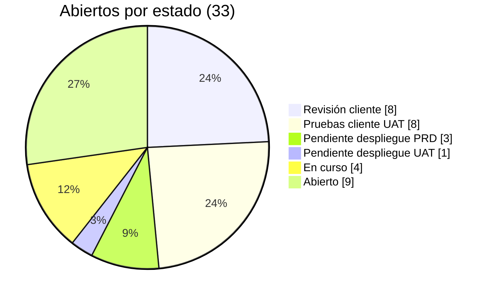

# Informe semanal BAU · del domingo 2026-11-08 al sábado 2026-11-14

## En una línea

33 abiertos · 25 creados · 25 resueltos · 5 rechazos del cliente · 8 salas atendidas

## Abiertos por estado

| Estado | Tickets |
|---|---|
| Abierto | 9 |
| En curso | 4 |
| Revisión cliente | 8 |
| Pendiente despliegue UAT | 1 |
| Pruebas cliente UAT | 8 |
| Pendiente despliegue PRD | 3 |

## Esperas en curso

| Ticket | Estado | Desde | Días |
|---|---|---|---|
| [NFQBAU-1525](02_TICKETS/Abiertos/NFQBAU-1525%20—%202026-10-15%20—%20Valores%20no%20actualizados%20Relatorio%20Estoque%20RF.md) | Revisión cliente | 2026-10-21 | 24 |
| [NFQBAU-1529](02_TICKETS/Abiertos/NFQBAU-1529%20—%202026-10-16%20—%20[ALDRIN]%20New%20extraction%20%20NavBankBalance.md) | Pruebas cliente UAT | 2026-10-21 | 24 |
| [NFQBAU-1545](02_TICKETS/Abiertos/NFQBAU-1545%20—%202026-10-20%20—%20[ALDRIN]%20Novo%20ajuste%20na%20função%20function_meg_cart_pos_fi_t.md) | Pruebas cliente UAT | 2026-10-26 | 19 |
| [NFQBAU-1576](02_TICKETS/Abiertos/NFQBAU-1576%20—%202026-10-27%20—%20New%20Aldrin%20Extraction%20+%20ValorizedPosition%20update%20-%20JIra%20SC-10594.md) | Pruebas cliente UAT | 2026-11-04 | 10 |
| [NFQBAU-1588](02_TICKETS/Abiertos/NFQBAU-1588%20—%202026-10-28%20—%20[EXTERNAL]%20RES%20JIRA%20SC-9861%20Campo%20código%20SubClasse%20não%20é%20preenchido%20no%20Megara.md) | Pendiente despliegue PRD | 2026-11-04 | 10 |
| [NFQBAU-1622](02_TICKETS/Abiertos/NFQBAU-1622%20—%202026-11-03%20—%20[Aldrin]%20-%20InvestCompany.md) | Revisión cliente | 2026-11-06 | 8 |
| [NFQBAU-1623](02_TICKETS/Abiertos/NFQBAU-1623%20—%202026-11-03%20—%20Portal%20PRD%20Erro%20relatório%20de%20Estoque%20de%20Cotas.md) | Pruebas cliente UAT | 2026-11-06 | 8 |
| [NFQBAU-1617](02_TICKETS/Abiertos/NFQBAU-1617%20—%202026-11-03%20—%20[EXTERNAL]%20Jiras%20Packages%20in%20the%20PRE-PROD%20Environment%20-%2030102026.md) | Revisión cliente | 2026-11-06 | 8 |
| [NFQBAU-1619](02_TICKETS/Abiertos/NFQBAU-1619%20—%202026-11-03%20—%20[ALDRIN]%20CashTransferOrder%20new%20CashTransferOrder%20type%20BookToBookTransferOrder.md) | Revisión cliente | 2026-11-06 | 8 |
| [NFQBAU-1592](02_TICKETS/Abiertos/NFQBAU-1592%20—%202026-10-28%20—%20[EXTERNAL]%20Regulation%20change%20for%20non-resident%20individual%20clients%20-%20CR%20SC-9947.md) | Pendiente despliegue PRD | 2026-11-06 | 8 |
| [NFQBAU-1597](02_TICKETS/Abiertos/NFQBAU-1597%20—%202026-10-29%20—%20[ALDRIN]%20Novo%20ajuste%20na%20função%20function_meg_cart_pos_fu_t.md) | Pruebas cliente UAT | 2026-11-07 | 7 |
| [NFQBAU-1596](02_TICKETS/Abiertos/NFQBAU-1596%20—%202026-10-29%20—%20[ALDRIN]%20Novo%20ajuste%20na%20função%20function_meg_sac_pl_cl_patrfut_t.md) | Pruebas cliente UAT | 2026-11-07 | 7 |
| [NFQBAU-1604](02_TICKETS/Abiertos/NFQBAU-1604%20—%202026-10-30%20—%20Liberação%20Carteira%20ASA%20-%20Portal.md) | Revisión cliente | 2026-11-09 | 5 |
| [NFQBAU-1669](02_TICKETS/Abiertos/NFQBAU-1669%20—%202026-11-09%20—%20[ALDRIN%20BR]%20-%20Incidência%20Carga%20PRD.md) | Revisión cliente | 2026-11-09 | 5 |
| [NFQBAU-1640](02_TICKETS/Abiertos/NFQBAU-1640%20—%202026-11-04%20—%20Ocorrências%20-%20Demonstrativo%20de%20Caixa%20Portal.md) | Pendiente despliegue UAT | 2026-11-09 | 5 |
| [NFQBAU-1671](02_TICKETS/Abiertos/NFQBAU-1671%20—%202026-11-09%20—%20Relatórios%20SAM%20-%20Extrato%20simplificado%20RF.md) | Pruebas cliente UAT | 2026-11-09 | 5 |
| [NFQBAU-1538](02_TICKETS/Abiertos/NFQBAU-1538%20—%202026-10-19%20—%20[ALDRIN]%20Novo%20ajuste%20na%20função%20function_meg_cart_pos_rf_t.md) | Pendiente despliegue PRD | 2026-11-10 | 4 |
| [NFQBAU-1657](02_TICKETS/Abiertos/NFQBAU-1657%20—%202026-11-06%20—%20[ALDRIN]%20Ajuste%20na%20função%20“function_meg_sac_stat_sw_cad_t()”.md) | Revisión cliente | 2026-11-10 | 4 |
| [NFQBAU-1550](02_TICKETS/Abiertos/NFQBAU-1550%20—%202026-10-20%20—%20[EXTERNAL]%20RES%20[Aldrin]%20ContractualClien%20extraction%20-%20Fund%20Classification%20and%20F.md) | Pruebas cliente UAT | 2026-11-12 | 2 |
| [NFQBAU-1577](02_TICKETS/Abiertos/NFQBAU-1577%20—%202026-10-27%20—%20PORTAL%20%20Incluir%20o%20código%20ISIN%20nos%20lastros%20das%20operações%20listadas%20no%20relatório%20D.md) | Revisión cliente | 2026-11-13 | 1 |

## Tiempo medio en cada espera (histórico completo)

- Revisión cliente: 2.4 días
- Pendiente despliegue UAT: 3.9 días
- Pruebas cliente UAT: 1.3 días
- Pendiente despliegue PRD: 1.8 días

## Resueltos esta semana

- [NFQBAU-1644](02_TICKETS/Abiertos/NFQBAU-1644%20—%202026-11-05%20—%20[ALDRIN]%20Novo%20ajuste%20na%20função%20function_meg_sac_pl_cl_patrrf_t.md): La función function_meg_sac_pl_cl_patrrf_t necesita ajustes para cálculos específicos. → Se aplicaron ajustes y correcciones en la función function_meg_sac_pl_cl_patrrf_t y se solicitó su compilación en UAT.
- [NFQBAU-1646](02_TICKETS/Abiertos/NFQBAU-1646%20—%202026-11-05%20—%20[ALDRIN%20BR]%20Incidencias%20Error%20Mapeo.md): Fallo en la ejecución del mapeo de la tabla sac_mov_rf_oper debido a un error de desbordamiento de caracteres. → sin solución corta
- [NFQBAU-1651](02_TICKETS/Abiertos/NFQBAU-1651%20—%202026-11-06%20—%20RES%20[ALDRIN]%20Novo%20ajuste%20na%20função%20function_meg_cart_pos_fu_t.md): RES [ALDRIN] Novo ajuste na função function_meg_cart_pos_fu_t → sin solución corta
- [NFQBAU-1652](02_TICKETS/Abiertos/NFQBAU-1652%20—%202026-11-06%20—%20[ALDRIN]%20Novo%20ajuste%20na%20função%20function_meg_sac_pl_cl_patrfut_t.md): [ALDRIN] Novo ajuste na função function_meg_sac_pl_cl_patrfut_t → sin solución corta
- [NFQBAU-1658](02_TICKETS/Abiertos/NFQBAU-1658%20—%202026-11-06%20—%20[ALDRIN]%20Ajuste%20no%20mapeamento%20para%20a%20tabela%20SAC_SW2_POS%20(cart_pos_sw_t).md): Se requiere ajustar la función SQL function_meg_cart_pos_sw_t para incorporar nuevos campos en el mapeo de la tabla SAC_SW2_POS. → Se ajustó el mapeo en la función SQL de la tabla SAC_SW2_POS para incluir nuevos campos solicitados.
- [NFQBAU-1662](02_TICKETS/Abiertos/NFQBAU-1662%20—%202026-11-07%20—%20[ALDRIN]%20Novo%20ajuste%20na%20função%20function_meg_sac_pl_cl_patrrf_t.md): [ALDRIN] Novo ajuste na função function_meg_sac_pl_cl_patrrf_t → sin solución corta
- [NFQBAU-1664](02_TICKETS/Abiertos/NFQBAU-1664%20—%202026-11-07%20—%20RES%20[ALDRIN]%20Novo%20ajuste%20na%20função%20function_meg_cart_pos_rf_.md): RES [ALDRIN] Novo ajuste na função function_meg_cart_pos_rf_ → sin solución corta
- [NFQBAU-1675](02_TICKETS/Abiertos/NFQBAU-1675%20—%202026-11-10%20—%20[Aldrin]%20Incidencias%20cargas%20PRD%20Reload.md): El sistema Rundeck perdió una ejecución y una recarga posterior quedó incompleta. → sin solución corta
- [NFQBAU-1676](02_TICKETS/Abiertos/NFQBAU-1676%20—%202026-11-10%20—%20Entrar%20na%20sala%20de%20PROJETOS.md): No se describe un problema técnico; es una solicitud de reunión. → sin solución corta
- [NFQBAU-1678](02_TICKETS/Abiertos/NFQBAU-1678%20—%202026-11-10%20—%20P0.md): Se solicita atención para una incidencia de prioridad P0. → sin solución corta
- [NFQBAU-1679](02_TICKETS/Abiertos/NFQBAU-1679%20—%202026-11-10%20—%20Entrar%20em%20P0.md): Un proceso o estado relacionado con 'P0' necesita ser re-ejecutado o re-ingresado. → sin solución corta
- [NFQBAU-1680](02_TICKETS/Abiertos/NFQBAU-1680%20—%202026-11-10%20—%20Entrar%20na%20sala%20de%20PROJETOS.md): No se reporta ningún fallo técnico, incidencia o error. → sin solución corta
- [NFQBAU-1682](02_TICKETS/Abiertos/NFQBAU-1682%20—%202026-11-10%20—%20[ALDRIN]%20Ajuste%20no%20mapeamento%20para%20a%20tabela%20SAC_SW2_POS%20(cart_pos_sw_t).md): Se requiere un ajuste en el mapeo para la tabla SAC_SW2_POS (cart_pos_sw_t) y en la función function_meg_sac_stat_sw_cad_t(). → Se ejecutaron los ajustes de mapeo para la tabla SAC_SW2_POS (cart_pos_sw_t) y la función function_meg_sac_stat_sw_cad_t().
- [NFQBAU-1683](02_TICKETS/Abiertos/NFQBAU-1683%20—%202026-11-10%20—%20Entrar%20na%20sala%20de%20PROJETOS.md): Se solicita acceso o entrada a la sala de PROJETOS. → sin solución corta
- [NFQBAU-1691](02_TICKETS/Abiertos/NFQBAU-1691%20—%202026-11-12%20—%20Entrar%20na%20sala%20de%20PROJETOS.md): Solicitud de acceso a la sala de PROJETOS. → sin solución corta
- [NFQBAU-1618](02_TICKETS/Archivo/NFQBAU-1618%20—%202026-11-03%20—%20[ALDRIN%20SALA%20DE%20PROJETOS]%20Testes%20CASHTRANSFERORDER%20-%20Pode%20entrar%20na%20sala%20de%20proj.md): No se muestran datos en las tablas de extracción trf_s3.SSS_PURECASH_BOOK_T, trf_s3.SSS_PURECASH_OPIN_T y trf_s3.SSS_PURECASH_OPOUT_T tras cargar los ficheros. → sin solución corta
- [NFQBAU-1621](02_TICKETS/Archivo/NFQBAU-1621%20—%202026-11-03%20—%20Incidente%20FundEncerramento.md): El servicio web de FundEncerramento en el entorno de producción presenta un incidente en WR. → sin solución corta
- [NFQBAU-1637](02_TICKETS/Archivo/NFQBAU-1637%20—%202026-11-04%20—%20OTCSwap%20em%20UAT.md): Se requiere la actualización del nuevo XSD de OTCSwap en el ambiente de UAT. → Se actualizó el archivo OTCSwap.xsd y se ejecutaron scripts SQL para corregir las tablas en el entorno UAT.
- [NFQBAU-1649](02_TICKETS/Archivo/NFQBAU-1649%20—%202026-11-06%20—%20Updates%20to%20OTCSwap%20extraction%20%20SC-10631.md): Se requiere realizar pruebas tras actualizar la configuración y los esquemas de campos en la extracción de OTCSwap. → Se actualizó la configuración y los esquemas de campos en la extracción de OTCSwap en el entorno PRE.
- [NFQBAU-1660](02_TICKETS/Archivo/NFQBAU-1660%20—%202026-11-06%20—%20Carga%20do%20arquivo%20“AdditionalDerivativePrice.XML”.md): El archivo “AdditionalDerivativePrice.XML” no está siendo consumido por la carga automática de Rundeck en UAT. → Se modificó el archivo lookup_java_flag.txt para normalizar la carga automática del archivo AdditionalDerivativePrice.XML.
- [NFQBAU-1663](02_TICKETS/Archivo/NFQBAU-1663%20—%202026-11-07%20—%20[ALDRIN]%20Mapeamento%20para%20a%20tabela%20SAC_SW2_MOV%20(sac_mov_sw2_t).md): No se reporta un fallo; se proporciona la consulta de mapeo para la función function_meg_sac_mov_sw2_t de operaciones de swap. → Se actualizó y ejecutó el mapeo de la función function_meg_sac_mov_sw2_t para la tabla SAC_SW2_MOV en UAT y Producción.
- [NFQBAU-1666](02_TICKETS/Archivo/NFQBAU-1666%20—%202026-11-07%20—%20OTCSwap%20em%20PRD.md): Se solicita la ejecución de un script SQL y la actualización de un archivo XSD en el entorno de producción. → Se ejecutaron los scripts y se actualizó el archivo XSD en producción para el sistema ALDRIN.
- [NFQBAU-1667](02_TICKETS/Archivo/NFQBAU-1667%20—%202026-11-08%20—%20[ALDRIN]%20-%20Houve%20errors%20no%20mapeamento%20de%20PRD.md): El job 'Job control errores mapeo' de Rundeck falló en producción, indicando errores en el mapeo. → sin solución corta
- [NFQBAU-1668](02_TICKETS/Archivo/NFQBAU-1668%20—%202026-11-09%20—%20P0.md): Se solicita atención para un problema clasificado como P0. → sin solución corta
- [NFQBAU-1673](02_TICKETS/Archivo/NFQBAU-1673%20—%202026-11-09%20—%20Entrar%20na%20sala%20de%20PROJETOS.md): Solicitud de acceso a la sala de PROJETOS. → sin solución corta

## Creados esta semana

- [NFQBAU-1669](02_TICKETS/Abiertos/NFQBAU-1669%20—%202026-11-09%20—%20[ALDRIN%20BR]%20-%20Incidência%20Carga%20PRD.md): [ALDRIN BR] - Incidência Carga PRD
- [NFQBAU-1670](02_TICKETS/Abiertos/NFQBAU-1670%20—%202026-11-09%20—%20Datahub%20APIs%20issue.md): Datahub APIs issue
- [NFQBAU-1671](02_TICKETS/Abiertos/NFQBAU-1671%20—%202026-11-09%20—%20Relatórios%20SAM%20-%20Extrato%20simplificado%20RF.md): Relatórios SAM - Extrato simplificado RF
- [NFQBAU-1672](02_TICKETS/Abiertos/NFQBAU-1672%20—%202026-11-09%20—%20Relatorios%20Swap.md): Relatorios Swap
- [NFQBAU-1674](02_TICKETS/Abiertos/NFQBAU-1674%20—%202026-11-09%20—%20[ALDRIN%20BR]%20-%20Restart%20Rundeck.md): [ALDRIN BR] - Restart Rundeck
- [NFQBAU-1675](02_TICKETS/Abiertos/NFQBAU-1675%20—%202026-11-10%20—%20[Aldrin]%20Incidencias%20cargas%20PRD%20Reload.md): [Aldrin] Incidencias cargas PRD Reload
- [NFQBAU-1676](02_TICKETS/Abiertos/NFQBAU-1676%20—%202026-11-10%20—%20Entrar%20na%20sala%20de%20PROJETOS.md): Entrar na sala de PROJETOS
- [NFQBAU-1677](02_TICKETS/Abiertos/NFQBAU-1677%20—%202026-11-10%20—%20[ALDRIN%20BR]%20-%20Demora%20Carga%20Atual%20PRD.md): [ALDRIN BR] - Demora Carga Atual PRD
- [NFQBAU-1678](02_TICKETS/Abiertos/NFQBAU-1678%20—%202026-11-10%20—%20P0.md): P0
- [NFQBAU-1679](02_TICKETS/Abiertos/NFQBAU-1679%20—%202026-11-10%20—%20Entrar%20em%20P0.md): Entrar em P0
- [NFQBAU-1680](02_TICKETS/Abiertos/NFQBAU-1680%20—%202026-11-10%20—%20Entrar%20na%20sala%20de%20PROJETOS.md): Entrar na sala de PROJETOS
- [NFQBAU-1681](02_TICKETS/Abiertos/NFQBAU-1681%20—%202026-11-10%20—%20[ALDRIN%20BR]%20-%20Incencidass%20Saldos%20duplicados.md): [ALDRIN BR] - Incencidass Saldos duplicados
- [NFQBAU-1682](02_TICKETS/Abiertos/NFQBAU-1682%20—%202026-11-10%20—%20[ALDRIN]%20Ajuste%20no%20mapeamento%20para%20a%20tabela%20SAC_SW2_POS%20(cart_pos_sw_t).md): [ALDRIN] Ajuste no mapeamento para a tabela SAC_SW2_POS (cart_pos_sw_t)
- [NFQBAU-1683](02_TICKETS/Abiertos/NFQBAU-1683%20—%202026-11-10%20—%20Entrar%20na%20sala%20de%20PROJETOS.md): Entrar na sala de PROJETOS
- [NFQBAU-1684](02_TICKETS/Abiertos/NFQBAU-1684%20—%202026-11-10%20—%20[ALDRIN]%20Novo%20ajuste%20na%20função%20function_meg_sac_pl_cl_patrrf_t.md): [ALDRIN] Novo ajuste na função function_meg_sac_pl_cl_patrrf_t
- [NFQBAU-1685](02_TICKETS/Abiertos/NFQBAU-1685%20—%202026-11-10%20—%20Saldo%20no%20demonstrativo%20de%20caixa%20CUST3600%20-%20DATA%2009112026.md): Saldo no demonstrativo de caixa CUST3600 - DATA 09112026
- [NFQBAU-1686](02_TICKETS/Abiertos/NFQBAU-1686%20—%202026-11-10%20—%20[ALDRIN]%20Novo%20ajuste%20na%20função.md): [ALDRIN] Novo ajuste na função
- [NFQBAU-1687](02_TICKETS/Abiertos/NFQBAU-1687%20—%202026-11-11%20—%20Atualização%20de%20demonstrativo%20de%20caixa.md): Atualização de demonstrativo de caixa
- [NFQBAU-1688](02_TICKETS/Abiertos/NFQBAU-1688%20—%202026-11-11%20—%20Lentidão%20nas%20cargas.md): Lentidão nas cargas
- [NFQBAU-1689](02_TICKETS/Abiertos/NFQBAU-1689%20—%202026-11-11%20—%20Interface%20XML%20de%20carga%20Aldrin.md): Interface XML de carga Aldrin
- [NFQBAU-1690](02_TICKETS/Abiertos/NFQBAU-1690%20—%202026-11-11%20—%20[ALDRIN%20BR]%20-%20Demora%20Carga%20Atual%20PRD%20-%20PATR%20RF.md): [ALDRIN BR] - Demora Carga Atual PRD - PATR RF
- [NFQBAU-1691](02_TICKETS/Abiertos/NFQBAU-1691%20—%202026-11-12%20—%20Entrar%20na%20sala%20de%20PROJETOS.md): Entrar na sala de PROJETOS
- [NFQBAU-1667](02_TICKETS/Archivo/NFQBAU-1667%20—%202026-11-08%20—%20[ALDRIN]%20-%20Houve%20errors%20no%20mapeamento%20de%20PRD.md): [ALDRIN] - Houve errors no mapeamento de PRD
- [NFQBAU-1668](02_TICKETS/Archivo/NFQBAU-1668%20—%202026-11-09%20—%20P0.md): P0
- [NFQBAU-1673](02_TICKETS/Archivo/NFQBAU-1673%20—%202026-11-09%20—%20Entrar%20na%20sala%20de%20PROJETOS.md): Entrar na sala de PROJETOS

## Foto para el cliente

### Resueltos

| Id | Asunto | Resuelto el | Días |
|---|---|---|---|
| NFQBAU-1644 | [ALDRIN] Novo ajuste na função function_meg_sac_pl_cl_patrrf_t | 2026-11-10 | 5 |
| NFQBAU-1646 | [ALDRIN BR] Incidencias Error Mapeo | 2026-11-10 | 5 |
| NFQBAU-1651 | RES [ALDRIN] Novo ajuste na função function_meg_cart_pos_fu_t | 2026-11-10 | 4 |
| NFQBAU-1652 | [ALDRIN] Novo ajuste na função function_meg_sac_pl_cl_patrfut_t | 2026-11-10 | 4 |
| NFQBAU-1658 | [ALDRIN] Ajuste no mapeamento para a tabela SAC_SW2_POS (cart_pos_sw_t) | 2026-11-10 | 4 |
| NFQBAU-1662 | [ALDRIN] Novo ajuste na função function_meg_sac_pl_cl_patrrf_t | 2026-11-10 | 3 |
| NFQBAU-1664 | RES [ALDRIN] Novo ajuste na função function_meg_cart_pos_rf_ | 2026-11-10 | 3 |
| NFQBAU-1675 | [Aldrin] Incidencias cargas PRD Reload | 2026-11-10 | 0 |
| NFQBAU-1676 | Entrar na sala de PROJETOS | 2026-11-10 | 0 |
| NFQBAU-1678 | P0 | 2026-11-10 | 0 |
| NFQBAU-1679 | Entrar em P0 | 2026-11-10 | 0 |
| NFQBAU-1680 | Entrar na sala de PROJETOS | 2026-11-10 | 0 |
| NFQBAU-1682 | [ALDRIN] Ajuste no mapeamento para a tabela SAC_SW2_POS (cart_pos_sw_t) | 2026-11-10 | 0 |
| NFQBAU-1683 | Entrar na sala de PROJETOS | 2026-11-10 | 0 |
| NFQBAU-1691 | Entrar na sala de PROJETOS | 2026-11-12 | 0 |
| NFQBAU-1618 | [ALDRIN SALA DE PROJETOS] Testes CASHTRANSFERORDER - Pode entrar na sala de proj | 2026-11-09 | 6 |
| NFQBAU-1621 | Incidente FundEncerramento | 2026-11-09 | 6 |
| NFQBAU-1637 | OTCSwap em UAT | 2026-11-09 | 5 |
| NFQBAU-1649 | Updates to OTCSwap extraction  SC-10631 | 2026-11-09 | 3 |
| NFQBAU-1660 | Carga do arquivo “AdditionalDerivativePrice.XML” | 2026-11-09 | 3 |
| NFQBAU-1663 | [ALDRIN] Mapeamento para a tabela SAC_SW2_MOV (sac_mov_sw2_t) | 2026-11-09 | 2 |
| NFQBAU-1666 | OTCSwap em PRD | 2026-11-09 | 2 |
| NFQBAU-1667 | [ALDRIN] - Houve errors no mapeamento de PRD | 2026-11-09 | 1 |
| NFQBAU-1668 | P0 | 2026-11-09 | 0 |
| NFQBAU-1673 | Entrar na sala de PROJETOS | 2026-11-09 | 0 |

### Pendientes a 2026-11-14

| Id | Asunto | Estado | Días abierto |
|---|---|---|---|
| NFQBAU-1525 | Valores no actualizados Relatorio Estoque RF | Revisión cliente | 30 |
| NFQBAU-1529 | [ALDRIN] New extraction  NavBankBalance | Pruebas cliente UAT | 29 |
| NFQBAU-1538 | [ALDRIN] Novo ajuste na função function_meg_cart_pos_rf_t | Pendiente despliegue PRD | 26 |
| NFQBAU-1545 | [ALDRIN] Novo ajuste na função function_meg_cart_pos_fi_t | Pruebas cliente UAT | 25 |
| NFQBAU-1550 | [EXTERNAL] RES [Aldrin] ContractualClien extraction - Fund Classification and F | Pruebas cliente UAT | 25 |
| NFQBAU-1576 | New Aldrin Extraction + ValorizedPosition update - JIra SC-10594 | Pruebas cliente UAT | 18 |
| NFQBAU-1577 | PORTAL  Incluir o código ISIN nos lastros das operações listadas no relatório D | Revisión cliente | 18 |
| NFQBAU-1588 | [EXTERNAL] RES JIRA SC-9861 Campo código SubClasse não é preenchido no Megara | Pendiente despliegue PRD | 17 |
| NFQBAU-1592 | [EXTERNAL] Regulation change for non-resident individual clients - CR SC-9947 | Pendiente despliegue PRD | 17 |
| NFQBAU-1596 | [ALDRIN] Novo ajuste na função function_meg_sac_pl_cl_patrfut_t | Pruebas cliente UAT | 16 |
| NFQBAU-1597 | [ALDRIN] Novo ajuste na função function_meg_cart_pos_fu_t | Pruebas cliente UAT | 16 |
| NFQBAU-1604 | Liberação Carteira ASA - Portal | Revisión cliente | 15 |
| NFQBAU-1617 | [EXTERNAL] Jiras Packages in the PRE-PROD Environment - 30102026 | Revisión cliente | 11 |
| NFQBAU-1619 | [ALDRIN] CashTransferOrder new CashTransferOrder type BookToBookTransferOrder | Revisión cliente | 11 |
| NFQBAU-1622 | [Aldrin] - InvestCompany | Revisión cliente | 11 |
| NFQBAU-1623 | Portal PRD Erro relatório de Estoque de Cotas | Pruebas cliente UAT | 11 |
| NFQBAU-1640 | Ocorrências - Demonstrativo de Caixa Portal | Pendiente despliegue UAT | 10 |
| NFQBAU-1643 | ETF - Relatório de Operações RF | En curso | 9 |
| NFQBAU-1657 | [ALDRIN] Ajuste na função “function_meg_sac_stat_sw_cad_t()” | Revisión cliente | 8 |
| NFQBAU-1669 | [ALDRIN BR] - Incidência Carga PRD | Revisión cliente | 5 |
| NFQBAU-1670 | Datahub APIs issue | Abierto | 5 |
| NFQBAU-1671 | Relatórios SAM - Extrato simplificado RF | Pruebas cliente UAT | 5 |
| NFQBAU-1672 | Relatorios Swap | En curso | 5 |
| NFQBAU-1674 | [ALDRIN BR] - Restart Rundeck | En curso | 5 |
| NFQBAU-1677 | [ALDRIN BR] - Demora Carga Atual PRD | En curso | 4 |
| NFQBAU-1681 | [ALDRIN BR] - Incencidass Saldos duplicados | Abierto | 4 |
| NFQBAU-1684 | [ALDRIN] Novo ajuste na função function_meg_sac_pl_cl_patrrf_t | Abierto | 4 |
| NFQBAU-1685 | Saldo no demonstrativo de caixa CUST3600 - DATA 09112026 | Abierto | 4 |
| NFQBAU-1686 | [ALDRIN] Novo ajuste na função | Abierto | 4 |
| NFQBAU-1687 | Atualização de demonstrativo de caixa | Abierto | 3 |
| NFQBAU-1688 | Lentidão nas cargas | Abierto | 3 |
| NFQBAU-1689 | Interface XML de carga Aldrin | Abierto | 3 |
| NFQBAU-1690 | [ALDRIN BR] - Demora Carga Atual PRD - PATR RF | Abierto | 3 |
