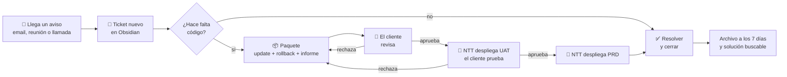
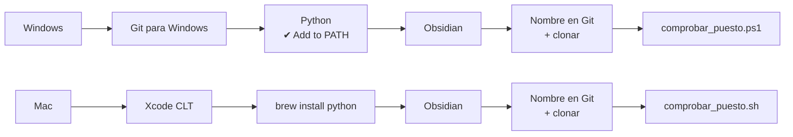
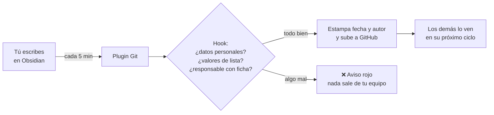
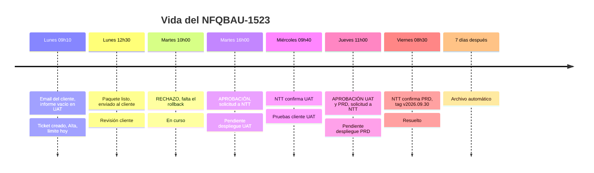
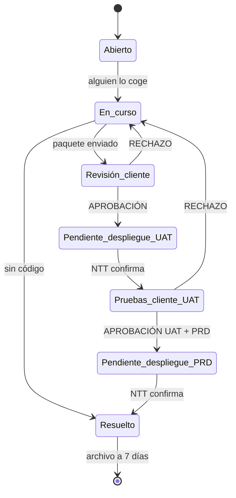
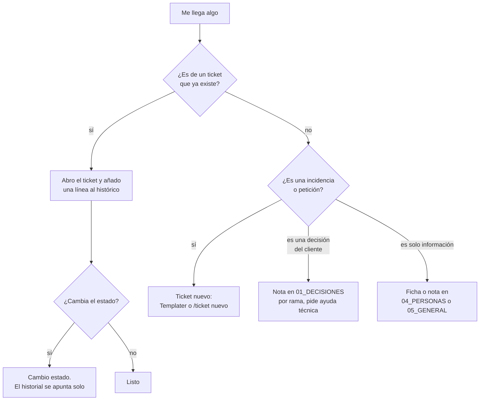
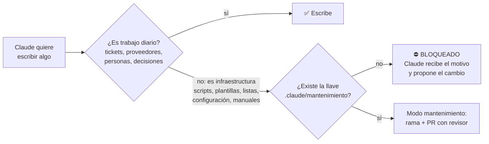

# Manual de usuario del vault BAU

Para todo el equipo, técnico o no. Está contado siguiendo **un ticket real de principio a fin**, el `NFQBAU-1523`, para que veas exactamente qué se escribe y dónde en cada paso. Si algo no está aquí, pregunta en el espacio de Google Chat del equipo o mira el [manual técnico](Manual-tecnico.md).

## 0. El día a día en un vistazo



Y esto es lo que hace cada uno:

| Quién | Hace | Cuándo |
|---|---|---|
| **Tú** | Creas el ticket, decides estado, prioridad y responsable, escribes lo que pasa | Cada vez que hay novedad |
| **Claude** | Resume y anonimiza lo que pegas, propone el resto de campos, busca si ya pasó antes, redacta correos | Cuando se lo pides |
| **El vault** (solo) | Guarda en Git cada 5 minutos, apunta quién y cuándo cambió cada cosa, bloquea datos personales, archiva, hace el informe del lunes y el aviso diario | Siempre |
| **El cliente** | Revisa el paquete, prueba en UAT, aprueba PRD | Dos veces por ticket con código |
| **NTT** | Despliega en UAT y en PRD cuando se lo pedís | Dos veces por ticket con código |

Versión interactiva, con más detalle: [Diagramas/Dia-a-dia.html](Diagramas/Dia-a-dia.html), la secuencia de un ticket de principio a fin. Y para ver qué pieza habla con cuál, el [mapa del sistema](Diagramas/Mapa-del-sistema.html).

## 1. Primer día

### 1.1 Instalar (una vez, 15 minutos)



**Windows**

1. [Git para Windows](https://git-scm.com/download/win), **versión de 64 bits**. Instalación por defecto. La de 32 bits funciona, pero el hook tuvo que rodear varias rarezas suyas.
2. [Python](https://www.python.org/downloads/windows/). Marca la casilla **Add python.exe to PATH**. Después, en Configuración de Windows → Aplicaciones → Configuración avanzada de aplicaciones → **Alias de ejecución de aplicaciones**, apaga `python.exe` y `python3.exe`: son accesos falsos de la Microsoft Store que engañan al hook.
3. [Obsidian](https://obsidian.md).
4. PowerShell. Primero tu nombre y apellido, tal como aparecerán en el vault (busca tu línea en la tabla de abajo), y después el clon:

> [!tip] Tu línea, lista para pegar
> Cada persona del equipo tiene su ficha ya creada. Copia **tu** línea tal cual, con el nombre exacto de la ficha. El correo puede ser el de NFQ (decisión del 2026-10-19) o el seudónimo que trae la línea; queda grabado como autor en el historial de Git, nada más.

| Persona             | Pegar en PowerShell o Terminal                                                                                                     |
| ------------------- | ---------------------------------------------------------------------------------------------------------------------------------- |
| Antonio Montoro     | `git config --global user.name "Antonio Montoro"; git config --global user.email "antoniomontoro@users.noreply.github.com"`        |
| Deborah Bertoldo    | `git config --global user.name "Deborah Bertoldo"; git config --global user.email "deborahbertoldo@users.noreply.github.com"`      |
| Ismael Barranco     | `git config --global user.name "Ismael Barranco"; git config --global user.email "ismaelbarranco@users.noreply.github.com"`        |
| Jesús Horno         | `git config --global user.name "Jesús Horno"; git config --global user.email "jesushorno@users.noreply.github.com"`                |
| Juan Antonio Gascón | `git config --global user.name "Juan Antonio Gascón"; git config --global user.email "juanantoniogascon@users.noreply.github.com"` |
| Manuel Hervas       | `git config --global user.name "Manuel Hervas"; git config --global user.email "manuelhervas@users.noreply.github.com"`            |
| Matheus Fransoni | `git config --global user.name "Matheus Fransoni"; git config --global user.email "matheusfransoni@users.noreply.github.com"` |
| Marco Pichardo      | `git config --global user.name "Marco Pichardo"; git config --global user.email "marcopichardo@users.noreply.github.com"`          |
| Ricardo Reyes       | `git config --global user.name "Ricardo Reyes"; git config --global user.email "ricardoreyes@users.noreply.github.com"`            |

Después, los tres comandos siguientes son iguales para todos. Antes de clonar, quien administra el repo tiene que haberte invitado a **los dos** repos de GitHub, el vault y el código `BAU-NFQ`; si el clon dice "Repository not found" en los submódulos, falta la segunda invitación.

```powershell
git clone --recurse-submodules https://github.com/RicardoNfq/BAU-NFQ-vault.git
cd BAU-NFQ-vault
powershell -ExecutionPolicy Bypass -File 05_GENERAL\Herramientas\comprobar_puesto.ps1
```

**Mac**

Primero tu línea de la tabla de arriba, y luego:

```sh
xcode-select --install && brew install python
git clone --recurse-submodules https://github.com/RicardoNfq/BAU-NFQ-vault.git
cd BAU-NFQ-vault
sh 05_GENERAL/Herramientas/comprobar_puesto.sh
```

Esto es lo que tiene que salir. Si algo está en rojo, el propio mensaje dice qué falta:

```
Comprobación del puesto: C:\Users\ana\BAU-NFQ-vault
  OK  git instalado
  OK  git user.name: Ana Pérez
  OK  Python: Python 3.12.4
  OK  hooks activados (.githooks)
  OK  submódulo PRD presente
  OK  submódulo UAT presente
  OK  plugin dataview en el repo
  OK  plugin obsidian-git en el repo
  OK  plugin templater-obsidian en el repo
  ...
Todo correcto.
```

> [!warning] Tu nombre en Git importa
> Es lo que queda como `actualizado_por` en cada cambio. Tiene que ser **exactamente** el nombre de tu ficha en `04_PERSONAS/`. "Ana Pérez" y "Ana Perez" son dos personas distintas para el vault.

### 1.2 Abrir el vault en Obsidian

1. Obsidian → **Abrir carpeta como vault** → la carpeta `BAU-NFQ-vault`.
2. Obsidian avisa de que el vault trae plugins. Acepta: **Trust author and enable plugins**. Todos viajan en el repo, no hay que instalar nada.
3. Se abre el **Dashboard**. Cada vez que abras Obsidian, empezarás ahí.

### 1.3 Tu ficha

Crea tu nota en `04_PERSONAS/` con tu nombre y apellido como título: botón derecho en la carpeta → Nueva nota → título `Ana Pérez` → `Ctrl/Cmd + P` → **Insertar plantilla** → **Persona**.

```yaml
---
nombre: Ana Pérez
rol: Soporte BAU
equipo_empresa: NFQ
escalado_a: Ricardo Reyes
tags: [persona, bau]
---
```

Debajo aparece sola la lista de tus tickets. Sin esta ficha, el vault no te deja aparecer como responsable. El cliente y NTT también tienen ficha, con su rol y **sin ningún dato de contacto**.

## 2. Cómo se sincroniza (y por qué a veces dice que no)



> [!tip] No tienes que hacer nada
> El plugin Git baja lo de los demás y sube lo tuyo cada 5 minutos. Verás un aviso corto en la barra inferior.

> [!danger] Si aparece un aviso rojo
> El vault ha bloqueado tu cambio. Nada ha salido de tu equipo. Ejemplos reales de lo que dice y qué hacer:

| Aviso | Qué pasó | Qué hacer |
|---|---|---|
| `NFQBAU-1523 ...md:31: email: luis.gomez@cliente.pt` | Pegaste un email | Sustitúyelo por el rol: "el responsable de informes del cliente" |
| `estado 'En Curso' no está en listas.json [...]` | Mayúscula distinta | Escríbelo igual que en la lista: `En curso` |
| `responsable 'Ana Perez' no tiene ficha en 04_PERSONAS` | Falta el acento | Usa el nombre exacto de la ficha |
| `credencial: password=Qlik2026!` | Pegaste una contraseña | Quítala. Escribe "clave del usuario de servicio de Qlik, la tiene el equipo" |
| `Las decisiones van por rama + PR...` | Guardaste una decisión en `main` | Pásasela al perfil técnico o crea la rama que indica |

Corriges, y en el siguiente ciclo se sube solo.

> [!tip] "Tickets renumerados" en un aviso rojo de Obsidian Git
> Si creas un ticket y, en el mismo tramo de 5 minutos, otra persona o el correo automático crean otro con el mismo número, el vault lo detecta al guardar en GitHub: renumera el tuyo al siguiente libre, nombre de fichero y campo `id`, y cancela esa subida con el aviso "NFQBAU-1519 ya existe en GitHub: renumerado a NFQBAU-1530". No hay que hacer nada: a los 5 minutos sube solo con el número nuevo. Si ya le habías dicho el número a alguien, díselo otra vez.

## 3. Un ticket de principio a fin: el NFQBAU-1523



### Paso 1. Llega el aviso (lunes 09:10)

Llega un email del cliente con el asunto **"Informe de siniestros vacío en UAT tras carga de ayer"**. Contiene el nombre del que escribe, su teléfono y una captura.

> [!example] Lo que va al vault y lo que no
> **Va:** el asunto tal cual (para encontrar el hilo después) y un resumen sin contacto.
> **No va nunca:** el email pegado, el teléfono, el nombre con apellidos del cliente si no está ya en `04_PERSONAS/`.

### Paso 2. Crear el ticket

Cuatro formas. Dan el mismo fichero.

**A. Desde Obsidian (recomendado).** `Ctrl/Cmd + Shift + N`. Aparecen seis preguntas seguidas:

```
Asunto breve del ticket:   Informe de siniestros vacío en UAT
Prioridad:                 ▸ Alta   Media   Baja
Origen:                    ▸ email  reunión llamada
Responsable:               ▸ Ana Pérez  Ricardo Reyes  ...
Categoría:                 ▸ Qlik   Rundeck  BBDD  APIs  Otros
Entorno:                   ▸ UAT    Producción
```

**B. Con Claude Code.** `/ticket nuevo`, pegas el email, y Claude te enseña primero si ya pasó algo parecido y después los campos para confirmar:

```
Tickets parecidos:
  NFQBAU-1502 (2026-09-24, Resuelto) · informe X sale vacío → relanzar mapeo y job de cierre
  00_REFERENCIA_TECNICA/H - Cierre y Qlik/H03_recarga_qlik.md

Propongo:
  asunto        Informe de siniestros vacío en UAT
  prioridad     Alta            origen  email
  responsable   Ana Pérez       categoria [Qlik]   entorno [UAT]
  sintoma       informe de siniestros sale vacío tras la carga nocturna
  resumen       El cliente ve el informe de siniestros vacío en UAT desde la carga de anoche.
¿Confirmas o cambias algo?
```

**C. Desde el terminal.** `python3 05_GENERAL/Herramientas/nuevo_ticket.py "Informe de siniestros vacío en UAT" Alta email`.

**D. Sin hacer nada.** Cuando llega un correo al buzón compartido, un script automático lo lee, Gemini lo resume y el ticket se crea solo, con el asunto, el síntoma, un resumen ya anonimizado y, cuando se deducen del correo, el entorno, la categoría, la prioridad y un párrafo de detalles técnicos (jobs, tablas, errores literales, lo que muestran las capturas de pantalla) más los nombres de los adjuntos; firmado por "Correo automático" y **sin responsable**. Aparece en el Dashboard, avisa en Google Chat, y alguien lo coge: pone responsable, prioridad y categoría, y sigue como cualquier otro. Si el correo es una respuesta a un ticket abierto, no crea otro: añade una línea a su histórico. Si el ticket de ese hilo ya está cerrado, no lo reabre: crea uno nuevo que enlaza al anterior. Reabrir un ticket es siempre una decisión de una persona.

**Peticiones de sala.** Un correo que pide entrar en una sala ("Entrar em P0", "WR P1", "sala de projetos") crea un ticket que **nace Resuelto**, con categoría **Sala**, asignado a quien esté de guardia, y Chat avisa destacado: "PIDEN SALA: P0 (guardia: Marco Pichardo)". No hay nada que cerrar: el ticket es el registro de la llamada y el informe semanal cuenta las salas atendidas. Cada correo nuevo es una llamada nueva aunque el asunto se repita; las respuestas (Re:) del mismo día van al histórico de esa sala. Si en la llamada sale una incidencia, abre un ticket aparte con Nuevo ticket y enlaza la sala.

Resultado, en los tres casos, el fichero `02_TICKETS/Abiertos/NFQBAU-1523 — 2026-09-28 — Informe de siniestros vacío en UAT.md`:

```yaml
---
id: NFQBAU-1523
fecha_apertura: 2026-09-28
fecha_limite: 2026-09-28          # Alta = mismo día. Media = +1, Baja = +3. Plazo para asumirlo: vence si sigue Abierto
fecha_resolucion:
estado: Abierto
prioridad: Alta
responsable: Ana Pérez
origen: email
referencia_origen: Informe de siniestros vacío en UAT tras carga de ayer
categoria: [Qlik]
entorno: [UAT]
sintoma: informe de siniestros sale vacío tras la carga nocturna
solucion_corta:
...
---

## Resumen

El cliente ve el informe de siniestros vacío en UAT desde la carga de anoche.

## Histórico de interacciones

- 2026-09-28 09:15 — Ana Pérez — Email de Luis G., responsable de informes del cliente: el informe de siniestros sale vacío en UAT desde la carga del 27. Adjunta captura. Pide prioridad.
```

> [!tip] Solo decides tres cosas
> **Estado, prioridad y responsable.** Todo lo demás lo completa Claude o se rellena cuando se sepa.

### Paso 3. Trabajar el ticket

Ana pone `estado: En curso` y mira el dashboard. En cuanto Obsidian Git guarda, el vault añade solo al final del ticket:

```
## Historial de estados
- 2026-09-28 09:15 — nuevo → Abierto — Ana Pérez
- 2026-09-28 09:40 — Abierto → En curso — Ana Pérez
```

> [!tip] Cambiar el estado: el desplegable de la cabecera
> Cada ticket empieza con un recuadro **Controles**: desplegables de estado, prioridad, responsable, categoría y entorno, y dos botones (Nota NTT, Dashboard). Eliges en el desplegable y se escribe en la nota, nada más. Al elegir Resuelto, la fecha de resolución se pone sola al guardar. Si prefieres el teclado, `Cmd/Ctrl + Shift + E` hace lo mismo, sin texto seleccionado.

> [!tip] Cambiar el estado: un atajo y elegir
> Dentro del ticket, `Cmd/Ctrl + Shift + E` y elige de la lista. Si eliges Resuelto, pone la fecha de resolución de hoy. `Cmd/Ctrl + Shift + R` para el responsable. El panel de propiedades de Obsidian también vale, pero solo sugiere valores que ya existen, no la lista completa.

| Atajo | Hace |
|---|---|
| `Cmd/Ctrl + Shift + N` | Nuevo ticket (o el botón del Dashboard) |
| `Cmd/Ctrl + Shift + P` | Nueva nota de proveedor NTT |
| `Cmd/Ctrl + Shift + E` | Cambiar estado del ticket abierto |
| `Cmd/Ctrl + Shift + R` | Cambiar responsable |
| `Cmd/Ctrl + Shift + D` | Abrir el Dashboard |
| `Cmd/Ctrl + O` | Buscar en todo el vault (Omnisearch) |

> [!info] Historial de estados
> Lo escribe el vault en cada cambio de estado, con fecha, hora y tu nombre. Nunca lo escribas a mano.

Descubre que el job de cierre no relanzó la recarga de Qlik. Hace falta un cambio de código: una rama `feature/NFQBAU-1523` en el repo de código, y el **paquete**:

```
## Paquete de despliegue

- Update:   [update.sql](../../06_CODIGO_VERSIONADO/UAT/envios/NFQBAU-1523/update.sql)
- Rollback: [rollback.sql](../../06_CODIGO_VERSIONADO/UAT/envios/NFQBAU-1523/rollback.sql)
- Informe:  [informe.md](../../06_CODIGO_VERSIONADO/UAT/envios/NFQBAU-1523/informe.md)
- Anexos:   captura del cliente (en el informe, sin datos personales)
```

> [!danger] Rollback obligatorio
> Un ticket con código no se cierra sin rollback. No es opcional: es lo que salva la producción cuando algo sale mal.

### Paso 4. El cliente revisa (lunes 12:30 → martes 16:00)

Ana envía el paquete al cliente. Con Claude, `/ticket redactar NFQBAU-1523` le escribe el correo en portugués de Brasil, sin firma, y ella lo copia y firma al enviar. Cambia el estado a `Revisión cliente`.

Martes 10:00: el cliente rechaza porque falta el rollback del histórico. Ana lo anota con el **prefijo fijo** `RECHAZO` y vuelve a `En curso`:

```
- 2026-09-29 10:00 — Ana Pérez — RECHAZO — el responsable de informes pide incluir rollback del histórico de siniestros
```

Martes 16:00: nuevo paquete, el cliente aprueba:

```
- 2026-09-29 16:00 — Ana Pérez — APROBACIÓN — el cliente acepta el paquete v2
```

> [!info] Prefijos fijos
> `APROBACIÓN`, `APROBACIÓN UAT`, `APROBACIÓN PRD` y `RECHAZO` se escriben siempre igual. Así el informe del lunes los cuenta solo.

### Paso 5. NTT despliega en UAT (martes 16:10 → miércoles 09:40)

Ana crea la nota de proveedor: `Cmd/Ctrl + Shift + P` → escribe `NFQBAU-1523`. Se crea `03_PROVEEDORES/NTT — NFQBAU-1523.md`. Marca el checklist y apunta la solicitud:

```
## UAT

- Solicitado:   2026-09-29 16:10 — por Ana Pérez
- Ticket NTT:   SRV-88213
- Desplegado:   2026-09-30 09:40 — confirmado por email

- [x] Rollback preparado
- [x] Backup hecho
- [x] Ventana acordada
```

Ticket a `Pendiente despliegue UAT`. En el ticket, `tickets_proveedor: ["../03_PROVEEDORES/NTT — NFQBAU-1523.md"]`.

> [!info] Si NTT no da número de ticket
> Pasa a veces: solo dicen "ya está". `Ticket NTT` se queda vacío. Lo que siempre existe es **Solicitado** y **Desplegado**.

Miércoles 09:40: NTT confirma. Ticket a `Pruebas cliente UAT`.

### Paso 6. El cliente prueba y aprueba PRD (jueves 11:00)

```
- 2026-10-01 11:00 — Ana Pérez — APROBACIÓN UAT — el cliente valida el informe en UAT con los datos del 30
- 2026-10-01 11:05 — Ana Pérez — APROBACIÓN PRD — visto bueno para producción en la reunión P0
```

Solicitud a NTT para PRD (sección `## PRD` de la nota de proveedor, checklist incluido) y estado `Pendiente despliegue PRD`.

### Paso 7. Cerrar (viernes 08:30)

NTT confirma PRD. El código se etiqueta en el repo como `v2026.09.30`. Ana cierra con `/ticket resolver NFQBAU-1523`, que le pregunta los cinco bloques uno a uno, o rellenando a mano:

```
## Resolución

### Qué se hizo
Se corrigió el job de cierre para que relance la recarga de Qlik cuando la carga nocturna termina después de las 06:00.

### Cómo se comprobó
SELECT COUNT(*) FROM trf_s3.siniestros_informe WHERE fecha_carga = '2026-09-30';  -- 41.203 filas, antes 0
Recarga de Qlik lanzada a mano y verificada en el informe.

### Con quién se habló
Responsable de informes del cliente (rechazo y aprobaciones). Operador de despliegue de NTT.

### Servicios, jobs o tablas tocados
Job Rundeck `cierre_diario`, tabla `trf_s3.siniestros_informe`, app Qlik de siniestros.

### Referencias técnicas usadas y por qué
[H03_recarga_qlik](../../00_REFERENCIA_TECNICA/H%20-%20Cierre%20y%20Qlik/H03_recarga_qlik.md): explica el orden cierre → recarga y por qué falla si la carga se retrasa.
```

Y en el frontmatter:

```yaml
estado: Resuelto
fecha_resolucion: 2026-10-02
solucion_corta: el job de cierre no relanzaba Qlik si la carga acababa tarde; corregido y relanzado
codigo_relacionado:
  - repo: BAU-NFQ
    modulo: cierre_diario
    version: v2026.09.30
referencias_tecnicas: ["../../00_REFERENCIA_TECNICA/H - Cierre y Qlik/H03_recarga_qlik.md"]
```

> [!tip] Escribe para dentro de seis meses
> `sintoma` y `solucion_corta` son las dos líneas que verá quien tenga el mismo problema más adelante. Escríbelas para esa persona, no para ti.

### Paso 8. Después

El entorno se completa solo al avanzar: al pasar a un estado de UAT aparece `UAT`, y al pedir el despliegue en PRD, `Producción`. Lo que tú pongas se respeta. A los 7 días de `fecha_resolucion`, cada madrugada, el ticket pasa solo a `02_TICKETS/Archivo/`. No lo muevas a mano. Sigue apareciendo en **Soluciones** y en el **Top de síntomas** del dashboard.

## 4. Los siete estados



| Estado | Significa | Quién tiene la pelota |
|---|---|---|
| Abierto | Acaba de llegar. Vence si nadie lo pasa a En curso antes de la fecha límite | Nosotros |
| En curso | Alguien lo ha asumido y trabaja en él. También al volver de un rechazo. Ya no vence | Nosotros |
| Revisión cliente | Paquete enviado | Cliente |
| Pendiente despliegue UAT | Pedido a NTT | NTT |
| Pruebas cliente UAT | Desplegado en UAT | Cliente |
| Pendiente despliegue PRD | Aprobado, pedido a NTT | NTT |
| Resuelto | Desplegado y verificado, o cerrado sin código | Nadie |

**El correo mueve el estado solo** cuando el hilo lo deja claro, y avisa en Chat ("Estado cambiado por correo: …"). Solo avanza desde el estado que toca; si no cuadra, solo anota la línea:

| Llega un correo en el que… | Si está en | Pasa a | Línea del histórico |
|---|---|---|---|
| el cliente acepta el paquete | Revisión cliente | Pendiente despliegue UAT | APROBACIÓN |
| NTT confirma que lo ejecutó en UAT | Pendiente despliegue UAT | Pruebas cliente UAT | |
| el cliente valida en UAT | Pruebas cliente UAT | Pendiente despliegue PRD | APROBACIÓN UAT |
| el cliente da el visto bueno para PRD | Pruebas cliente UAT | Pendiente despliegue PRD | APROBACIÓN PRD |
| NTT confirma que lo ejecutó en PRD | Pendiente despliegue PRD | no cambia: Chat avisa "Listo para cerrar" | |
| el cliente rechaza o dice que no funciona | Revisión cliente o Pruebas cliente UAT | En curso | RECHAZO |

El correo **nunca** pasa un ticket a Resuelto: cerrar es tuyo. Si un cambio automático no es correcto, devuelve el estado en Obsidian; el historial guarda los dos movimientos.

> [!warning] Se escriben exactamente así
> `En Curso` o `Resuelto.` no pasan el filtro. Si dudas, usa **Cambiar estado** de Templater, que solo ofrece los siete.

## 5. ¿Qué hago con esto que me llega?



### 5.1 El responsable de guardia

En el Dashboard, debajo de los botones, hay un desplegable: **Los tickets nuevos del correo se asignan a**. Quien vaya a atender los tickets nuevos ese día elige su nombre; al dejarlo, elige `nadie`. Eso es todo.

Con un responsable de guardia:

- Cada ticket que nace de un correo se asigna a esa persona, y Chat avisa: "Ticket nuevo asignado a Marco Pichardo: NFQBAU-1530".
- Cuando llega una respuesta a un ticket ya abierto, el ticket se queda con su responsable y la respuesta entra en su histórico, sin aviso.

Sin responsable de guardia, todo sigue como antes: los tickets nuevos nacen sin responsable, Chat lo avisa y alguien lo coge. El aviso diario recuerda "Sin responsable de guardia para los tickets nuevos".

> [!tip] Caduca sola
> El dato vale 12 horas desde que eliges tu nombre, para que los tickets nuevos no se asignen a quien ya no los atiende. Si tu guardia dura más, vuelve a elegir tu nombre. La marca de hora la pone el hook en el siguiente guardado; no hay que escribir nada.

## 6. Ver cómo va el día

**Dashboard** (se abre solo). Arriba, cuatro botones: **Nuevo ticket**, **Nota NTT**, **Tabla de tickets** y **Buscar**. Debajo, tres gráficos que se calculan solos: abiertos por estado, abiertos por responsable, y creados frente a resueltos en las últimas ocho semanas. Y después, las tablas. Así se ve una de ellas con dos tickets de ejemplo:

```
Vencidos
  NFQBAU-1523 · Ana Pérez · Alta · 2026-09-28 · Abierto

Esperando a NTT
  NFQBAU-1523 · Pendiente despliegue UAT · UAT · 2 días esperando · NTT — NFQBAU-1523

Esperando al cliente
  NFQBAU-1519 · Revisión cliente · Ricardo Reyes · 4 días esperando

Abiertos por estado, con días en el estado
  En curso                 NFQBAU-1521 (1d)  NFQBAU-1522 (0d)
  Revisión cliente         NFQBAU-1519 (4d)
  Pendiente despliegue UAT NFQBAU-1523 (2d)
```

Más abajo: por responsable, categoría y entorno, tus tareas de hoy, soluciones, top de síntomas, resueltos pendientes de archivar. Y **Foto para el cliente**: dos tablas, resueltos y pendientes, con id, asunto y días, para copiar tal cual en un correo; en modo lectura, seleccionar la tabla y pegar.

**Tickets.base**: lo mismo en tabla con desplegables. Cambias el estado o el responsable desde la celda, sin abrir la nota. Pestañas: Abiertos por estado, Por responsable, Esperando a NTT, Tarjetas, Soluciones.

**Informe semanal**: cada lunes en `05_GENERAL/Informes/`, con el nombre de las fechas que cubre, la última semana completa de domingo a sábado. La semana en curso se ve en vivo arriba del Dashboard, en "Esta semana, desde el domingo". El informe empieza así, y es la agenda de la reunión con el cliente:

```
# Informe semanal BAU · del domingo 2026-09-27 al sábado 2026-10-03

## En una línea
6 abiertos · 9 creados · 7 resueltos · 2 rechazos del cliente

## Abiertos por estado          (gráfico de tarta)
## Esperas en curso             (tabla: ticket, estado, desde, días)
## Tiempo medio en cada espera  Revisión cliente 1,3 días · Pendiente despliegue UAT 0,9 días
## Resueltos esta semana        NFQBAU-1523: informe de siniestros vacío → el job de cierre no relanzaba Qlik...
```

**Avisos en Google Chat**, en el espacio del equipo, nunca en fin de semana. La foto del día llega en días laborables entre las 08:55 y las 09:00 de Madrid, lo mismo en São Paulo, y entre las 10:55 y las 11:00 de Ciudad de México, cada una por su reloj (el cambio de hora de España no la mueve). La dispara el mismo script que lee el correo, que es puntual; si un día no llega, se lanza a mano desde Actions, "Foto del día". Siempre: es la foto del día, abiertos por responsable y por estado, creados y resueltos de ayer, quién está de guardia, y los vencidos y esperas largas si los hay. Y cada vez que un correo se convierte en ticket nuevo, un aviso con el ticket y su responsable (§5.1). Las respuestas en hilos ya abiertos no avisan: se ven en el histórico del ticket y en el bloque "Hilos con respuesta hoy" del Dashboard, que lista las de hoy y ayer con hora, ticket, responsable y resumen. Cuando un correo no se puede convertir, el aviso de Chat dice la fila de la hoja y la hora en que se leyó; las filas con error del propio script van en rojo. Si dudas de si un correo entró, el bloque "Correo automático" del Dashboard enlaza a la hoja: la pestaña `estado` dice cuándo leyó el buzón por última vez y cuándo lo leerá, y `correos` tiene una fila por correo con lo que decidió Gemini.

```
Vault BAU, foto del día
Abiertos: 12. Marco Pichardo 10, Ricardo Reyes 2.
Por estado: En curso 8, Revisión cliente 2, Pendiente despliegue UAT 2.
Ayer: 3 creado(s), 1 resuelto(s).
De guardia: Ricardo Reyes.
Vencidos (1): NFQBAU-1519.
Espera: NFQBAU-1516, 4 días en Pendiente despliegue UAT
```

### 6.1 Preguntar desde Google Chat

En el espacio del equipo hay una app llamada **BAU**. Se le escribe mencionándola:

- `@BAU NFQBAU-1545`: estado, responsable, entorno, fecha límite y la última línea del histórico.
- `@BAU foto`: la foto del día, calculada en ese momento.
- `@BAU guardia`: quién atiende hoy los tickets nuevos.
- `@BAU ayuda`: esta lista.

Solo lee: para cambiar algo, Obsidian.

## 7. Tareas dentro de un ticket

Una casilla con fecha en cualquier nota aparece en "Mis pendientes de hoy" del Dashboard:

```
- [ ] Llamar a NTT para confirmar la ventana de PRD 📅 2026-10-01
```

## 8. Buscar lo que ya pasó

| Quiero | Uso |
|---|---|
| Encontrar cualquier cosa, aunque me equivoque al escribir | **Omnisearch**, `Ctrl/Cmd + O` |
| Ver qué se hizo con síntomas parecidos | Dashboard → **Soluciones** y **Top de síntomas** |
| Que me lo expliquen, tengo que actuar ya | Claude Code: `/ticket consultar "informe vacío"` |
| Lo mismo, pero desde el navegador | El **Proyecto de claude.ai** enlazado al repo |

Ejemplo de `/ticket consultar "informe de siniestros vacío"`:

```
Ha pasado dos veces (NFQBAU-1502, NFQBAU-1523). Las dos por lo mismo: la carga
nocturna acabó tarde y el job de cierre no relanzó la recarga de Qlik.

Comprobación que usaron:
  SELECT COUNT(*) FROM trf_s3.siniestros_informe WHERE fecha_carga = '<hoy>';
  Si da 0, es esto.

Con quién hablar: nadie para arreglarlo; el responsable de informes del cliente para avisar.
Ficha que lo explica: 00_REFERENCIA_TECNICA/H - Cierre y Qlik/H03_recarga_qlik.md
Yo empezaría por la query y, si da 0, relanzar la recarga como dice la ficha.
```

## 9. Decisiones

Algo que el cliente autorizó y que hay que poder demostrar después: "el cliente acepta que el informe X no incluya pólizas anuladas". Plantilla **Decision** en `01_DECISIONES/`:

```yaml
---
id: NFQBAU-DEC-004
titulo: Pólizas anuladas fuera del informe de siniestros
fecha: 2026-10-01
autorizado_por: responsable de informes del cliente
fuente: reunión P0 2026-10-01
ticket_relacionado: NFQBAU-1523
estado: vigente
---
```

> [!warning] Van por rama y revisión
> Si intentas guardarla en `main`, el vault lo bloquea y dice cómo crear la rama. Si no estás cómodo con Git, pásasela a alguien técnico: es un minuto.

## 10. Desde el móvil

Obsidian móvil con el plugin Git sirve para **leer**: abre el vault, deja que sincronice y consulta tickets o fichas en una reunión. Para escribir, mejor desde el ordenador.

## 11. Las tres reglas, con ejemplos

> [!danger] Lo que nunca entra en el vault
> Datos de contacto, credenciales y correos enteros. El historial de Git no se puede limpiar después.

| Regla | Mal | Bien |
|---|---|---|
| Nombre e inicial, nunca contactos | "Llamé a Luis Gómez al 612 345 678" | "Llamé a Luis G., responsable de informes del cliente" |
| Credenciales nunca | "usuario qlik_svc / clave Qlik2026!" | "con el usuario de servicio de Qlik (la clave la tiene el equipo)" |
| Nunca el correo entero | pegar el email | "Email de Luis G., responsable de informes del cliente: el informe sale vacío desde la carga del 27, pide prioridad" |

## 12. La guardia: lo que Claude no puede tocar

En el día a día, Claude tiende a "arreglar" un script o una plantilla para salir de un problema puntual. El vault tiene un seguro contra eso.



> [!example] Cómo se ve cuando salta
> ```
> BLOQUEADO por la guardia de la zona protegida:
>   05_GENERAL/Herramientas/escanear_pii.py
> Esto es infraestructura del vault, no trabajo diario. No la cambies para salir de un problema puntual.
> Resuelve el ticket con lo que hay y, si de verdad hace falta un cambio, proponlo y pide a la persona
> que active el modo mantenimiento: `touch .claude/mantenimiento` (y luego rama mantenimiento/... + PR).
> ```

> [!tip] Qué hacer cuando salta
> Nada. Es correcto. Deja que Claude resuelva el ticket con lo que hay. Si su propuesta de cambio te convence, díselo al perfil técnico, que lo hará por rama con revisión. La llave la crea una persona desde su terminal, nunca Claude.

Lo mismo vale para las personas: si tocas un manual, una plantilla o un script en Obsidian, al guardar en Git ese cambio se descarta solo, con el aviso "Cambio en la zona protegida descartado", y tus tickets suben igual. Los manuales, el diseño y el Dashboard se abren en modo lectura; para editarlos a propósito hay que pulsar el lápiz, y aun así el cambio no sube: pídelo.

## 13. Si algo va mal

| Síntoma | Qué hacer |
|---|---|
| Obsidian Git dice "conflict" | No toques nada. Avisa al perfil técnico; se resuelve en un minuto |
| Llevas días sin que suba nada y Chat avisa de tickets que ya cerraste | Un aviso rojo anterior dejó un cambio atascado y retiene todo lo demás. Mira el aviso, corrige ese fichero, y el resto sube solo. Si no lo ves, avisa al perfil técnico |
| El cambio no se sube | Mira el aviso rojo: casi siempre es un dato personal o un valor fuera de lista (sección 2) |
| No aparezco como responsable | Te falta la ficha en `04_PERSONAS/` o tu nombre en Git no coincide con ella |
| El Dashboard sale vacío | Espera unos segundos a que Dataview indexe, o `Ctrl/Cmd + R` |
| Veo `<% ... %>` en una nota nueva | Usaste **Insertar plantilla** del menú del núcleo. Borra la nota y usa `Cmd/Ctrl + Shift + N` |
| Al cambiar estado se abre una nota sin título | Lanzaste "Cambiar estado" como nota nueva desde el selector de Templater. La nota se borra sola; abre el ticket y usa `Cmd/Ctrl + Shift + E` |
| `comprobar_puesto` da rojo en "rutas largas" | Solo Windows: ejecuta como administrador el comando que muestra |
| `comprobar_puesto` da rojo en "finales de línea" del hook | Solo Windows: ejecuta los tres comandos que muestra y repite la comprobación |
| Obsidian dice "No encuentro un Python que funcione" pero `comprobar_puesto` da verde | Obsidian arranca sin Python en su entorno aunque la terminal lo vea | Crea el fichero `.githooks\python-ruta.txt` en la carpeta del vault con una sola línea, la ruta de Python con barras normales, por ejemplo `C:/Program Files/Python312/python.exe` (sale con `(Get-Command python).Source`). No se sube a GitHub; es de tu puesto |
| `git commit` no dice nada y no commitea | El hook ha fallado sin mensaje. Haz `git pull` por si hay un hook nuevo y repite. Si sigue, pasa a quien mantiene el vault la salida de la traza que indica el Manual técnico §9 |
| Obsidian pregunta "Select or create a new remote" | Escribe `origin` y selecciónalo. Si lo repite, comprueba que Obsidian tiene abierta la carpeta del clon y pide ayuda |
| Obsidian Git avisa de conflicto en un ticket que otra persona tocó a la vez | Las dos personas cambiaron la misma frase del ticket (el estado y el historial se fusionan solos desde el 2026-10-28) | Abre el ticket en modo fuente, deja el texto bueno entre las marcas `<<<<<<< mio` y `>>>>>>> suyo`, borra las marcas, y `Obsidian Git: Commit all changes` y `Push` |
| Obsidian Git dice "did not commit, because you have conflicts" en `Guardia-de-tickets` | Dos puestos cambiaron la guardia casi a la vez, antes de la fusión automática | Una vez: `git checkout --theirs 05_GENERAL/Guardia-de-tickets.md`, `git add` de ese fichero, `git commit -m guardia`, `git push`. Después pasa `comprobar_puesto`, que activa la fusión automática, y no vuelve a ocurrir |
| Mi ticket tiene el mismo número que otro de GitHub | Nació sin subir mientras otro se creaba. Desde el 2026-10-17 el vault lo renumera solo al guardar o subir; si ves un aviso rojo "Tickets renumerados", espera al siguiente ciclo |
| Dos tickets con el mismo número | Creaste uno a mano, no llegó a subir, y el correo creó otro con ese número. Cambia el tuyo al siguiente número libre: en el frontmatter `id:` y en el nombre del fichero (`F2`). Hasta entonces, tus cambios no suben |
| Aviso "Cambio en la zona protegida descartado" | Tocaste un manual, una plantilla, un script o la configuración. El vault ha devuelto ese fichero a como estaba y ha subido lo demás. Si de verdad hace falta el cambio, pídelo al perfil técnico |
| Claude dice "BLOQUEADO por la guardia" | Claude intentó cambiar infraestructura para salir del paso. Es normal y es correcto: que resuelva el ticket con lo que hay. Si su propuesta te convence, el perfil técnico la hace por rama |
