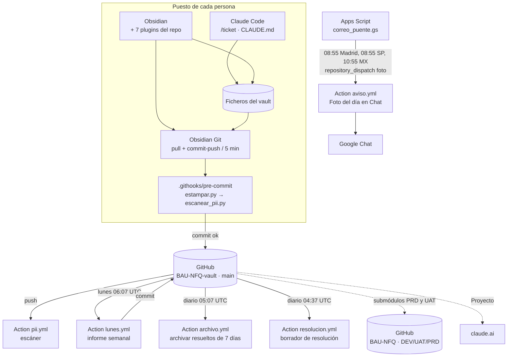
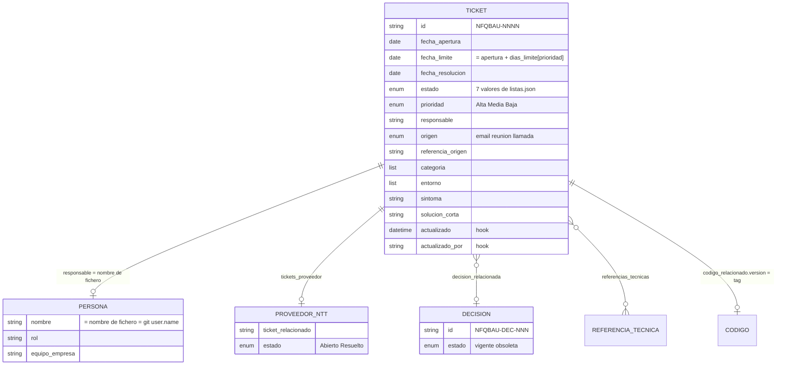
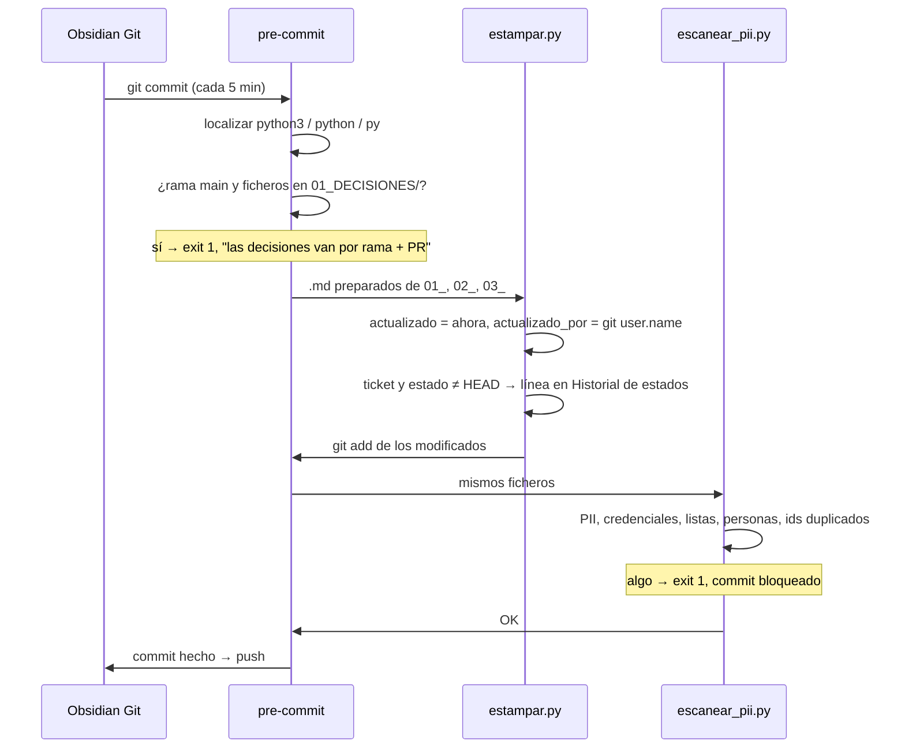
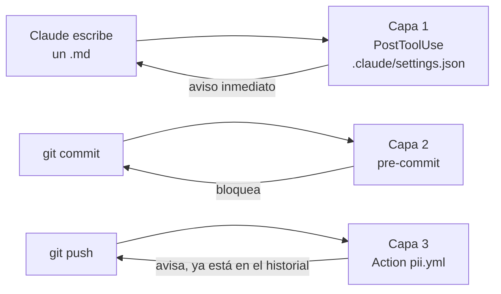
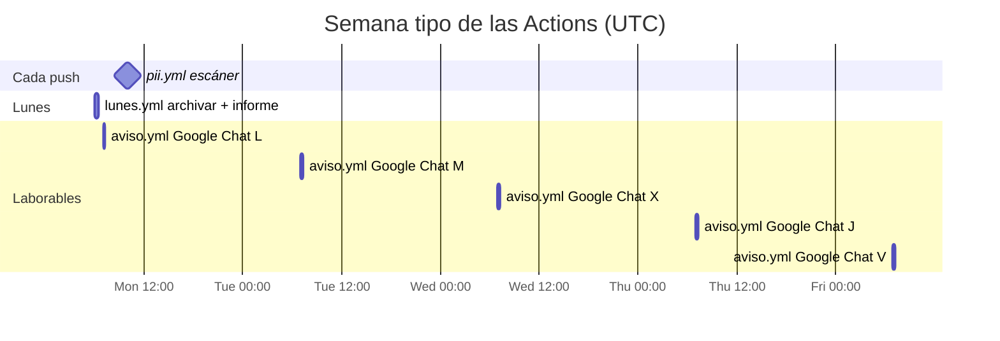
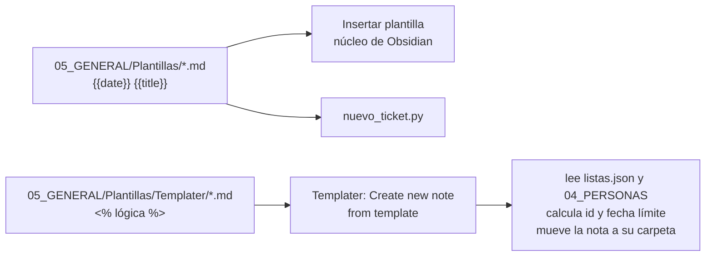
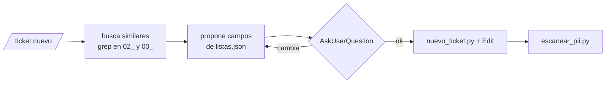
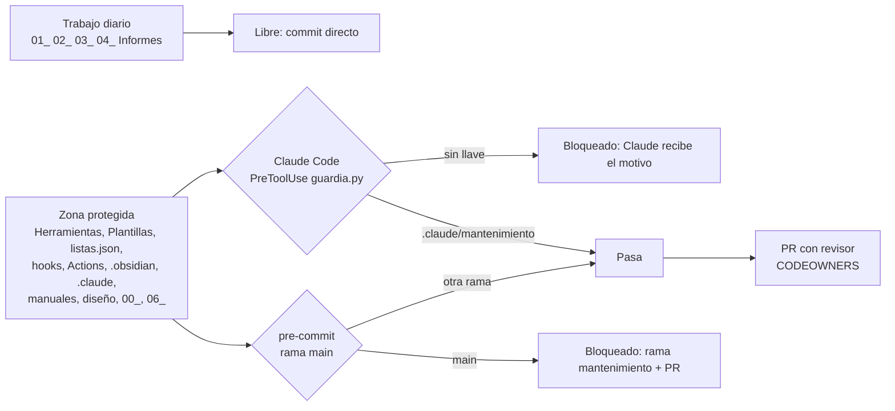
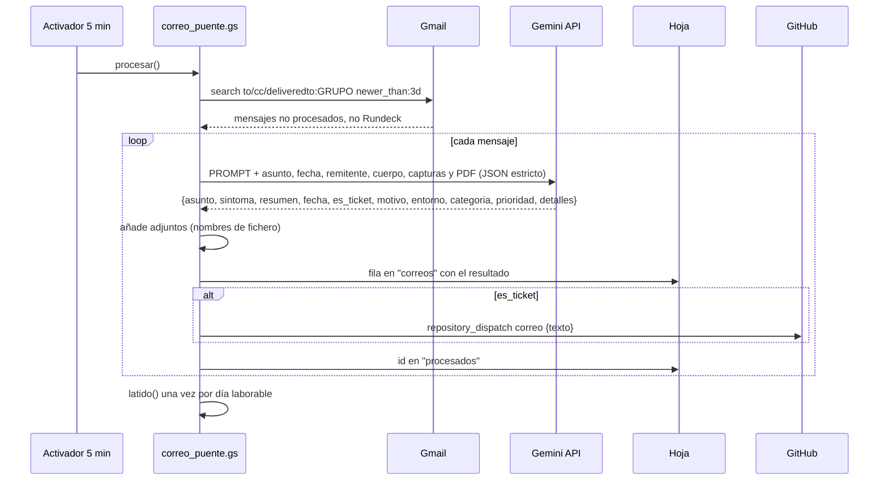

# Manual técnico del vault BAU

Para quien mantiene el vault. El *qué* y el *por qué* están en el [documento de diseño](Diseno-Vault-BAU-NFQ.md); el uso diario, en el [manual de usuario](Manual-de-usuario.md). Aquí está el *cómo funciona por dentro* y el *cómo se cambia*, con ejemplos ejecutables.

## 1. Arquitectura

Versión interactiva de este mapa, con vistas guiadas: [Diagramas/Mapa-del-sistema.html](Diagramas/Mapa-del-sistema.html). La fuente es `Mapa-del-sistema.architecture.json`; se regenera con archify.



| Pieza | Dónde | Qué hace |
|---|---|---|
| Repo del vault | `github.com/RicardoNfq/BAU-NFQ-vault`, rama `main` | Notas. Todo el equipo hace commit directo salvo en `01_DECISIONES/` |
| Repo de código | `github.com/RicardoNfq/BAU-NFQ`, ramas `DEV`, `UAT`, `PRD` | Foto del esquema de cada entorno (`schema_backup/<esquema>/<tipo>/<objeto>.sql`) y envíos por ticket en `envios/NFQBAU-NNNN/`. Se actualiza con `foto.py` desde un zip de la VDI; `--comparar` entre entornos. Montado como submódulo en `06_CODIGO_VERSIONADO/PRD` y `UAT` |
| Listas cerradas | `05_GENERAL/listas.json` | Única fuente de estados, prioridades, categorías, entornos, orígenes y días de límite |
| Herramientas | `05_GENERAL/Herramientas/` | Python 3.9+, solo stdlib (3.9 es el del sistema en Mac, el único que ve Obsidian). Todas importan `vault.py` |
| Hooks | `.githooks/pre-commit` | Estampado, historial de estados, bloqueo de decisiones en `main`, escáner |
| Actions | `.github/workflows/` | `pii.yml`, `lunes.yml`, `aviso.yml`, `archivo.yml`, `correo.yml`, `resolucion.yml` |
| Claude Code | `CLAUDE.md`, `.claude/settings.json`, `.claude/skills/ticket/SKILL.md` | Reglas, guardia de la zona protegida, escáner al escribir, línea de estado, comando `/ticket` |
| Obsidian | `.obsidian/` | Configuración y plugins dentro del repo; `workspace.json` ignorado |

## 2. Modelo de datos

Todo son notas Markdown con frontmatter. Las relaciones son texto plano o enlaces relativos; ningún campo lleva wikilinks.



> [!warning] Secciones fijas
> Los scripts buscan por los títulos de sección. No los renombres.
>
> Secciones fijas del cuerpo de un ticket, en este orden: `## Resumen`, `## Histórico de interacciones`, `## Paquete de despliegue`, `## Resolución` con cinco `###`, `## Vencimiento`, `## Historial de estados`. Los scripts buscan por esos títulos: no los renombres.

## 3. Qué pasa en un commit



Detalles que importan:

- `estampar.py` compara `estado` con `git show HEAD:ruta`. Un ticket nuevo registra `nuevo → Abierto`. Desde el 2026-10-22 completa `entorno` según el estado: `UAT` en Pendiente despliegue UAT, Pruebas cliente UAT y Pendiente despliegue PRD; `Producción` en Pendiente despliegue PRD. Solo añade.
- **Ids únicos frente a GitHub** (`estampar.py`, 2026-10-17). Antes de estampar, los tickets nuevos del commit se comparan con `origin/main` tras un `git fetch` de 5 s como máximo (`ids_en_origin()`, con `core.quotePath=false` o las rutas con acentos no coinciden). Mismo id en otro fichero = `renumerar()`: `git mv` al siguiente libre contando local y origin, campo `id` y mensaje. Un renombrado propio no es colisión (el fichero de origin estaba en HEAD). El hook `pre-push` (`estampar.py --push`) repite la comprobación sobre los tickets commiteados que no están en origin, ya con el pull hecho por Obsidian Git: si renumera, commitea "Tickets renumerados" y sale 1 para cancelar ese push; el siguiente ciclo lo sube. Sin red o sin Python, ningún hook bloquea: el escáner de ids duplicados de la Action sigue detrás. Ventana restante: dos pushes en el mismo segundo.
- **Nota de guardia sin conflictos** (2026-10-19). Obsidian reescribe la nota al abrirla y dos puestos la cambiaban en el mismo tramo de 5 minutos: conflicto en Obsidian Git. Tres piezas: `estampar.py` solo la estampa si cambió `responsable` respecto a HEAD; `.gitattributes` le asigna `merge=guardia` y `.githooks/fusionar-guardia` (`estampar.py --fusionar MIO SUYO`) resuelve la fusión quedándose con la marca `actualizado` más reciente; `comprobar_puesto` activa el driver con `git config merge.guardia.driver` (es configuración local, por eso va en el script del puesto). Sin Python el driver sale 1 y Git deja el conflicto normal.
- **Tickets sin conflictos** (2026-10-28): `02_TICKETS/**/*.md merge=ticket` en `.gitattributes` y `.githooks/fusionar-ticket` (`estampar.py --fusionar-ticket BASE MIO SUYO`): fusión a tres bandas con `git merge-file` y, de los trozos en conflicto, resuelve solo la marca `actualizado` (gana la más reciente) y las líneas de historial o histórico (se conservan todas, ordenadas). Cualquier otro conflicto, dos resúmenes distintos por ejemplo, queda con marcas `mio`/`suyo` para una persona. `comprobar_puesto` activa el driver. Probado: dos cierres simultáneos del mismo ticket fusionan limpio.
- **Correo del autor**: libre. El 2026-10-19 se exigió el seudónimo de GitHub durante unas horas y el usuario lo retiró: los correos del equipo NFQ pueden ir en el autor de los commits (nunca en los ficheros del vault, eso sigue bloqueado por el escáner).
- `estampar.py` estampa `01_`, `02_`, `03_` y, fuera de esas zonas, solo `05_GENERAL/Guardia-de-tickets.md`: su marca `actualizado` es lo que da validez al responsable de guardia (`vault.de_guardia()`, 12 horas, `HORAS_GUARDIA`). El desplegable del Dashboard escribe en esa nota con un bind target de Meta Bind a otro fichero (`05_GENERAL/Guardia-de-tickets#responsable`).
- El hook exige `git config user.name`; sin él falla con mensaje claro. Ese nombre debe existir en `04_PERSONAS/` o el escáner bloquea por `actualizado_por`.
- Los nombres de fichero llevan espacios y guiones largos: el hook pasa las rutas a Python como argumentos separando solo por salto de línea (`IFS`), y usa `core.quotePath=false` para que Git no escape los acentos. Sin `xargs` ni `>/dev/null` dentro de bucles: el Git de 32 bits de Windows no los maneja (§9).

Ejemplo de un commit bloqueado tal como lo ve la persona:

```
$ git commit -m "actualizo 1523"
02_TICKETS/Abiertos/NFQBAU-1523 — 2026-09-28 — Informe de siniestros vacío en UAT.md:31: email: luis.gomez@cliente.pt
02_TICKETS/Abiertos/NFQBAU-1523 — 2026-09-28 — Informe de siniestros vacío en UAT.md: estado 'En Curso' no está en listas.json ['Abierto', 'En curso', ...]
Commit bloqueado: corrige lo indicado arriba.
```

## 4. Escáner en tres capas



| Capa | Bloquea | Cubre |
|---|---|---|
| Claude Code | No, avisa al instante | Solo lo que escribe Claude |
| pre-commit | Sí | Todo lo que sale de un puesto con hooks activados |
| Action | No | Todo lo que llega a GitHub, incluidos puestos sin hook |

Patrones: email, teléfono español (`6/7/8/9` + 8 dígitos, con o sin `+34`), DNI, NIE, IBAN español, `password|passwd|pwd|contraseña|token|api_key|secret` seguido de `:` o `=` y un valor literal (se ignoran `$VAR`, `<marcador>`, `{{...}}`, `***`, `xxx`), cadenas de conexión con `password=`, cabeceras `BEGIN ... PRIVATE KEY`. Permitidos: `noreply@anthropic.com`, `@example.com`, `@users.noreply.github.com`.

Probar un patrón nuevo sin commitear nada:

```sh
printf -- "---\nid: X\n---\nclave api_key=abcd1234efgh\n" > /tmp/p.md
python3 05_GENERAL/Herramientas/escanear_pii.py /tmp/p.md    # /tmp está fuera del vault: no se escanea
cp /tmp/p.md 05_GENERAL/prueba.md && python3 05_GENERAL/Herramientas/escanear_pii.py 05_GENERAL/prueba.md; rm 05_GENERAL/prueba.md
# 05_GENERAL/prueba.md:4: credencial: api_key=abcd1234efgh
```

## 5. Herramientas

Todas desde la raíz del vault. En Windows, `python` en vez de `python3`.

| Script | Uso | Salida de ejemplo |
|---|---|---|
| `nuevo_ticket.py "Asunto" [prioridad] [origen]` | crea ticket | `02_TICKETS/Abiertos/NFQBAU-1524 — 2026-09-28 — Asunto.md` |
| `escanear_pii.py [fichero...]` | escáner | `OK: 41 fichero(s) sin datos personales ni valores fuera de lista` o la lista de problemas y exit 1 |
| `archivar.py [--dias 7]` | archivado | `archivado NFQBAU-1502 — ...md` · `AVISO ...: Resuelto sin fecha_resolucion, no se archiva` |
| `informe_semanal.py [--semanas 1]` | informe | `05_GENERAL/Informes/2026-10-04 a 2026-10-10.md` |
| `bau.py` | tabla en terminal | ver abajo |
| `bau.py --statusline` | barra de Claude Code | `BAU: 6 abiertos · 2 esperando a NTT · 1 vencido(s)` |
| `bau.py --aviso` | foto del día para Chat: abiertos por responsable y estado, ayer, guardia, vencidos, esperas | `Abiertos: 12. Marco Pichardo 10, Ricardo Reyes 2.` |
| `estampar.py fichero...` / `--push` | lo llaman los hooks pre-commit y pre-push | no se usa a mano |
| `comprobar_puesto.sh` / `.ps1` | onboarding | verde/rojo por requisito |
| `guardia.py` | lo llaman los hooks | sección 13 |
| `migrar_referencia.py ORIGEN` | migración puntual, ya hecha | `184 ficheros migrados` |

`bau.py` en el terminal:

```
En curso (2)
  NFQBAU-1521  Media  Ricardo Reyes        1d  Job Rundeck parado
  NFQBAU-1522  Baja   Ana Pérez            0d  Mapeo erróneo

Pendiente despliegue UAT (1)
  NFQBAU-1523  Alta   Ana Pérez            2d  VENCIDO Informe de siniestros vacío en UAT

3 abiertos · 1 esperando a NTT · 0 esperando al cliente · 1 vencidos
```

Rojo = vencido o espera ≥ 3 días (`DIAS_AVISO` en `bau.py`). Vencido = sigue Abierto pasada la fecha límite (`SIN_ASUMIR`): el plazo mide la primera respuesta, no la resolución. En curso o en cualquier espera ya no vence. Amarillo = más de un día en el estado.

`vault.py`, el módulo común:

| Función | Devuelve |
|---|---|
| `frontmatter(texto)` | dict con strings y listas. Parser mínimo: `clave: valor`, `[a, b]`, `- item`, comentarios `#` |
| `poner_campo(texto, clave, valor)` | el texto con la línea sustituida o añadida antes del cierre `---` |
| `tickets(incluir_archivo=True)` | generador de `(ruta, frontmatter)` |
| `listas()` / `personas()` | `listas.json` / nombres de fichero de `04_PERSONAS/` |
| `dias_desde("AAAA-MM-DD[ HH:MM]")` / `ahora()` | días enteros / `"AAAA-MM-DD HH:MM"` local |

## 6. Automatizaciones



| Workflow      | Disparo                                                                                                        | Necesita                                                                                            | Qué hace                                                                                                                                                                                                                                                                                                                                                                                                                                                                                                                                                                                                                                                                                                                                                                                                                                                                                                                                                                                     |
| ------------- | -------------------------------------------------------------------------------------------------------------- | --------------------------------------------------------------------------------------------------- | -------------------------------------------------------------------------------------------------------------------------------------------------------------------------------------------------------------------------------------------------------------------------------------------------------------------------------------------------------------------------------------------------------------------------------------------------------------------------------------------------------------------------------------------------------------------------------------------------------------------------------------------------------------------------------------------------------------------------------------------------------------------------------------------------------------------------------------------------------------------------------------------------------------------------------------------------------------------------------------------- |
| `pii.yml`     | push y PR                                                                                                      | nada                                                                                                | `escanear_pii.py` completo. Rojo = avisar a quien subió                                                                                                                                                                                                                                                                                                                                                                                                                                                                                                                                                                                                                                                                                                                                                                                                                                                                                                                                      |
| `archivo.yml` | diario 05:07 UTC y manual                                                                                      | `contents: write`                                                                                   | `archivar.py` (Resueltos con 7 días o más → Archivo) y commit si movió algo. Desde el 2026-10-21; antes lo hacía `lunes.yml` a los 30 días                                                                                                                                                                                                                                                                                                                                                                                                                                                                                                                                                                                                                                                                                                                                                                                                                                                   |
| `resolucion.yml` | diario 04:37 UTC y manual | secreto `GEMINI_API_KEY` | `redactar_resolucion.py --max 20`: a cada Resuelto sin `solucion_corta` ni bloques de `## Resolución`, Gemini (Flash Lite, `MODELO_RESOLUCION`) le redacta la solución corta y cuatro bloques desde el resumen y el histórico; solo rellena lo vacío, lo que no se deduce queda "No consta en el histórico.", referencias técnicas no. Línea en el histórico "Resolución redactada automáticamente…; revisar". Cada fichero pasa `escanear_pii.py` o se descarta; `estampar.py`; push con 3 reintentos. Misma cola (`concurrency: correo`) que el correo. Desde el 2026-11-06: antes 98 de 107 resueltos no tenían resolución |
| `lunes.yml`   | lunes 06:00 UTC y manual                                                                                       | `contents: write` (declarado)                                                                       | `archivar.py`, `informe_semanal.py`, commit como `github-actions[bot]`                                                                                                                                                                                                                                                                                                                                                                                                                                                                                                                                                                                                                                                                                                                                                                                                                                                                                                                       |
| `aviso.yml` | `repository_dispatch` tipo `foto` (lo envía `correo_puente.gs` a las 08:55 Madrid, 08:55 São Paulo y 10:55 México, laborables, una vez por zona y día: propiedades `FOTO_<zona>`) y manual | secreto `GCHAT_WEBHOOK` | `bau.py --aviso` → POST JSON al webhook. Sin cron desde el 2026-10-21: GitHub lo retrasaba hasta una hora o lo perdía |
| `correo.yml`  | `repository_dispatch` tipo `correo` (lo envía `correo_puente.gs` desde la hoja)                                | token de GitHub en las propiedades del script; `GCHAT_WEBHOOK` y `HOJA_CORREOS_URL` para los avisos | `correo_a_ticket.py` crea el ticket o añade al histórico → `estampar.py` firma como "Correo automático" → `escanear_pii.py`; limpio = commit y, solo si es ticket nuevo, aviso en Chat con responsable de guardia (o sin responsable), asunto y síntoma; una respuesta en hilo vivo no avisa desde el 2026-10-21 (el script imprime la ruta, el tipo `nuevo`/`sala`/`respuesta`/`estado`/`prd` y una tercera línea con el detalle); en un hilo vivo, el campo `evento` de Gemini (`EVENTOS` en `correo_a_ticket.py`) mueve el estado solo desde el de partida esperado y nunca a Resuelto, pone el prefijo fijo en la línea del histórico y avisa en Chat ("Estado cambiado por correo" o, con `desplegado_prd`, "Listo para cerrar"); `--probar` comprueba que ningún evento cierra ni usa estados o prefijos fuera de `listas.json`; una petición de sala (`SALA` en `correo_a_ticket.py`, por asunto) nace Resuelta con categoría `Sala`, ignora `es_ticket`, avisa como "PIDEN SALA: P0", y un Re: a una sala de hoy o ayer (`sala_de_la_llamada()`) va a su histórico aunque esté Resuelta; `redactar_resolucion.py` las salta y el informe semanal las cuenta; sucio o ilegible = nada y aviso de rechazo con el asunto, la fila de la hoja y la hora de lectura (`client_payload.fila` y `cuando`, que el `.gs` manda tras escribir la fila antes de enviar) y el enlace a la hoja (variable del repo `HOJA_CORREOS_URL`). El `.gs` pinta en rojo las filas con error propio. Ningún aviso en sábado ni domingo (hora de São Paulo); el ticket se crea igual. Si el JSON de Gemini viene roto (asunto con comillas sin escapar), `campos_a_mano()` lo recompone línea a línea. `entorno`, `categoria` y `prioridad` se escriben solo si el valor está en `listas.json` (`en_lista()`); `detalles` y `adjuntos` van bajo el resumen o en la línea del histórico (`extras()`). Serializado con `concurrency: correo` |

Lanzar a mano: `gh workflow run lunes.yml` o desde la pestaña Actions → Run workflow.

Webhook de Google Chat, paso a paso (hecho el 2026-09-27):

1. En el espacio del equipo (no un chat directo): nombre del espacio → **Apps e integraciones** → **Webhooks** → **Añadir webhook**, nombre `Vault BAU`. Copiar la URL. Si no aparece la opción, el administrador de Workspace tiene que permitir webhooks entrantes.
2. Probarlo desde un terminal normal: `curl -sS -X POST -H 'Content-Type: application/json' -d '{"text":"Prueba"}' '<URL>'`. Debe aparecer el mensaje en el espacio.
3. Guardarlo como secreto sin que la URL pase por ningún chat ni fichero: `gh secret set GCHAT_WEBHOOK -R RicardoNfq/BAU-NFQ-vault` y pegar la URL cuando la pida.
4. Comprobar: `gh workflow run aviso.yml`. Con nada que avisar, la Action termina sin enviar; para forzar un envío, poner a un ticket de ejemplo una `fecha_limite` pasada, lanzar, y restaurarla.

> [!warning] La URL del webhook es un secreto
> Quien la tenga puede publicar en el espacio. Si pasa por un chat, un correo o un ticket, borrar el webhook en Google Chat, crear otro y repetir el paso 3. Cambiar el secreto en GitHub basta: la Action lee el valor nuevo en la siguiente ejecución.

## 7. Obsidian

| Plugin | Versión | Config | Para qué |
|---|---|---|---|
| Dataview | 0.5.68 | por defecto | Dashboard y ficha de persona |
| Git | 2.38.6 | commit y pull cada 5 min, `lineAuthor.show: true` | Sincronización, autor por línea |
| Templater | 2.25.1 | carpeta `05_GENERAL/Plantillas/Templater` | Alta de ticket y nota NTT con desplegables; comandos Cambiar estado y Cambiar responsable (escriben el frontmatter con `processFrontMatter`, sin insertar texto) |
| Omnisearch | 1.31.0 | por defecto | Búsqueda difusa local |
| Homepage | 4.5.0 | entrada `Main Homepage` → `05_GENERAL/Dashboard` (el plugin ignora otras claves) | Dashboard al abrir y con `Mod+Shift+D` |
| Tasks | 8.4.0 | por defecto | Casillas con fecha, vista en el Dashboard |
| Advanced Tables | 0.23.2 | por defecto | Edición de tablas |
| Meta Bind | 1.5.1 | por defecto | Barra de controles en cada ticket (desplegables enlazados al frontmatter, botones que lanzan comandos) y botones del Dashboard. La barra la generan `controles_ticket()` en `vault.py` y la plantilla Templater. Los botones se definen una vez en `buttonTemplates` de `data.json` (ids `bau-*`) y cualquier nota los agrupa con `` `BUTTON[bau-resolver, bau-ntt]` ``. Las listas (categoría, entorno) usan `inlineListSuggester`; los tipos de bloque como `multiSelect` no funcionan en línea. **Nunca un botón que lance un "insertar plantilla" de Templater**: inserta sobre la selección del editor y, pulsado desde la nota, borra el recuadro. Cambiar estado va por el desplegable; Templater solo por atajo de teclado |
| Charts | 3.9.0 | Dataview con `enableDataviewJs` | Gráficos del Dashboard: `window.renderChart(configChartJs, contenedor)` desde un bloque `dataviewjs` |
| Iconize | 2.14.7 | iconos Lucide por carpeta en `data.json` | Icono por carpeta y por nota clave en el explorador |

Actualizar un plugin: descargar `main.js`, `manifest.json` y `styles.css` de la release en GitHub a `.obsidian/plugins/<id>/` y commitear. Con `gh`:

```sh
gh release download --repo SilentVoid13/Templater -p main.js -p manifest.json -p styles.css -D .obsidian/plugins/templater-obsidian --clobber
```

Dos familias de plantillas:



`Tickets.base` (Bases, núcleo): filtro `file.inFolder("02_TICKETS") && file.name.startsWith("NFQBAU-")`, fórmulas `dias_en_estado` y `vencido`, cinco vistas. Vista kanban con arrastre: desde Obsidian 1.14, añadir:

```yaml
  - type: kanban
    name: Tablero
    groupBy:
      property: note.estado
```

## 8. Cómo se cambia

### Añadir una persona

```sh
cat > "04_PERSONAS/Ana Pérez.md" <<'EOF2'
---
nombre: Ana Pérez
rol: Soporte BAU
equipo_empresa: NFQ
escalado_a: Ricardo Reyes
tags: [persona, bau]
---
EOF2
```

Y en su puesto `git config --global user.name "Ana Pérez"`. Sin coincidencia exacta, sus commits se bloquean por `actualizado_por`.

### Cambiar una lista cerrada

Editar `05_GENERAL/listas.json` y nada más. Lo leen el escáner, `nuevo_ticket.py`, `bau.py`, el informe, la plantilla Templater y `/ticket`. Al renombrar un estado con tickets vivos, reemplazar en `02_TICKETS/` en el mismo commit o el escáner bloqueará:

```sh
grep -rl "^estado: Pruebas cliente UAT" 02_TICKETS | xargs sed -i '' 's/^estado: Pruebas cliente UAT/estado: Pruebas en UAT/'
```

Los comentarios de `Plantillas/Ticket.md` y el README son informativos: actualizarlos a mano.

### Una decisión, paso a paso

```sh
git switch -c decision/NFQBAU-DEC-004
# crear 01_DECISIONES/NFQBAU-DEC-004 — Pólizas anuladas fuera del informe.md desde la plantilla
git add 01_DECISIONES && git commit -m "Decisión DEC-004: pólizas anuladas fuera del informe"
git push -u origin decision/NFQBAU-DEC-004
gh pr create --fill          # CODEOWNERS asigna revisor
# tras aprobar: merge en GitHub y git switch main && git pull
```

### Resolver un conflicto de Obsidian Git

```sh
git status                       # muestra "both modified: 02_TICKETS/...md"
# abrir el fichero, dejar la versión buena, quitar las marcas <<<<<<< ======= >>>>>>>
git add "02_TICKETS/Abiertos/NFQBAU-1523 — ....md" && git commit -m "resuelvo conflicto 1523" && git push
```

### Actualizar lo que el vault ve del código

```sh
git submodule update --remote && git add 06_CODIGO_VERSIONADO && git commit -m "submódulos al día" && git push
# Con ignore=all en .gitmodules, `git add` del submódulo hay que hacerlo explícito (como arriba); `-A` no lo sube.
```

## 9. Windows

- `.gitattributes` normaliza a LF; `.ps1` en CRLF; `.githooks/*` forzado a LF porque el hook no tiene extensión y, con CRLF, Git para Windows no lo ejecuta y **los commits pasan sin estampado ni escáner** (pasó en el primer puesto Windows, 2026-10-15). `comprobar_puesto.ps1` lo verifica con `git ls-files --eol`. Si un commit desde Windows aparece con cientos de ficheros cambiados: `git add --renormalize .`.
- Hooks: Git para Windows ejecuta `.githooks/pre-commit` con su `sh`.
- **Git de 32 bits** (visto el 2026-10-16 en el primer puesto, Git 2.44 MINGW32): su `sh` parte los argumentos con espacios al lanzar programas de Windows, devuelve 127 a `comando >/dev/null` dentro de un bucle o un `if`, y `xargs` no consigue lanzar Python (el estampado salía 1 sin mensaje y la zona protegida devolvía vacío). El hook está escrito para sobrevivir a eso: prueba Python con `v=$("$c" -V 2>&1)` y `case`, y pasa los ficheros como argumentos con `IFS` de salto de línea. Recomendado instalar Git de 64 bits.
- **Zona protegida en `main`, desde el 2026-10-27**: el pre-commit ya no bloquea; descarta el cambio de cada fichero protegido (`git checkout HEAD -- f`, o `git rm --cached` si es nuevo) y sigue con el resto. Motivo: Obsidian Git commitea todo o nada y un roce con un manual retenía los tickets del día. Las notas de infraestructura que se abren en Obsidian (Dashboard, manuales, diseño) llevan `obsidianUIMode: preview`. En rama `mantenimiento/*` no se descarta nada.
- **Python a mano**: si existe `.githooks/python-ruta.txt` (ignorado por Git), los tres hooks usan esa ruta antes de buscar `py`, `python3`, `python`. Para puestos donde Obsidian hereda un PATH sin Python (Marco, 2026-10-20: la terminal lo veía, Obsidian no, ni con Python en el PATH del sistema). `comprobar_puesto.ps1` valida el fichero si está.
- **Diagnóstico de un commit mudo** (no imprime nada y no commitea): con los ficheros en el índice, la traza del hook reproduce lo que hace el commit:
  ```
  & "C:\Program Files (x86)\Git\bin\sh.exe" -x .githooks/pre-commit 2>&1 | Out-String
  ```
  La ruta es la de Git de 32 bits; en 64 bits es `C:\Program Files\Git\bin\sh.exe`. El `Out-String` evita que PowerShell desordene las líneas.
- **Al dictar comandos de PowerShell a distancia**: los asteriscos se pierden al pegar (el chat los lee como cursiva) y las comillas dobles dentro de una cadena en comillas simples se las come PowerShell al llamar a `sh.exe`. Filtrar con `Where-Object { $_.Name.StartsWith(...) }` en vez de comodines, y escribir sin comillas internas. Para escribir ficheros sin BOM: `[IO.File]::WriteAllText($ruta, $texto, (New-Object Text.UTF8Encoding $false))`, con ruta absoluta (`Join-Path $PWD ...`).
- **Obsidian Git pide "Select or create a new remote"**: escribir `origin`; si insiste, `git branch --set-upstream-to=origin/main main` y comprobar que Obsidian tiene abierta la carpeta del clon.

> [!warning] Python en el PATH del sistema
> Debe estar en el PATH **del sistema**, no solo del terminal, para que Obsidian Git lo encuentre. Es la causa más probable de "el hook no se ejecuta desde Obsidian".
- Rutas largas: `core.longpaths true` (lo pone `comprobar_puesto`) y `LongPathsEnabled` en el registro (administrador; el script muestra el comando).

## 10. Claude Code

- `CLAUDE.md`: reglas de anonimización, convenciones, campos, herramientas.
- `.claude/settings.json`: hook `PostToolUse` sobre Write/Edit que lanza el escáner; `statusLine` con `bau.py --statusline`.
- `.claude/skills/ticket/SKILL.md`: los cinco modos de `/ticket`. Es un prompt: lo único que hay que mantener son las rutas y las reglas que cita.



## 11. Batería de pruebas

Desde una copia limpia, con una ficha en `04_PERSONAS/` que coincida con `git config user.name`. Cada línea dice el resultado esperado.

```sh
B=$(git rev-parse HEAD)
T=$(python3 05_GENERAL/Herramientas/nuevo_ticket.py "Prueba" Baja)
git add -A 02_TICKETS 04_PERSONAS && git commit -m t1          # ok: estampa y añade "nuevo → Abierto"
sed -i '' 's/^estado: Abierto.*/estado: Revisión cliente/' "$T" && git add -A && git commit -m t2   # ok: transición
sed -i '' 's/^estado: Revisión cliente/estado: En Curso/' "$T" && git add -A && git commit -m t3   # bloqueado: fuera de lista
sed -i '' 's/^estado: En Curso/estado: Revisión cliente/' "$T"
printf -- "- password=Sup3rSecreta1\n" >> "$T" && git add -A && git commit -m t4                    # bloqueado: credencial
sed -i '' '/Sup3rSecreta1/d' "$T"
cp 05_GENERAL/Plantillas/Decision.md "01_DECISIONES/x.md" && git add -A && git commit -m t5        # bloqueado: decisión en main
rm "01_DECISIONES/x.md"; git reset -q
python3 05_GENERAL/Herramientas/bau.py && python3 05_GENERAL/Herramientas/informe_semanal.py        # tabla e informe
git reset --hard "$B" && git clean -fd 02_TICKETS 04_PERSONAS 01_DECISIONES 05_GENERAL/Informes     # limpieza
```

En Windows, `sed -i ''` es `sed -i` (Git Bash) o editar a mano.

## 12. Problemas conocidos

| Problema | Causa | Solución |
|---|---|---|
| Al commitear una fusión (`git pull` con conflictos resueltos) el hook descarta ficheros de la zona protegida que no he tocado | Hook anterior al 2026-10-20: en una fusión el índice trae lo del pull | `git pull` trae el hook corregido (no revisa la zona protegida si hay `MERGE_HEAD`). Si pasa antes del pull, pedir a quien mantiene el vault que fusione desde su puesto |
| Un correo de un hilo abierto crea otro ticket en vez de ir al histórico | Hasta el 2026-10-22, asuntos con comillas: el lector de frontmatter no deshacía `\"` ni las comillas simples con que Obsidian reescribe el campo | `_sin_comillas()` en `vault.frontmatter()` y `normalizar()` ignora comillas. Si pasa con otro carácter, comparar `normalizar(referencia_origen)` con `normalizar(asunto)` |
| No llegó la foto del día | El Apps Script no corrió a esa hora (mirar `estado` en la hoja) o GitHub no procesó el dispatch | Actions → Foto del día → Run workflow. El informe del lunes y el archivado siguen en cron de GitHub (minuto 7) y pueden retrasarse |
| Los submódulos de `06_CODIGO_VERSIONADO` vuelven solos al commit inicial o desaparecen | Un puesto con los submódulos viejos y Obsidian Git subiendo todo (visto el 2026-10-27 con un hook que no corría) | `.gitmodules` lleva `ignore = all` desde entonces: `git add -A` no sube el puntero. Si pasa igualmente, restaurar con `git update-index --add --cacheinfo 160000,<sha>,06_CODIGO_VERSIONADO/UAT` en rama de mantenimiento |
| `comprobar_puesto.ps1` dice que no reconoce `...\mingw64\bin\sh.exe` | Git instalado por usuario (`AppData\Local\Programs\Git`): `git.exe` está en `mingw64\bin` y el script suponía `cmd\git.exe` | Corregido el 2026-10-22: busca `sh.exe` subiendo carpetas. `git pull` y repetir |
| El hook no se ejecuta desde Obsidian en Windows | Python no está en el PATH del sistema | Reinstalar Python con "Add to PATH" o añadirlo en Variables de entorno, y reiniciar Obsidian |
| El hook dice "No encuentro un Python que funcione" aunque `py -V` funciona | Git de 32 bits: dentro de un bucle, `comando >/dev/null` devuelve 127 (visto el 2026-10-16) | El hook captura la salida con `$(...)` y no redirige a `/dev/null`. Diagnóstico: `& "C:\Program Files (x86)\Git\bin\sh.exe" -x .githooks/pre-commit`. Recomendado instalar Git de 64 bits |
| Todos los commits de una persona bloqueados por `actualizado_por` | Su `git config user.name` no coincide con `04_PERSONAS/` | Crear la ficha o corregir el nombre |
| Conflicto en Obsidian Git | Dos personas tocaron la misma línea entre dos ciclos | Sección 8 |
| Obsidian Git no sube nada desde hace días y los avisos de Chat hablan de tickets ya cerrados | Un commit bloqueado por el hook (zona protegida en main, dato personal, valor fuera de lista) retiene todo lo demás: Obsidian Git commitea todo o nada | `git status` en el vault: el fichero marcado es el culpable. Deshacerlo (`git checkout HEAD -- <fichero>`) o corregirlo; el siguiente ciclo sube el resto |
| "días esperando" vacío en el Dashboard | `actualizado` vacío en tickets creados antes del primer commit | Se rellena en el siguiente commit que los toque |
| Un `.md` con `<% %>` sin procesar | Plantilla Templater insertada con el menú del núcleo | Borrar y usar el comando de Templater |
| Desapareció el recuadro Controles de un ticket | Se lanzó un "insertar plantilla" con el recuadro seleccionado (botón dentro de la nota) | Regenerar la barra con `controles_ticket()` de `vault.py`; no poner botones de Templater en las notas |
| `lunes.yml` no commitea | Nada que archivar y el informe no cambió | Normal; el paso está condicionado a cambios |

## 13. Zona protegida y modo mantenimiento

Seguro contra el cambio "de paso": Claude, o una persona con prisa, arregla un script o una plantilla para cerrar un ticket y la infraestructura cambia sin que nadie lo decidiera.



| Capa | Qué bloquea | Cómo se abre |
|---|---|---|
| `guardia.py` como `PreToolUse` en `.claude/settings.json` | Write, Edit, MultiEdit y los Bash que escriben (`>`, `sed -i`, `rm`, `mv`, `cp`, `tee`, `touch`, `chmod`, `git checkout/restore/rm/mv`) sobre rutas protegidas. `2>&1` y `>&2` no cuentan | La persona crea `.claude/mantenimiento` desde su terminal (`touch`). No se versiona. Claude tiene prohibido crearlo |
| `pre-commit`, bloque 2b | Cualquier fichero protegido en un commit de `main` | Rama `mantenimiento/<qué>` + PR; `CODEOWNERS` asigna revisor |

La lista de rutas es `PROTEGIDOS` en `guardia.py`. `05_GENERAL/Informes/` queda fuera a propósito: lo escribe la Action del lunes en `main`. Y `LIBRE_EN_GIT` exime **solo en el hook de Git** lo que Obsidian escribe por sí mismo con el uso normal, `.obsidian/`, `Tickets.base` y el Dashboard, y la referencia técnica `00_REFERENCIA_TECNICA/`: al abrir una ficha, el plugin de tablas la reformatea y, como Obsidian Git commitea todo o nada, un bloqueo ahí retenía también los tickets de la persona (pasó el 2026-09-29 y nadie lo vio hasta el 8 de octubre). Frente a Claude siguen protegidos. Un cambio de contenido en la referencia se ve en el historial de Git.

> [!warning] La llave se crea desde un terminal normal
> El prefijo `!` de Claude Code puede ejecutarse en otro directorio o sin permiso de escritura; si `touch .claude/mantenimiento` no crea el fichero, usar la app Terminal. Claude no puede crearla: la propia guardia se lo impide.

Ciclo de un cambio de infraestructura:

```sh
touch .claude/mantenimiento                      # la persona, desde su terminal (no con el prefijo ! de Claude Code)
git switch -c mantenimiento/nuevo-patron-escaner
# cambios en 05_GENERAL/Herramientas/escanear_pii.py, con Claude o sin él
git add -A && git commit -m "escáner: patrón de tarjeta de crédito"
git push -u origin mantenimiento/nuevo-patron-escaner && gh pr create --fill
# revisión, merge, y al volver:
git switch main && git pull && rm .claude/mantenimiento
```

Probar la guardia sin tocar nada:

```sh
printf '{"tool_name":"Write","tool_input":{"file_path":"05_GENERAL/listas.json"}}' | python3 05_GENERAL/Herramientas/guardia.py; echo "exit=$?"   # 2 = bloqueado
printf '{"tool_name":"Edit","tool_input":{"file_path":"02_TICKETS/Abiertos/x.md"}}' | python3 05_GENERAL/Herramientas/guardia.py; echo "exit=$?"    # 0 = pasa
```

## 14. Correo automático (Apps Script → Gemini → GitHub)

> [!info] Plan C desde el 2026-10-16
> Studio se retiró: su disparador de Gmail falló dos veces sin dejar rastro. Ahora el script de la hoja, `Herramientas/correo_puente.gs`, lee el buzón, llama a Gemini por API y envía a GitHub. El flujo de Studio debe quedar apagado o borrado para no duplicar.



### Montaje (lo hace el dueño del buzón, con su cuenta)

1. **Clave de Gemini**: [Google AI Studio](https://aistudio.google.com) → Get API key → crear. No pasa por ningún chat.
2. **Token de GitHub** de grano fino, *Contents: Read and write* solo sobre `BAU-NFQ-vault` (ya existe desde el puente anterior).
3. **La hoja**: cualquier Google Sheet. Extensiones → Apps Script → borrar lo que haya y pegar `Herramientas/correo_puente.gs` entero. El script crea solo las pestañas `correos`, `procesados` y `pruebas`.
3c. **App de Chat** (2026-10-30, solo lectura): el mismo script responde a mensajes dirigidos a la app, `@BAU NFQBAU-1545` (estado, prioridad, responsable, entorno, límite y última interacción), `@BAU foto` (foto calculada al momento), `@BAU guardia` y `@BAU ayuda`. Lee el vault por la API de contenidos de GitHub con `GITHUB_TOKEN`. Montaje: el script enlazado a un proyecto de Google Cloud propio (Configuración del proyecto → Proyecto de Google Cloud, pide pantalla de consentimiento OAuth interna); en ese proyecto, Google Chat API habilitada y configurada (nombre `BAU`, recibir mensajes y unirse a espacios, conexión "Apps Script" con el ID de implementación: Implementar → Nueva implementación → Complemento de Google Workspace); visibilidad al dominio. Luego en el espacio: añadir la app `BAU`. Sin escrituras: cualquier cambio sigue entrando por Obsidian o el correo.
3b. **Pestaña `estado`**: el script la reescribe en cada ciclo (última lectura, próxima prevista, correos del ciclo y del día, último error, modelos). Es a donde enlaza el bloque "Correo automático" del Dashboard. Si el Workspace permite publicar la hoja en la web dentro del dominio, esa pestaña puede incrustarse en el Dashboard con un `<iframe>` de la URL publicada; no se ha probado.
4. **Propiedades del script** (Configuración del proyecto → Propiedades del script): `GITHUB_TOKEN`, `GEMINI_API_KEY`, `GRUPO` (dirección del buzón compartido), `EXCLUIR` (remitentes o fragmentos a ignorar, separados por comas: `alerts_rundeck@..., rundeck-noreply@`), `MODELO` (lista de modelos separados por comas, de mejor a peor; por defecto `gemini-3.8-flash, gemini-3.7-flash, gemini-3.6-flash, gemini-3-flash, gemini-2.5-flash, gemini-3.5-flash-lite, gemini-3.1-flash-lite`; en el plan gratuito cada Flash da 20 peticiones al día y cada Flash Lite 500, cada uno con su cuota propia), `REINTENTOS` (opcional; 3, con esperas 2-4-8 s, solo ante 503; un 429 pasa al siguiente modelo sin reintentar, y si todos dan 429 el ciclo se detiene), `GCHAT_WEBHOOK` (opcional, para el latido). La columna `modelo` de la pestaña `correos` dice cuál respondió y en qué intento; un nombre de modelo mal escrito da 404 y se salta. `probar()` solo usa el primer modelo. `DESDE` la fija el propio script en su primera ejecución: solo procesa correos posteriores a la activación, así no convierte en ticket correos antiguos; para reprocesar desde otra fecha, cambiarla a mano (ISO). Tope de 20 correos por ejecución.
5. **Probar antes de activar**: en el editor, elegir la función `probar` y ejecutar. Pide permisos la primera vez (Gmail, hoja, conexiones externas): aceptar. Revisar la pestaña `pruebas`: si los resúmenes convencen, seguir; si no, cambiar `MODELO` (por ejemplo `gemini-pro-latest`) y repetir.
6. **Activador**: función `procesar`, basado en tiempo, cada 5 minutos, notificar errores inmediatamente. La primera ejecución solo se arma (escribe `(activado)` en la pestaña `correos` y fija `DESDE`); desde la segunda procesa.
7. **Apagar o borrar el flujo de Studio**, si aún existe, para no duplicar.
8. Prueba real: un correo al grupo desde fuera; en menos de 6 minutos, fila en `correos` con `enviado a GitHub` y ticket en el vault.

### Qué mirar si no llegan tickets

| Dónde | Qué dice |
|---|---|
| Pestaña `correos` | Si hay fila con `error: Gemini 4xx`, la clave o el modelo; `Gemini 429` en el último modelo de la cadena, cuota del día agotada en todos (se libera a las 04:00 de São Paulo; mirar la pantalla de límites de AI Studio) y el ciclo se detuvo: se reintenta en el siguiente; `Gemini 503`, Google saturado: igual; `error GitHub 401`, el token caducó; `(Gemini: no es ticket...)`, se envió igualmente y la Action solo lo usará si hay un hilo vivo |
| Pestaña `procesados` | Si el mensaje está ahí, se procesó: no se repite nunca |
| Apps Script → Ejecuciones | Si `procesar` no aparece cada 5 minutos, el activador se desactivó (suele pasar al cambiar de dueño) |
| Google Chat, latido diario | Si no llega el "💓 Correo automático vivo" un día laborable, el script no corre |

Un correo con `error` no se marca como procesado y se reintenta en el siguiente ciclo; la búsqueda cubre 3 días, así que un fallo de Gemini de una tarde se recupera solo.

## 15. Hora del vault

Todas las marcas de fecha y hora se calculan en `zona_horaria` de `listas.json` (`America/Sao_Paulo`, UTC-3 sin horario de verano), no en la del ordenador: el equipo está en varios países y las esperas se miden restando marcas. `vault.ahora()` y `vault.hoy()` la aplican en hook, Action y scripts; las plantillas Templater la aplican en JavaScript con `toLocaleString(..., {timeZone})`. Respaldo en Windows sin base de datos de zonas: `desplazamiento_horas`. Cambiar de zona = cambiar esos dos valores.
