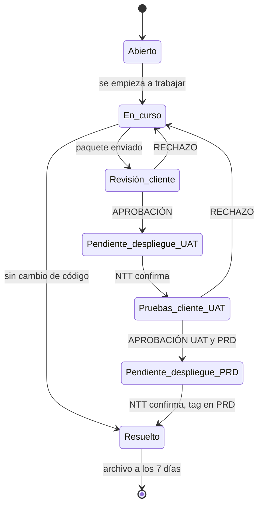

# BAU-NFQ-vault

Vault de soporte BAU para un único cliente: tickets, decisiones, proveedores, personas y la referencia técnica de Megara AS-IS. Se edita en Obsidian, se sincroniza por Git y Claude ayuda a rellenar, anonimizar y consultar.

- **Primer día y uso diario:** [Manual de usuario](05_GENERAL/Manual-de-usuario.md)
- **Cómo está hecho y cómo se mantiene:** [Manual técnico](05_GENERAL/Manual-tecnico.md)
- **Por qué está hecho así:** [Documento de diseño](05_GENERAL/Diseno-Vault-BAU-NFQ.md)
- **El día a día en un diagrama:** [Dia-a-dia.html](05_GENERAL/Diagramas/Dia-a-dia.html), la secuencia de un ticket con cliente, Claude, vault, código, NTT y Chat
- **El sistema en un mapa:** [Mapa-del-sistema.html](05_GENERAL/Diagramas/Mapa-del-sistema.html), qué pieza habla con cuál

## Los siete estados de un ticket

## Tres reglas

1. **El equipo con nombre completo; las personas del cliente y de NTT por nombre e inicial del apellido ("Luis G.") y su rol. Emails, teléfonos, DNI, IBAN o cualquier dato de contacto, no.** Nunca se pega un correo en crudo. El historial de Git no se puede limpiar después.
2. **Credenciales, nunca.** Se escribe el nombre del sistema o de la variable, y quien la necesite la pide.
3. **Enlaces relativos, nunca `[[wikilinks]]`.** Carpetas sin acentos. Obsidian ya viene configurado así.

## Estructura

| Carpeta | Qué hay | Cómo se escribe |
|---|---|---|
| `00_REFERENCIA_TECNICA/` | Referencia Megara AS-IS, 184 fichas, foto fija | Solo lectura |
| `01_DECISIONES/` | Qué se decidió, quién lo autorizó | Rama + PR con revisor (el hook lo exige) |
| `02_TICKETS/Abiertos/` y `Archivo/` | Un fichero por ticket | Commit directo; archivo automático diario a los 7 días de resolver |
| `03_PROVEEDORES/` | Una nota por ticket con código: peticiones a NTT | Commit directo |
| `04_PERSONAS/` | Una ficha por persona del equipo y del cliente | Commit directo |
| `05_GENERAL/` | Plantillas, herramientas, dashboard, informes, manuales, diseño | Commit directo |
| `06_CODIGO_VERSIONADO/PRD` y `UAT` | Submódulos del repo de código `BAU-NFQ`: la foto del esquema de cada entorno y los envíos por ticket | No se edita desde aquí; se actualiza con `foto.py` en el repo de código |
